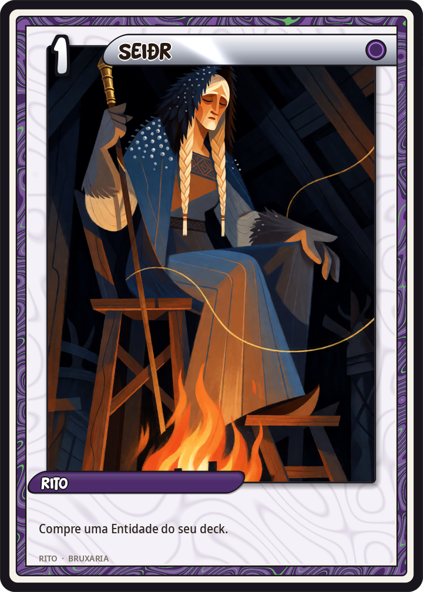
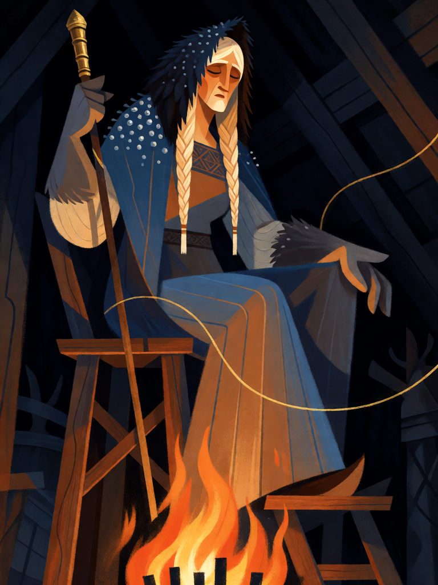

# Seiðr

[← Bruxaria](../bruxaria.md) · [Wiki KodeX](../README.md) · [◀ Pacto na Encruzilhada](bru_pacto_na_encruzilhada.md) · [Pó de Ossos ▶](bru_po_de_ossos.md)

| Carta | Arte |
|---|---|
|  |  |

| | |
|---|---|
| **Tradição** | Bruxaria |
| **Tipo** | Rito |
| **Custo de Fé** | 1 |
| **Palavras-chave** | — |
| **Lendária** | não |
| **Cópias no deck** | 1 |
| **Id** | `bru_seidr` |

## Texto da carta

> Busque uma Entidade do seu deck e ponha-a na mão. Embaralhe.

**EN — Seiðr:** *Search your deck for an Entity and put it into your hand. Shuffle.*

## Contexto mitológico

*Seiðr* é a magia nórdica de transe, adivinhação e manipulação da sorte — a mais próxima de uma "bruxaria" no mundo escandinavo pré-cristão. Snorri Sturluson conta, na *Ynglinga saga* (cap. 4), que foi **Freyja** quem ensinou o *seiðr* aos Æsir, como era costume entre os Vanir; e que Odin o praticava, embora a arte carregasse tal *ergi* (desonra, falta de virilidade) que os homens a deixavam às sacerdotisas (cap. 7). Freyja, senhora do amor, da guerra e da metade dos mortos em batalha, é assim a padroeira da feiticeira nórdica.

A descrição mais rica é a da *völva* Þorbjörg lítilvölva em *Eiríks saga rauða* (cap. 4): convidada a uma fazenda da Groenlândia durante uma fome, chega com manto azul de pedrarias, gorro de pele de cordeiro negro, luvas de gato e um cajado de latão; senta-se numa plataforma alta (*seiðhjallr*), uma mulher canta o *varðlokkur* para atrair os espíritos, e a vidente então responde a cada pergunta sobre o futuro. Cajados de ferro encontrados em túmulos femininos (Fyrkat, Oseberg) são tomados como os *seiðstafr* dessas mulheres. As bruxas dos processos escandinavos tardios herdarão o vocabulário.

Na carta o *seiðr* é adivinhação pura: a bruxa olha o fio do destino do deck e puxa a Entidade de que precisa.

## Papel no jogo

O tutor do deck: por 1 Fé, pega Hécate para o turno 7, Baba Yaga quando há familiares sobrando, Cerridwen quando a mão está vazia ou um Sapo quando falta um corpo para o Sacrifício. Uma cópia só — mais do que isso tornaria o deck previsível. É deliberadamente 1 pt abaixo do orçamento pela tabela, porque escolher a carta certa vale mais do que comprar uma qualquer.

## Atributos visuais

völva nórdica madura · manto azul com pedras e gorro de pele de cordeiro preto · luvas de pele de gato · cajado de latão · sentada em plataforma alta em transe

Balanço (conta de custo)

Orçamento P = 2·1+1 = 3 pts. Gasto: buscar carta de um tipo do deck (2) = 2. Dentro (1 pt de folga, intencional: tutor é forte na prática).

Ficha completa: `cartas/bruxaria/19_seidr.md` · cartas base da versão Alpha
