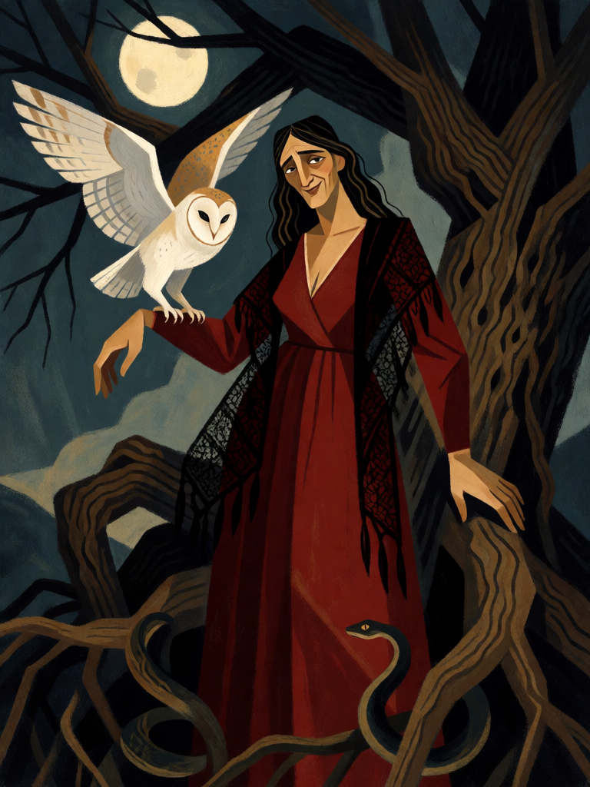

# Strega de Benevento

[← Bruxaria](../bruxaria.md) · [Wiki KodeX](../README.md) · [◀ Corvo Agourento](bru_corvo_agourento.md) · [Benandante ▶](bru_benandante.md)

| Carta | Arte |
|---|---|
|  |  |

| | |
|---|---|
| **Tradição** | Bruxaria |
| **Tipo** | Entidade |
| **Custo de Fé** | 3 |
| **ATK / DEF** | 2 / 3 |
| **Palavras-chave** | — |
| **Lendária** | não |
| **Cópias no deck** | 1 |
| **Id** | `bru_strega_de_benevento` |

## Texto da carta

> Despertar: invoque uma Strix 1/1 (coruja familiar).

**EN — Strega of Benevento:** *Awaken: Summon a 1/1 Strix (owl familiar).*

## Contexto mitológico

*Strega*, bruxa em italiano, vem do latim *strix*, a coruja-das-torres. Para os romanos a *strix* era um pássaro noturno que entrava pelas janelas e sugava o sangue e as entranhas dos recém-nascidos; Ovídio dá o remédio — ramos de medronheiro e espinheiro na porta, entranhas de leitoa em troca (*Fastos* VI.131–168) — e Petrônio conta uma *striga* roubando o corpo de um menino (*Satyricon* 63). Em Apuleio (*Asno de Ouro* III.21) a bruxa Pânfila unta-se, bate os braços e vira coruja: a bruxa e a ave são a mesma coisa.

Benevento, na Campânia, é a capital italiana das streghe. Sob uma grande nogueira às margens do rio Sabato elas dançavam em volta de uma serpente ou de um bode, segundo a tradição recolhida (e combatida) pelo médico Pietro Piperno em *De nuce maga beneventana* (1635). A lenda diz que o bispo São Barbato mandou arrancar a árvore no séc. VII — e que ela voltou a crescer. O licor Strega, com a bruxa no rótulo, é a sobrevivência turística do culto.

Na carta, a strega chega com sua coruja: a mulher e o bicho que ela também é.

## Papel no jogo

Dois corpos por 3 Fé: uma 2/3 razoável e uma Strix 1/1 que serve de Sacrifício, de alvo da Vassoura ou de mais um corpo para o Sabá. É o motor de "muitos familiares pequenos" do meio do jogo; com Mau-Olhado em campo, a strega e a coruja seguram a frente enquanto o inimigo entra congelado. Sofre contra dano em área (os dois corpos morrem juntos).

## Atributos visuais

mulher italiana madura · vestido vermelho-escuro e xale de renda preta · coruja-das-torres no antebraço esquerdo · grande nogueira retorcida · serpente nas raízes

Balanço (conta de custo)

Orçamento P = 2·3+1 = 7 pts. Gasto: ATK 2 + Vida 3 + Despertar: token 1/1 (1+1 = 2 pts) = 7. Dentro.

Ficha completa: `cartas/bruxaria/04_strega_de_benevento.md` · cartas base da versão Alpha
