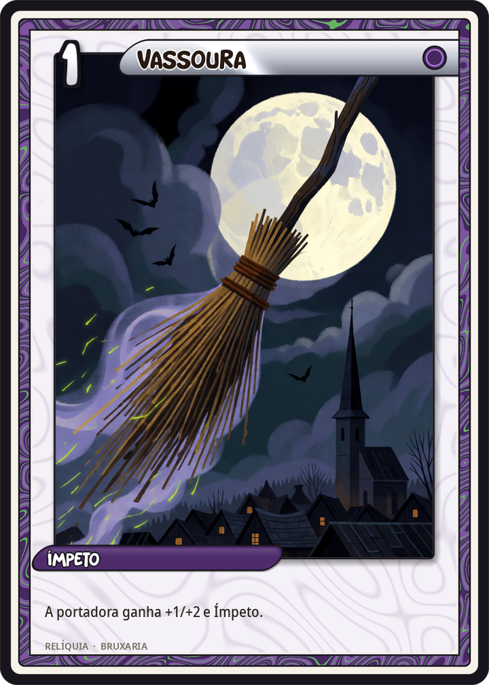
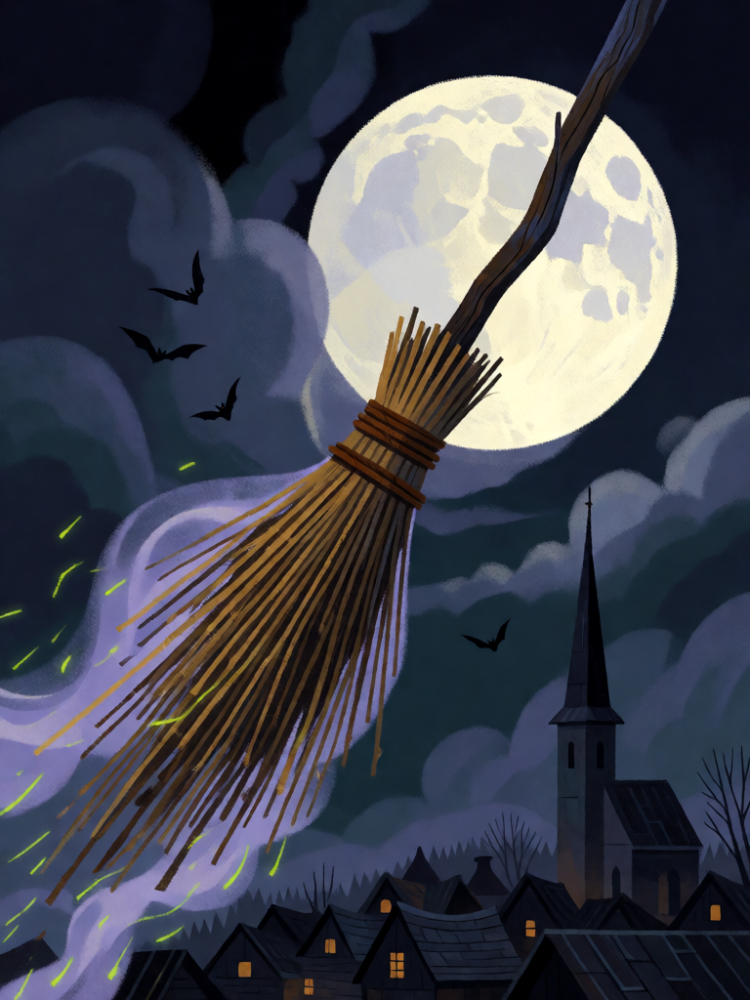

# Vassoura

[← Bruxaria](../bruxaria.md) · [Wiki KodeX](../README.md) · [◀ Sabá de Walpurgis](bru_saba_de_walpurgis.md) · [Livro das Sombras ▶](bru_livro_das_sombras.md)

| Carta | Arte |
|---|---|
|  |  |

| | |
|---|---|
| **Tradição** | Bruxaria |
| **Tipo** | Relíquia |
| **Custo de Fé** | 1 |
| **Palavras-chave** | — |
| **Lendária** | não |
| **Cópias no deck** | 2 |
| **Id** | `bru_vassoura` |

## Texto da carta

> A portadora ganha +1 ATK e +2 Vida e Ímpeto.

**EN — Broomstick:** *The bearer gains +1 ATK, +2 Health and Rush.*

## Contexto mitológico

A imagem mais antiga que se conhece de mulheres voando — uma em vassoura, outra num bastão — está nas margens de um manuscrito de *Le Champion des Dames*, poema de Martin Le Franc (1451), com a legenda "des vaudoises" (as valdenses, nome que então servia para bruxas). A associação se fixa rápido: a vassoura é o instrumento doméstico por excelência, e a bruxa é a mulher que o vira do avesso — monta nele, em vez de varrer com ele, e sai pela chaminé em vez de ficar junto ao fogo. Os tratados descrevem o unguento de voo esfregado no cabo; a farmacologia explica o resto.

Antes de voar, a vassoura já era mágica: varre para fora da casa o mal e as almas dos mortos (daí não se varrer à noite, nem depois de um defunto sair), marca o limiar (saltar a vassoura é casamento em várias tradições populares, do País de Gales aos escravizados americanos) e, posta atrás da porta com as cerdas para cima, impede a bruxa de entrar. Na Wicca é o *besom*, usado para varrer ritualmente o círculo antes do trabalho e para o salto do *handfasting*. Baba Yaga voa no pilão, mas é com a vassoura que apaga o rastro.

Na carta a vassoura dá o que dá à bruxa: pernas que não precisava ter. Quem a monta ataca já.

## Papel no jogo

Relíquia barata que transforma um familiar recém-invocado em ameaça imediata: Sapo 0/1 vira 1/3 com Ímpeto, Strix vira 2/3 e ataca na hora, um Gato Preto Furtivo bate antes que o oponente possa alvejá-lo. Duas cópias para ter sempre tempo no início. Em Baba Yaga ou na Bruxa de Endor, o Ímpeto no turno de invocação é um ataque extra que o oponente não previu. Morre com a portadora — usar em quem vai sobreviver ou em quem já vai ser sacrificado depois de bater.

## Atributos visuais

vassoura de galhos de bétula antiga · cabo de madeira gasto · feixe amarrado com corda · voando sozinha sem ninguém · rastro de faíscas verdes e fumaça roxa

Balanço (conta de custo)

Orçamento P = 2·1+1 + 1 (Relíquia) = 4 pts. Gasto: +1/+2 permanente (3) + Ímpeto (1) = 4. Dentro.
Rodada 2 de balanceamento (pacote CB3 do Analista): era +1/+1 (3/4; +2,3 pp medido, o maior ganho do pacote). A ferramenta dos familiares sobe para P.

Ficha completa: `cartas/bruxaria/23_vassoura.md` · cartas base da versão Alpha
