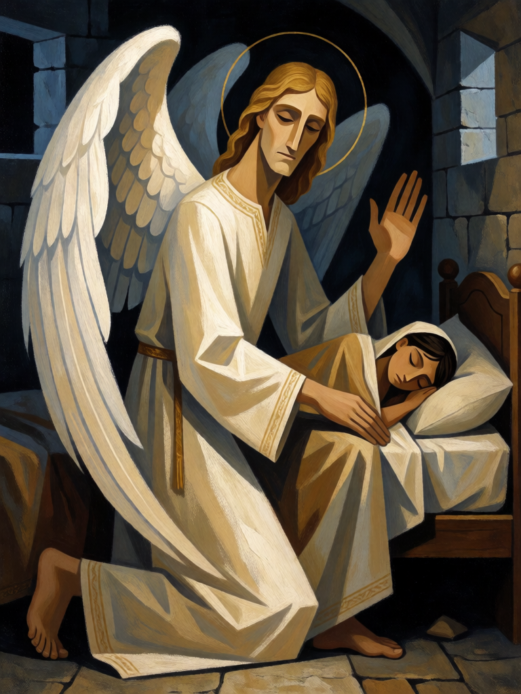

# Anjo da Guarda

[← Cristianismo](../cristianismo.md) · [Wiki KodeX](../README.md) · [Jonas ▶](cri_jonas.md)

| Carta | Arte |
|---|---|
|  |  |

| | |
|---|---|
| **Tradição** | Cristianismo |
| **Tipo** | Entidade |
| **Custo de Fé** | 2 |
| **ATK / DEF** | 1 / 2 |
| **Palavras-chave** | Guarda |
| **Lendária** | não |
| **Cópias no deck** | 2 |
| **Id** | `cri_anjo_da_guarda` |
| **Arte** | provisória nesta Alpha |

## Texto da carta

> Guarda. Último Sopro: cura 2 da sua Cornucópia.

**EN — Guardian Angel:** *Guard. Last Breath: Heal your Cornucopia for 2.*

## Contexto mitológico

A ideia de um anjo designado a cada pessoa vem do Salmo 91,11 ("ele ordenou aos seus anjos que te guardem em todos os teus caminhos") e de Mt 18,10, onde os pequeninos têm "seus anjos nos céus" diante do Pai. A Carta aos Hebreus chama os anjos de "espíritos enviados em serviço" (Hb 1,14), e o Livro de Tobias mostra o modelo completo: Rafael, disfarçado de viajante, acompanha o jovem Tobias por todo o caminho.

A devoção aos anjos da guarda ganhou festa própria no calendário romano com Paulo V (1608), fixada em 2 de outubro por Clemente X. Na iconografia popular, o anjo caminha ao lado de uma criança, mão no ombro, cobrindo-a com a asa — é essa imagem, simples e protetora, que a carta evoca.

Virou Entidade barata com **Guarda** porque é literalmente quem se põe entre o perigo e o protegido. O Último Sopro que cura a Cornucópia é o anjo que, ao cair, ainda deixa uma bênção na casa que guardava.

## Papel no jogo

Abertura defensiva do deck: desde o turno 2 obriga o inimigo a atacá-lo antes das outras Entidades, protegendo Davi, Jonas e Lázaro. Como morre barato, alimenta Tumba Vazia e Talita Cumi (revive um Guarda por quase nada). Duas cópias porque Guarda é a espinha da identidade. Fraco contra Ritos de área, que o removem sem disparar ataques.

## Atributos visuais

duas asas brancas emplumadas · auréola dourada · túnica branca longa · mão no ombro da criança · asa curvada como escudo

Balanço (conta de custo)

Orçamento P = 2·C+1 = 5 pts. Gasto: ATK 1 + Vida 2 + Guarda 1 + Último Sopro curar 2 Cornucópia 1 = 5. Dentro.

Ficha completa: `cartas/cristianismo/01_anjo_da_guarda.md` · cartas base da versão Alpha
