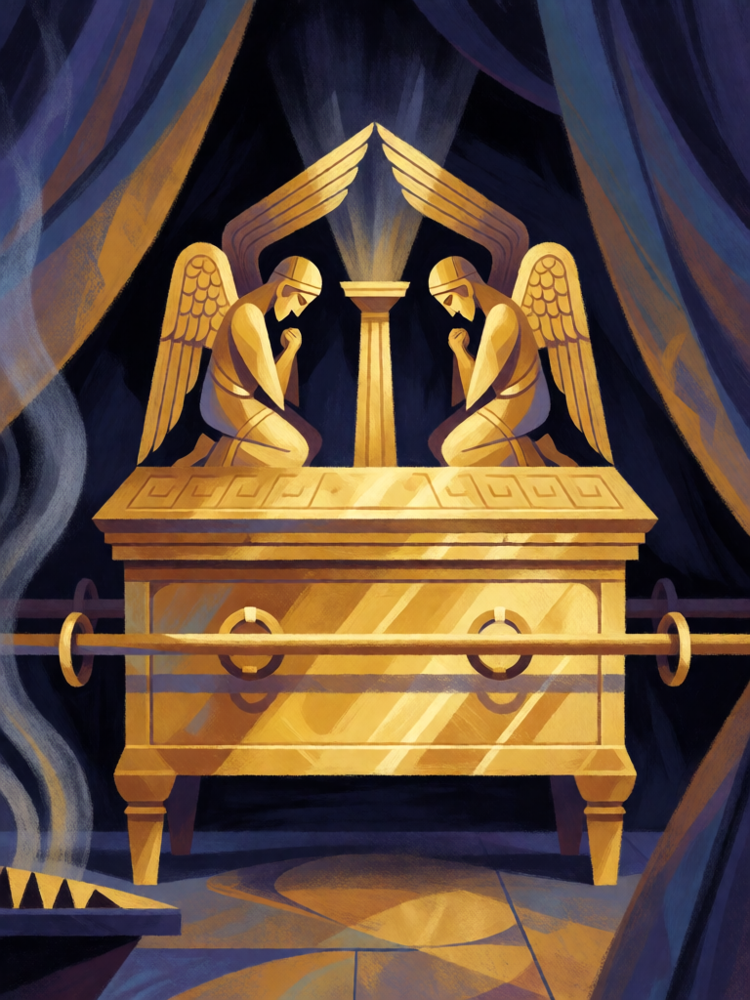

# Arca da Aliança

[← Cristianismo](../cristianismo.md) · [Wiki KodeX](../README.md) · [◀ Santo Graal](cri_santo_graal.md)

| Carta | Arte |
|---|---|
|  |  |

| | |
|---|---|
| **Tradição** | Cristianismo |
| **Tipo** | Relíquia |
| **Custo de Fé** | 3 |
| **Palavras-chave** | — |
| **Lendária** | não |
| **Cópias no deck** | 1 |
| **Id** | `cri_arca_da_alianca` |

## Texto da carta

> A portadora ganha +0/+3 e Guarda. Enquanto a Arca estiver em campo, suas Entidades têm +1 ATK.

**EN — Ark of the Covenant:** *The bearer gains +0/+3 and Guard. While the Ark is on the field, your Entities have +1 ATK.*

## Contexto mitológico

Construída por Bezalel no Sinai segundo as medidas dadas a Moisés — madeira de acácia revestida de ouro, dois querubins de ouro batido sobre a tampa, o *propiciatório*, onde Deus "falaria" com Moisés (Ex 25,10-22) —, a Arca guarda as tábuas da Lei, e, segundo Hb 9,4, a vara de Aarão e um vaso de maná. É o objeto mais sagrado de Israel, carregado pelos levitas com varais, nunca tocado.

É também um objeto de guerra. Vai à frente do povo na travessia do Jordão, cujas águas param (Js 3), e dá sete voltas em torno de Jericó antes das muralhas caírem (Js 6). Capturada pelos filisteus, derruba a estátua de Dagon e cobre as cidades de tumores até ser devolvida numa carroça (1Sm 5–6). Quando Uzá a toca para firmá-la, cai morto (2Sm 6,6-7). Davi a leva a Jerusalém dançando; Salomão a instala no Santo dos Santos; e depois de Nabucodonosor ela desaparece da história — Jeremias diz que não será mais lembrada (Jr 3,16), e o Apocalipse a vê no céu (Ap 11,19). A Etiópia a reivindica em Axum.

A carta é a Arca em marcha: quem a carrega está à frente de todos (**Guarda**) e protegido pela presença (Vida), e todo o exército que a segue luta com mais força (aura de ATK).

## Papel no jogo

A Relíquia mais cara e a que mais muda o campo: transforma qualquer Entidade num muro de Guarda (Leviatã 6/10, Miguel 6/9, Lázaro 2/6 que renasce) e dá +1 ATK a todas as suas Entidades enquanto a portadora viver. Equipe num corpo que o oponente não consegue remover facilmente — um Renascido devolve a Arca ao cemitério, mas só depois de absorver ataques. A aura some se a portadora morre; é a carta que o oponente vai mirar com remoção dura.

## Atributos visuais

baú retangular revestido de ouro · dois querubins de ouro com asas se tocando · dois varais de transporte · coluna de luz · cortinas azul e púrpura

Balanço (conta de custo)

Orçamento P = 2·C+1 = 7 pts, +1 grátis de Relíquia = 8. Gasto: +3 Vida permanente 3 + Guarda 1 + aura `static` +1 ATK em todas as aliadas (tabela §10) 3 = 7. Dentro (faixa 6–8).

Ficha completa: `cartas/cristianismo/28_arca_da_alianca.md` · cartas base da versão Alpha
