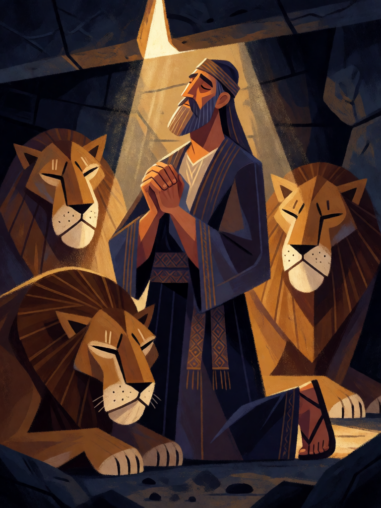

# Cova dos Leões

[← Cristianismo](../cristianismo.md) · [Wiki KodeX](../README.md) · [◀ São Miguel Arcanjo](cri_sao_miguel_arcanjo.md) · [Tumba Vazia ▶](cri_tumba_vazia.md)

| Carta | Arte |
|---|---|
|  |  |

| | |
|---|---|
| **Tradição** | Cristianismo |
| **Tipo** | Selo |
| **Custo de Fé** | 1 |
| **Palavras-chave** | — |
| **Lendária** | não |
| **Cópias no deck** | 1 |
| **Id** | `cri_cova_dos_leoes` |

## Texto da carta

> Quando uma Entidade aliada sofrer dano, cure 4 dela e ela ganha +1/+1 permanente.

**EN — Lions' Den:** *When an allied Entity takes damage, heal it for 4 and it gains permanent +1/+1.*

## Contexto mitológico

Daniel, judeu exilado na Babilônia, chega a chefe dos sátrapas sob Dario, o Medo. Os rivais, não achando falha nele, armam um decreto: durante trinta dias ninguém pode fazer súplica a deus ou homem senão ao rei. Daniel continua orando três vezes ao dia, de janela aberta voltada para Jerusalém, e é lançado na cova dos leões; o rei, contrariado, sela a pedra com seu anel (Dn 6,1-18).

Ao amanhecer, Dario corre à cova e Daniel responde de dentro: "Meu Deus enviou o seu anjo e fechou a boca dos leões, e eles não me fizeram mal" (Dn 6,23). Daniel sai sem um arranhão — e os acusadores são lançados no lugar dele. É a cena mais pintada do livro (Rubens, Briton Rivière), e nas catacumbas romanas Daniel entre leões é, como Jonas, um símbolo de salvação da morte.

Como **Selo**, é a armadilha que vira o jogo do inimigo: ele fere uma aliada e descobre que ela sai da cova curada e fortalecida — Daniel "prosperou no reinado de Dario".

## Papel no jogo

O Selo mais barato do deck, colocável no turno 1. Dispara no primeiro dano que uma aliada sofrer no turno do oponente — normalmente num ataque — e devolve a Vida perdida com juros. Com Anjo da Guarda (que absorve o primeiro ataque) é quase garantido; com Lázaro ou Serafim cria um corpo permanentemente maior. Não salva uma Entidade que morre do dano (o alvo já se foi): o oponente pode ignorá-lo matando de uma vez.

## Atributos visuais

ajoelhado em oração · olhos fechados e mãos juntas · três leões deitados de boca fechada · cova de pedra selada · único feixe de luz

Balanço (conta de custo)

Orçamento P = 2·C+1 = 3 pts, +1 grátis de Selo = 4. Gasto: curar 4 (2 × "curar 2 = 1") 2 + +1 ATK permanente 1 + +1 Vida permanente 1 = 4. Dentro. Alvo `defender` (a aliada ferida em `ally_damaged`, conforme a DSL); se o dano vier de um Rito de área e a aliada morrer, as ações são puladas.

Ficha completa: `cartas/cristianismo/13_cova_dos_leoes.md` · cartas base da versão Alpha
