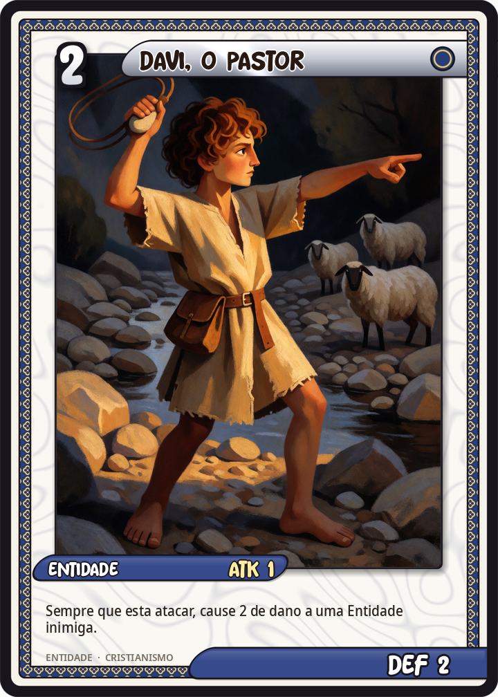
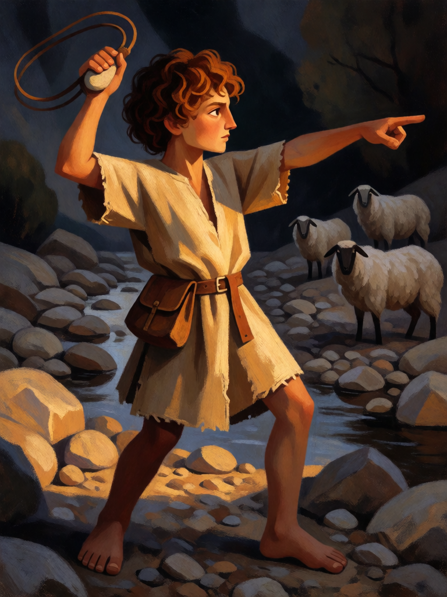

# Davi, o Pastor

[← Cristianismo](../cristianismo.md) · [Wiki KodeX](../README.md) · [◀ Jonas](cri_jonas.md) · [Lázaro de Betânia ▶](cri_lazaro_de_betania.md)

| Carta | Arte |
|---|---|
|  |  |

| | |
|---|---|
| **Tradição** | Cristianismo |
| **Tipo** | Entidade |
| **Custo de Fé** | 2 |
| **ATK / DEF** | 1 / 2 |
| **Palavras-chave** | — |
| **Lendária** | não |
| **Cópias no deck** | 1 |
| **Id** | `cri_davi_o_pastor` |

## Texto da carta

> Ao atacar, causa 2 de dano a uma Entidade inimiga à sua escolha.

**EN — David, the Shepherd:** *When this attacks, deal 2 damage to an enemy Entity of your choice.*

## Contexto mitológico

Davi, o caçula de Jessé, pastoreia ovelhas em Belém quando Samuel o unge rei em segredo (1Sm 16,1-13). Pouco depois, no vale de Elá, o gigante filisteu Golias desafia Israel por quarenta dias. Davi recusa a armadura de Saul, escolhe cinco pedras lisas no riacho e, com a funda, acerta a testa do gigante antes de decapitá-lo com a própria espada dele (1Sm 17,40-51). "Tu vens a mim com espada e lança; eu venho a ti em nome do Senhor."

Antes de ser rei, poeta dos Salmos e ancestral do Messias, Davi é o menino que acerta a pedra *antes* do combate corpo a corpo. É esse gesto que a carta traduz: ao declarar o ataque, uma pedra sai da funda e fere alguém à escolha — não necessariamente quem ele vai enfrentar. O corpo é de menino (1 ATK); a pedra é que mata (2 de dano).

Escolhi a versão "pastor" (e não o rei) porque é o Davi dos ícones e da escultura: jovem, sem armadura, com a funda na mão.

## Papel no jogo

Agressor barato que ajuda a fechar contas: os 2 de dano "da funda" matam um token ou um inimigo ferido antes mesmo do combate, e podem ir num alvo diferente do que ele enfrenta. Com a Funda de Davi ganha Ímpeto e mais ATK — a dupla temática é a melhor abertura ofensiva do deck. Morre fácil para qualquer troca igual, o que é aceitável: Talita Cumi o traz de volta por pouco.

## Atributos visuais

menino de 12 anos ruivo · funda girando acima da cabeça · túnica curta de lã · bolsa de pastor no quadril · descalço

Balanço (conta de custo)

Orçamento P = 2·C+1 = 5 pts. Gasto: ATK 1 + Vida 2 + `on_attack` 2 de dano a Entidade escolhida (gatilho repetível, valor cheio) 2 = 5. Dentro. Nota para o simulador: se a pedra matar o próprio alvo do ataque antes do combate, Davi não sofre dano de volta — conferir se isso o torna remoção gratuita repetida.

Ficha completa: `cartas/cristianismo/03_davi_o_pastor.md` · cartas base da versão Alpha
