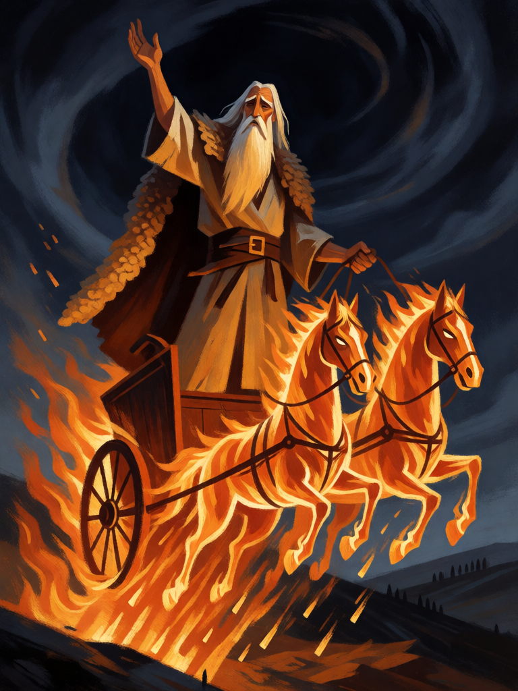

# Elias, Carro de Fogo

[← Cristianismo](../cristianismo.md) · [Wiki KodeX](../README.md) · [◀ Leviatã](cri_leviata.md) · [São Miguel Arcanjo ▶](cri_sao_miguel_arcanjo.md)

| Carta | Arte |
|---|---|
|  |  |

| | |
|---|---|
| **Tradição** | Cristianismo |
| **Tipo** | Entidade |
| **Custo de Fé** | 6 |
| **ATK / DEF** | 4 / 5 |
| **Palavras-chave** | Renascer |
| **Lendária** | sim |
| **Cópias no deck** | 1 |
| **Id** | `cri_elias` |

## Texto da carta

> Lendária. Renascer. Despertar: fogo do céu — 2 de dano a todas as Entidades inimigas.

**EN — Elijah, Chariot of Fire:** *Legendary. Rebirth. Awaken: fire from heaven — 2 damage to all enemy Entities.*

## Contexto mitológico

Elias, o tesbita, surge sem genealogia em 1 Reis 17 anunciando seca ao rei Acab. Alimentado por corvos junto à torrente de Carit, hospeda-se com a viúva de Sarepta, cuja farinha e azeite não acabam; quando o filho dela morre, Elias se estende três vezes sobre o menino e o devolve vivo à mãe — a primeira ressurreição narrada na Bíblia (1Rs 17,17-24). No Monte Carmelo desafia 450 profetas de Baal: o fogo do Senhor desce e consome o holocausto, a lenha, as pedras e a água da vala (1Rs 18,38). Duas vezes mais, fogo do céu consome os cinquenta soldados enviados para prendê-lo (2Rs 1,10-12).

Elias não morre. "Eis que um carro de fogo com cavalos de fogo os separou, e Elias subiu ao céu num redemoinho" (2Rs 2,11). Por isso Malaquias promete sua volta "antes do grande e terrível dia do Senhor" (Ml 3,23), e por isso ele está com Moisés na Transfiguração (Mt 17,3). Na tradição judaica tem uma cadeira na circuncisão e uma taça na Páscoa; na cristã é o modelo dos eremitas e padroeiro dos carmelitas.

A carta reúne os três traços: o fogo que desce quando ele chega (**Despertar** em área), o homem que não fica morto (**Renascer**), e o peso de Lendária de quem precede o Juízo.

## Papel no jogo

Primeira Lendária: um 4/5 que limpa o campo inimigo de pequenos ao entrar e volta para a mão se morrer — para entrar de novo e queimar de novo. É a carta que pune decks de muitos corpos pequenos. Com Juízo Final, vai e volta junto com Lázaro. O Véu de Verônica não lhe dá um segundo Renascer (palavras-chave não acumulam); prefira a Arca ou o Graal nele. Cuidado: 6 Fé e um Renascer significam que ele pode ser reinvocado só no turno seguinte — o oponente tem uma janela.

## Atributos visuais

idoso de cabelo e barba brancos · manto de pele de carneiro · cinto de couro · carro de fogo de duas rodas · dois cavalos de fogo

Balanço (conta de custo)

Orçamento P = 2·C+1 = 13 pts; Lendária pode passar até +2 → 15. Gasto: ATK 4 + Vida 5 + Renascer 2 + 2 de dano a todas as inimigas (1,5 × 2) = 3 → 14. Lendária +1.
Rodada 1 de balanceamento: era 4/6 (P+2; 78 % de WR global) — com 5 de Vida morre para um golpe de 5 e ainda volta à mão.

Ficha completa: `cartas/cristianismo/11_elias.md` · cartas base da versão Alpha
