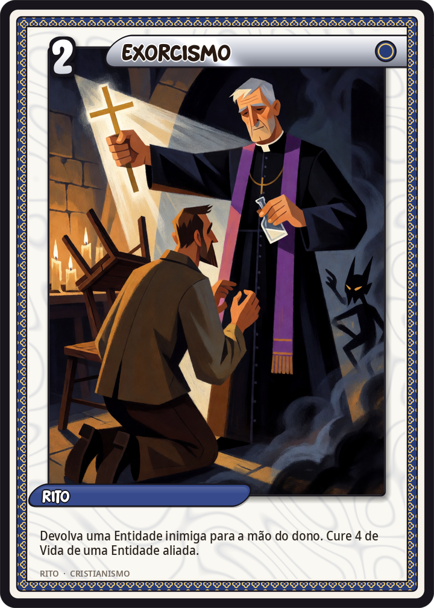
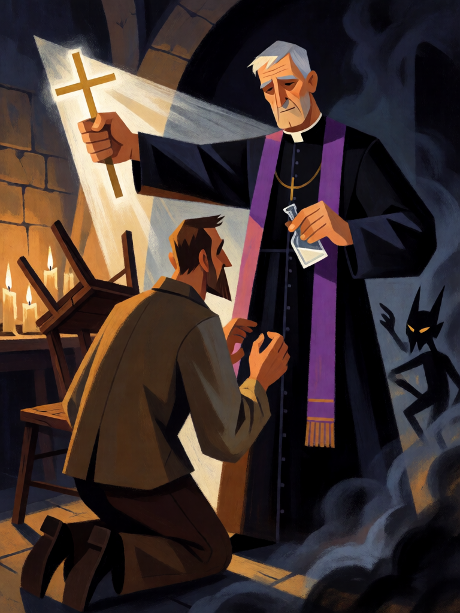

# Exorcismo

[← Cristianismo](../cristianismo.md) · [Wiki KodeX](../README.md) · [◀ Multiplicação dos Pães](cri_multiplicacao_dos_paes.md) · [Praga dos Gafanhotos ▶](cri_praga_dos_gafanhotos.md)

| Carta | Arte |
|---|---|
|  |  |

| | |
|---|---|
| **Tradição** | Cristianismo |
| **Tipo** | Rito |
| **Custo de Fé** | 2 |
| **Palavras-chave** | — |
| **Lendária** | não |
| **Cópias no deck** | 1 |
| **Id** | `cri_exorcismo` |

## Texto da carta

> Devolva uma Entidade inimiga à mão do dono. Cure 4 de Vida de uma Entidade aliada.

**EN — Exorcism:** *Return an enemy Entity to its owner's hand. Restore 4 Health to an allied Entity.*

## Contexto mitológico

Expulsar espíritos impuros é a ação mais frequente de Jesus nos evangelhos sinóticos: na sinagoga de Cafarnaum (Mc 1,21-28), o menino epiléptico que os discípulos não conseguem curar (Mc 9,14-29), a filha da sirofenícia (Mc 7,24-30). O caso mais vívido é o geraseno: um homem que vive entre os túmulos, que ninguém consegue acorrentar, e cujo espírito responde "Meu nome é Legião, porque somos muitos". Os espíritos pedem para entrar numa vara de dois mil porcos, que se precipita no lago (Mc 5,1-20). O homem é encontrado depois "sentado, vestido e em perfeito juízo".

A Igreja formalizou o rito: o *Rituale Romanum* de 1614 (título XI) fixa o exorcismo com estola roxa, água benta, o crucifixo e a fórmula *Exorcizo te, immundissime spiritus*. Os exorcistas eram uma das ordens menores até 1972. A iconografia medieval mostra o demônio saindo pela boca do possesso como uma figura negra e pequena.

A carta separa os dois movimentos do rito: o espírito é **expulso** (a Entidade inimiga volta para a mão — não morre, só sai), e o possesso é **restaurado** (uma aliada é curada).

## Papel no jogo

Remoção "mansa" e flexível: devolve à mão uma Entidade grande (o oponente perde a Fé gasta e, se for Sacrifício, o sacrifício), um token (que some), ou uma Entidade com Relíquia (a Relíquia vai ao cemitério). A cura de 4 recupera uma aliada depois de uma troca. Jogue em cima de Entidades de custo alto para máximo retorno de tempo; evite em cima de Entidades com Despertar forte, que vão reentrar e dispará-lo de novo.

## Atributos visuais

batina preta · estola roxa · cruz dourada lisa erguida na mão direita · frasco de água benta na esquerda · demônio negro saindo como fumaça

Balanço (conta de custo)

Orçamento P = 2·C+1 = 5 pts. Gasto: devolver Entidade inimiga à mão 2 + curar 4 (2 × "curar 2 = 1") = 2 → 4. Dentro.

Ficha completa: `cartas/cristianismo/19_exorcismo.md` · cartas base da versão Alpha
