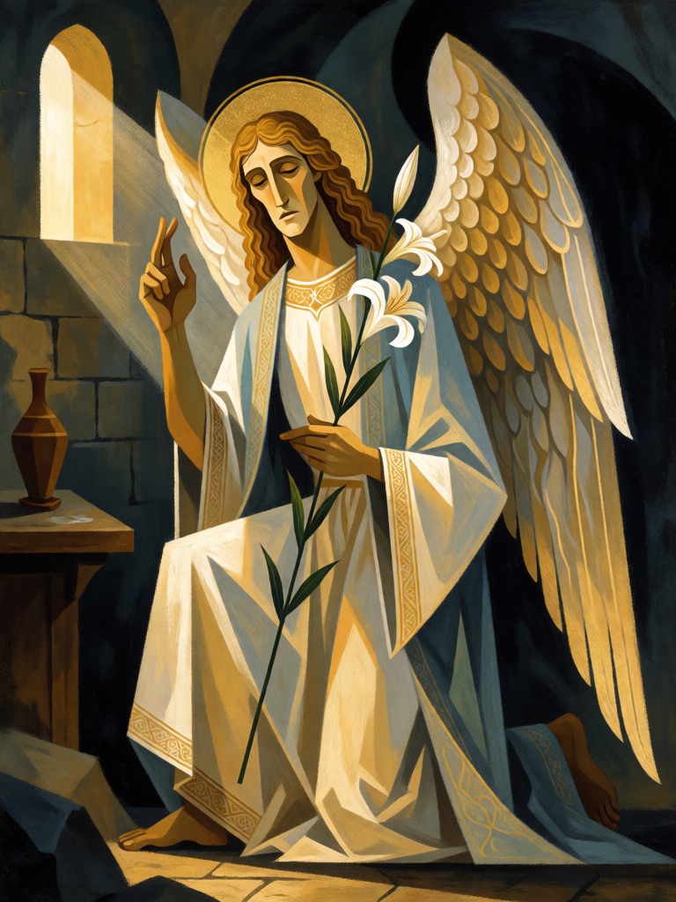

# Gabriel, o Mensageiro

[← Cristianismo](../cristianismo.md) · [Wiki KodeX](../README.md) · [◀ Judite](cri_judite.md) · [Rafael, o Curador ▶](cri_rafael.md)

| Carta | Arte |
|---|---|
|  |  |

| | |
|---|---|
| **Tradição** | Cristianismo |
| **Tipo** | Entidade |
| **Custo de Fé** | 3 |
| **ATK / DEF** | 2 / 3 |
| **Palavras-chave** | — |
| **Lendária** | não |
| **Cópias no deck** | 1 |
| **Id** | `cri_gabriel` |

## Texto da carta

> Despertar: busque um Rito do seu deck para a mão.

**EN — Gabriel, the Messenger:** *Awaken: Search your deck for a Rite and put it into your hand.*

## Contexto mitológico

Gabriel ("Fortaleza de Deus") é, com Miguel e Rafael, um dos três anjos nomeados na Bíblia. Aparece primeiro a Daniel, para explicar a visão do carneiro e do bode (Dn 8,16) e a profecia das setenta semanas (Dn 9,21). No Novo Testamento é o anúncio feito pessoa: aparece a Zacarias no Templo para anunciar João Batista (Lc 1,11-20) e a Maria em Nazaré para anunciar o nascimento de Jesus (Lc 1,26-38) — "Ave, cheia de graça".

Na tradição ele é o arauto celeste por excelência: o Islã o tem como transmissor do Corão, e na iconografia cristã surge ajoelhado com um lírio ou um cetro, a boca aberta na palavra. Pseudo-Dionísio o coloca entre os arcanjos, o coro dos que levam mensagens de grande peso.

A carta traduz isso em **busca**: quando Gabriel chega, a palavra certa chega com ele — um Rito do deck para a mão.

## Papel no jogo

A única busca do deck, de propósito. Puxa a resposta que falta: Talita Cumi para reviver, Exorcismo para tirar um bloqueio, Juízo Final para virar a mesa. Corpo honesto de 2/3 que ainda segura o campo. Jogado cedo, dá consistência; jogado tarde, com o deck fino, vale menos. Vulnerável a Selos inimigos de `enemy_plays_entity`, que o punem antes de a busca render.

## Atributos visuais

lírio branco na mão esquerda · mão direita em bênção · ajoelhado num joelho · asas brancas e douradas · auréola dourada

Balanço (conta de custo)

Orçamento P = 2·C+1 = 7 pts. Gasto: ATK 2 + Vida 3 + buscar carta por tipo 2 = 7. Dentro.

Ficha completa: `cartas/cristianismo/06_gabriel.md` · cartas base da versão Alpha
