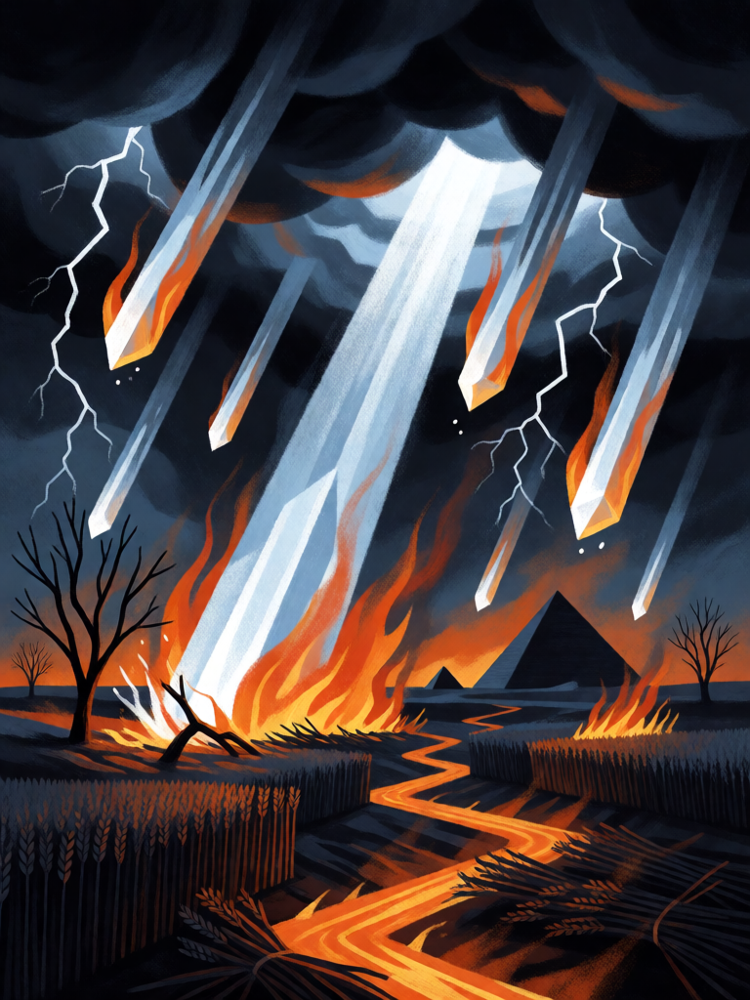

# Granizo e Fogo

[← Cristianismo](../cristianismo.md) · [Wiki KodeX](../README.md) · [◀ Vale dos Ossos Secos](cri_vale_dos_ossos_secos.md) · [Juízo Final ▶](cri_juizo_final.md)

| Carta | Arte |
|---|---|
|  |  |

| | |
|---|---|
| **Tradição** | Cristianismo |
| **Tipo** | Rito |
| **Custo de Fé** | 3 |
| **Palavras-chave** | — |
| **Lendária** | não |
| **Cópias no deck** | 1 |
| **Id** | `cri_granizo_e_fogo` |

## Texto da carta

> Causa 3 de dano a todas as Entidades inimigas e 1 de dano à Cornucópia inimiga.

**EN — Hail and Fire:** *Deal 3 damage to all enemy Entities and 1 damage to the enemy Cornucopia.*

## Contexto mitológico

A sétima praga do Egito. "Moisés estendeu o cajado para o céu, e o Senhor enviou trovões e granizo, e fogo corria pela terra. O Senhor fez chover granizo sobre a terra do Egito; havia granizo, e fogo misturado com o granizo, tão forte como nunca houvera em todo o Egito desde que se tornara nação. O granizo feriu em toda a terra do Egito tudo quanto estava no campo, tanto homens como animais, e feriu toda a erva do campo e quebrou todas as árvores" (Ex 9,23-25). Só a terra de Gósen, onde viviam os israelitas, foi poupada.

É a primeira praga que mata pessoas, e a primeira em que o Faraó confessa: "Pequei esta vez". O Salmo 78,47-48 e o Salmo 105,32-33 a recordam, e o Apocalipse a ecoa duas vezes — na primeira trombeta ("saraiva e fogo misturados com sangue", Ap 8,7) e no granizo de um talento das sete taças (Ap 16,21). Na iconografia (Doré, John Martin) é um céu rachado despejando pedras em chamas sobre uma paisagem rasa.

A carta é a praga "pesada": fere tudo o que está no campo e, pela primeira e única vez no deck, rompe a casa — 1 ponto na Cornucópia inimiga.

## Papel no jogo

Segunda praga e a limpeza de campo mais forte do deck fora do Juízo Final. Mata quase toda Entidade de custo ≤ 3 e deixa as grandes feridas para Davi, Judite e os ataques normais terminarem. O 1 de dano direto é marginal — está lá pelo tema e para decidir partidas a 1 de Vida, não como plano. Guarde para quando o oponente tiver dois ou três corpos no campo; contra um só, Exorcismo rende mais.

## Atributos visuais

granizo gigante envolto em chamas · fogo correndo pelo chão · trigo queimando · raios nas nuvens negras · pirâmide no horizonte

Balanço (conta de custo)

Orçamento P = 2·C+1 = 7 pts. Gasto: 3 de dano a todas as inimigas (1,5 × 3) = 4,5 + 1 de dano direto à Cornucópia 2 = 6,5. Dentro.

Ficha completa: `cartas/cristianismo/23_granizo_e_fogo.md` · cartas base da versão Alpha
