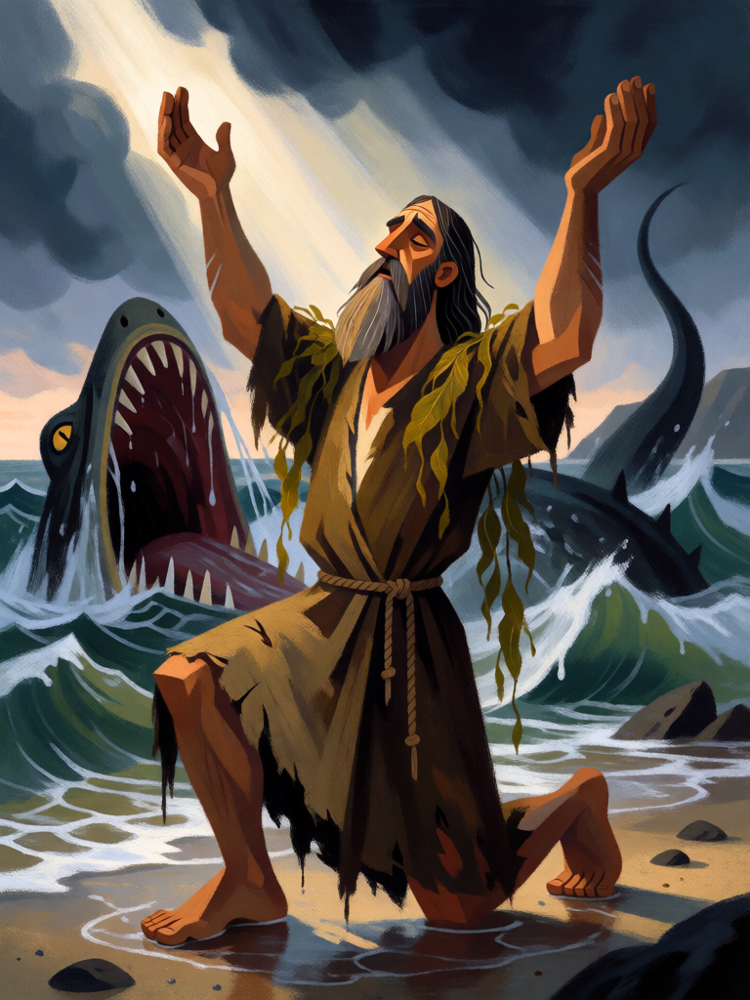

# Jonas

[← Cristianismo](../cristianismo.md) · [Wiki KodeX](../README.md) · [◀ Anjo da Guarda](cri_anjo_da_guarda.md) · [Davi, o Pastor ▶](cri_davi_o_pastor.md)

| Carta | Arte |
|---|---|
|  |  |

| | |
|---|---|
| **Tradição** | Cristianismo |
| **Tipo** | Entidade |
| **Custo de Fé** | 2 |
| **ATK / DEF** | 1 / 2 |
| **Palavras-chave** | Renascer |
| **Lendária** | não |
| **Cópias no deck** | 1 |
| **Id** | `cri_jonas` |

## Texto da carta

> Renascer. (Quando morrer, volta para a sua mão uma vez.)

**EN — Jonah:** *Rebirth. (When it dies, it returns to your hand once.)*

## Contexto mitológico

Jonas, filho de Amitai, recebe ordem de pregar em Nínive e foge no sentido contrário, embarcando para Társis. A tempestade, o sorteio dos marinheiros, o mar que se acalma quando o lançam à água — e então "o Senhor fez vir um grande peixe para engolir Jonas; e Jonas ficou nas entranhas do peixe três dias e três noites" (Jn 2,1). Do ventre do animal ele canta um salmo e é vomitado em terra firme, de onde finalmente vai a Nínive.

O texto hebraico diz *dag gadol*, "grande peixe"; a Septuaginta usa *kētos*, monstro marinho, e daí a "baleia" da tradição. Os evangelhos leem o episódio como prefiguração da ressurreição: "assim como Jonas esteve três dias e três noites no ventre do peixe" (Mt 12,40). Na arte cristã primitiva das catacumbas, Jonas devolvido pelo peixe é o símbolo mais frequente da vida que vence a morte.

Por isso ele é a carta mais simples de **Renascer** do deck: engolido, mas devolvido. Barato, frágil, e volta para a mão como quem é cuspido na praia.

## Papel no jogo

Corpo de turno 2 que o oponente não consegue remover de vez: morre, volta à mão, é reinvocado por 2 Fé. Serve de escudo barato enquanto a mão se encaminha para Lázaro e Elias. Bom portador da Funda de Davi (Renascer protege o investimento); **não** vale equipar o Véu de Verônica nele — palavras-chave não acumulam, e Renascer já é dele. Também não serve de oferenda para o Leviatã: Sacrifício conta como morte, mas **não** aciona Renascer (regras §2). Sofre contra `silence` e contra Exorcismos inimigos, que o devolvem à mão sem gastar o Renascer.

## Atributos visuais

barba e cabelo encharcados · túnica marrom rasgada e molhada · ajoelhado de braços erguidos · algas nos ombros · boca aberta do grande peixe atrás

Balanço (conta de custo)

Orçamento P = 2·C+1 = 5 pts. Gasto: ATK 1 + Vida 2 + Renascer 2 = 5. Dentro.

Ficha completa: `cartas/cristianismo/02_jonas.md` · cartas base da versão Alpha
