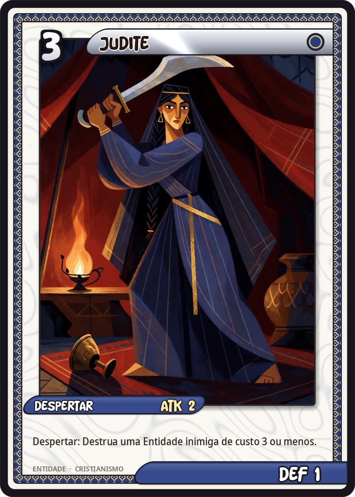
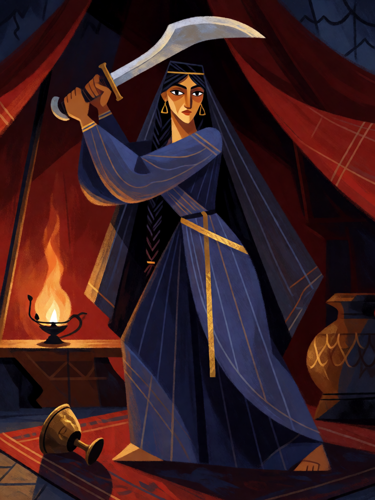

# Judite

[← Cristianismo](../cristianismo.md) · [Wiki KodeX](../README.md) · [◀ Lázaro de Betânia](cri_lazaro_de_betania.md) · [Gabriel, o Mensageiro ▶](cri_gabriel.md)

| Carta | Arte |
|---|---|
|  |  |

| | |
|---|---|
| **Tradição** | Cristianismo |
| **Tipo** | Entidade |
| **Custo de Fé** | 3 |
| **ATK / DEF** | 2 / 1 |
| **Palavras-chave** | — |
| **Lendária** | não |
| **Cópias no deck** | 1 |
| **Id** | `cri_judite` |

## Texto da carta

> Despertar: destrói uma Entidade inimiga de custo 3 ou menos.

**EN — Judith:** *Awaken: Destroy an enemy Entity that costs 3 or less.*

## Contexto mitológico

O Livro de Judite (deuterocanônico, séc. II a.C.) conta como a cidade de Betúlia, sitiada pelo general assírio Holofernes, está a dias de se render por sede. Judite, viúva rica e piedosa, repreende os anciãos pela falta de fé, veste-se com esmero e vai ao acampamento inimigo com a sua criada. Holofernes, encantado, oferece um banquete; embriagado, adormece, e Judite "golpeou-lhe duas vezes o pescoço com toda a força e cortou-lhe a cabeça" (Jt 13,8). A cabeça, exposta nas muralhas, desbarata o exército.

Judite é modelo de vitória pela astúcia e pela fé, não pela força — o cântico final o resume: "o Senhor Todo-Poderoso os frustrou pela mão de uma mulher" (Jt 16,5). A cena foi pintada por Caravaggio, Artemisia Gentileschi, Botticelli, Klimt — quase sempre o instante da espada ou a cabeça no cesto.

Na carta, é remoção **condicional**: o golpe acerta um comandante dormindo, não um exército — por isso destrói apenas Entidades de custo igual ou inferior ao dela.

## Papel no jogo

A resposta barata do deck a ameaças pequenas e médias: Entidades de custo ≤ 3 com habilidades irritantes (auras, Furtivo após atacar, geradores de token). Depois do Despertar, fica um 2/1 frágil — a astúcia já foi gasta; revivê-la para o campo não repete o golpe (reviver não dispara Despertar), só devolver à mão e reinvocar. Inútil contra campo vazio ou só com Entidades grandes; aí guarde-a até surgir alvo.

## Atributos visuais

véu escuro e diadema de ouro · vestido azul de mangas longas · espada assíria erguida com as duas mãos · tenda militar vermelha · taça de vinho caída

Balanço (conta de custo)

Orçamento P = 2·C+1 = 7 pts. Gasto: ATK 2 + Vida 1 + destruir Entidade escolhida com `target_cost_max` ≤ 3 (3,5) = 6,5. Dentro (P−0,5).
Rodada 1 de balanceamento: era 2/2 (7,5 com a tabela §10 nova).

Ficha completa: `cartas/cristianismo/05_judite.md` · cartas base da versão Alpha
