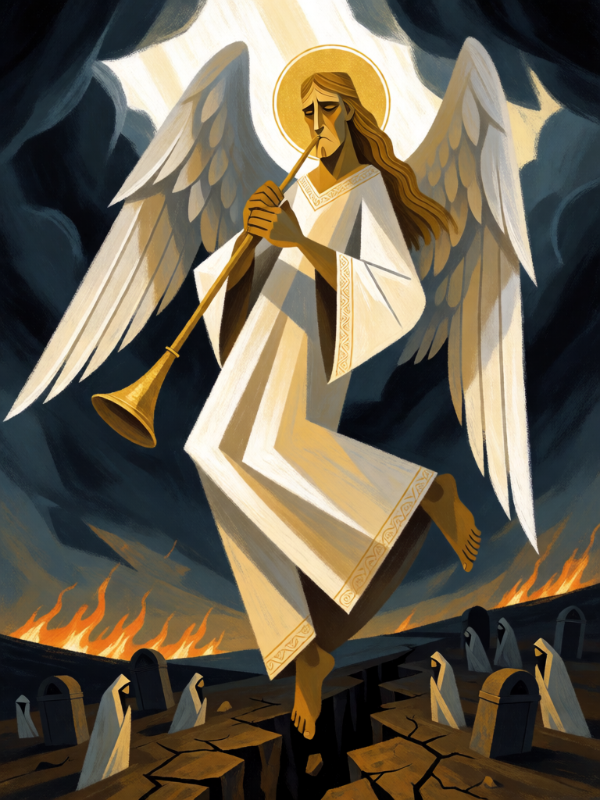

# Juízo Final

[← Cristianismo](../cristianismo.md) · [Wiki KodeX](../README.md) · [◀ Granizo e Fogo](cri_granizo_e_fogo.md) · [Funda de Davi ▶](cri_funda_de_davi.md)

| Carta | Arte |
|---|---|
|  |  |

| | |
|---|---|
| **Tradição** | Cristianismo |
| **Tipo** | Rito |
| **Custo de Fé** | 4 |
| **Palavras-chave** | — |
| **Lendária** | não |
| **Cópias no deck** | 1 |
| **Id** | `cri_juizo_final` |

## Texto da carta

> Destrua todas as Entidades em campo, inimigas e suas. Depois, uma Entidade aleatória do seu cemitério volta à sua mão.

**EN — Last Judgment:** *Destroy all Entities on the field, yours and the enemy's. Then a random Entity from your graveyard returns to your hand.*

## Contexto mitológico

"Quando o Filho do Homem vier na sua glória... todas as nações serão reunidas diante dele, e ele separará uns dos outros, como o pastor separa as ovelhas dos cabritos" (Mt 25,31-33). O Apocalipse descreve a cena final: "Vi um grande trono branco... e vi os mortos, grandes e pequenos, em pé diante do trono; e abriram-se livros" (Ap 20,11-12). Daniel já tinha visto o Ancião de dias sentado, "o seu trono eram chamas de fogo", e os livros abertos (Dn 7,9-10). O Juízo é universal: ninguém fica de pé por conta própria — todos passam pelo mesmo tribunal.

É o tema mais monumental da arte cristã: os tímpanos românicos de Autun e Conques, o *Dies irae* da liturgia dos defuntos, o políptico de Beaune, a parede inteira da Capela Sistina de Michelangelo com os eleitos subindo à esquerda e os condenados caindo à direita, Caronte à proa. Em todas elas, os anjos tocam as trombetas e os mortos saem dos túmulos — porque o Juízo pressupõe a ressurreição: "os que estão nos sepulcros ouvirão a sua voz e sairão" (Jo 5,28-29; cf. Dn 12,2).

Daí o desenho da carta em dois tempos. Primeiro ela **destrói tudo**, dos dois lados. Depois, **alguém se levanta**: uma Entidade do seu cemitério volta à mão — aleatória, porque não cabe a quem joga escolher quem é chamado. O deck cristão é feito de quem volta — Lázaro, Jonas e Elias renascem na mão por conta própria; Talita Cumi reabre os túmulos no turno seguinte. O tribunal é o mesmo para todos; a diferença é quem se levanta depois.

## Papel no jogo

A carta de reset do deck, e a razão de ser de todo o Renascer. Jogue com o campo inimigo mais valioso que o seu — ou com o seu campo feito de Renascidos, Anjos da Guarda (curam 2 ao cair) e Leviatã (cura 4). As Entidades com Renascer voltam à mão, e o Rito ainda devolve uma aleatória do cemitério; no turno seguinte Talita Cumi reconstrói o resto enquanto o oponente recomeça do zero. **Cuidado**: Tumba Vazia **não** dispara aqui — Selos só disparam no turno do oponente, e o Juízo é jogado no seu. O Último Sopro de Sansão também não rende nada: as inimigas já se foram quando ele cai. Perigosa com um Miguel seu em campo; segure-a até ter a sequência pronta.

## Atributos visuais

trombeta dourada longa nas duas mãos · asas brancas abertas · túnica branca com borda dourada · túmulos se abrindo embaixo · céu rasgado de luz

Balanço (conta de custo)

Orçamento P = 2·C+1 = 9 pts. Gasto: destruir Entidade (5) × 2 inimigas esperadas em campo = 10, × 0,7 por ser simétrico (destrói as suas também) = 7; + reviver Entidade do cemitério para a mão 2 × aleatório 0,8 = 1,6 → **8,6**. Dentro (faixa 7–9). _(Rodada 1: reconta com `destroy` a 5 pts; antes 7,2. Sem mudança na carta.)_

Ficha completa: `cartas/cristianismo/24_juizo_final.md` · cartas base da versão Alpha
