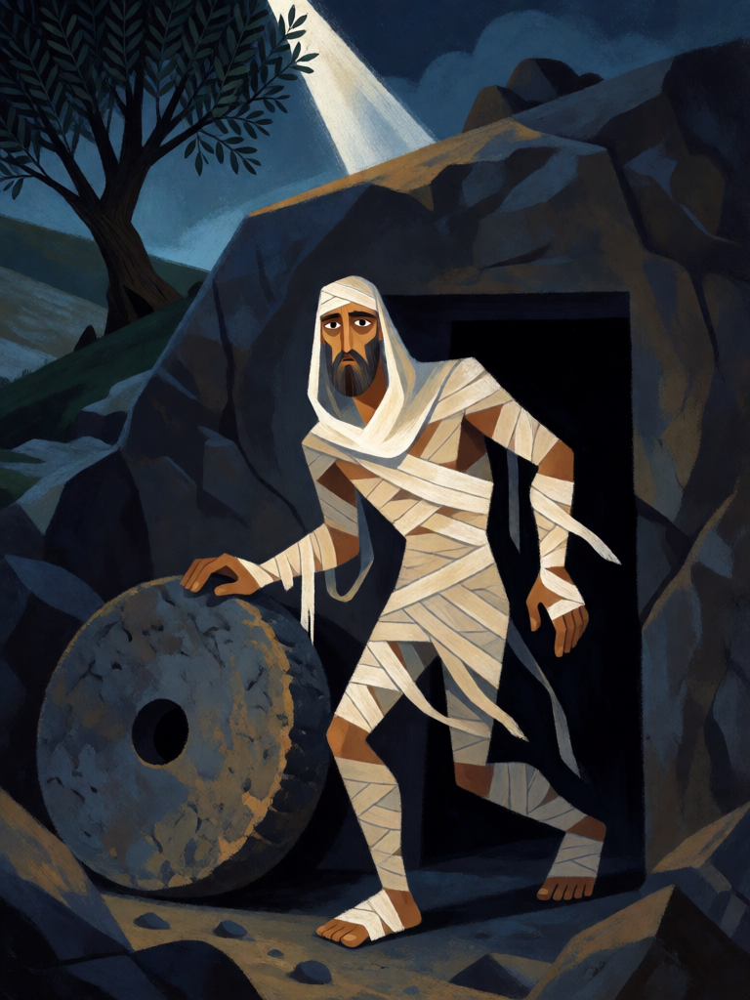

# Lázaro de Betânia

[← Cristianismo](../cristianismo.md) · [Wiki KodeX](../README.md) · [◀ Davi, o Pastor](cri_davi_o_pastor.md) · [Judite ▶](cri_judite.md)

| Carta | Arte |
|---|---|
|  |  |

| | |
|---|---|
| **Tradição** | Cristianismo |
| **Tipo** | Entidade |
| **Custo de Fé** | 3 |
| **ATK / DEF** | 2 / 3 |
| **Palavras-chave** | Renascer |
| **Lendária** | não |
| **Cópias no deck** | 2 |
| **Id** | `cri_lazaro_de_betania` |

## Texto da carta

> Renascer. (Quando morrer, volta para a sua mão uma vez.)

**EN — Lazarus of Bethany:** *Rebirth. (When it dies, it returns to your hand once.)*

## Contexto mitológico

Lázaro, irmão de Marta e Maria, adoece em Betânia e morre antes que Jesus chegue. Quatro dias depois, diante do sepulcro fechado, com Marta avisando que "já cheira mal", a pedra é removida e o grito "Lázaro, vem para fora!" o faz sair ainda atado nas faixas fúnebres (Jo 11,1-44). É o maior sinal do Evangelho de João antes da Paixão e o episódio que precipita a decisão do Sinédrio.

A tradição posterior deu a Lázaro uma segunda vida literal: a *Legenda Áurea* e as lendas provençais o fazem chegar a Marselha com as irmãs e tornar-se o primeiro bispo da cidade; a tradição oriental o leva a Chipre (Larnaca guarda um túmulo com a inscrição "Lázaro, amigo de Cristo"). Em ambas, ele viveu, pregou e morreu de novo — desta vez em paz.

A carta o representa saindo do túmulo, não como figura passiva: ele tem corpo de combate e **Renascer** porque voltar da morte é, por definição, o que ele faz.

## Papel no jogo

Peça central da identidade. Um 2/3 por 3 que volta para a mão garante presença de campo contínua e é o melhor alvo do Juízo Final (destrói tudo, Lázaro volta). Duas cópias para que a ressurreição seja constante e não um golpe de sorte. Combina com a Arca da Aliança (Guarda + Vida extra num corpo que o oponente não consegue remover de vez) e com Tumba Vazia depois que o Renascer foi gasto (aí ele passa a ir ao cemitério). O Véu de Verônica é desperdício nele: palavras-chave não acumulam. Perde para `silence` inimigo e para bounce, que gastam tempo sem matar.

## Atributos visuais

faixas fúnebres de linho se soltando · sudário escorregando do rosto · pele pálida e olhos abertos · saindo da tumba de rocha · pedra redonda rolada

Balanço (conta de custo)

Orçamento P = 2·C+1 = 7 pts. Gasto: ATK 2 + Vida 3 + Renascer 2 = 7. Dentro.

Ficha completa: `cartas/cristianismo/04_lazaro_de_betania.md` · cartas base da versão Alpha
