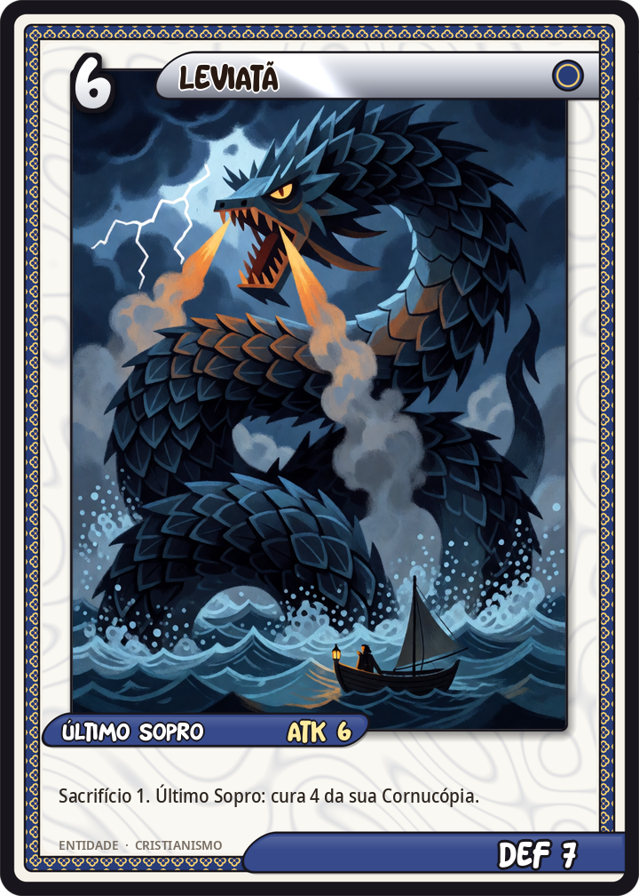
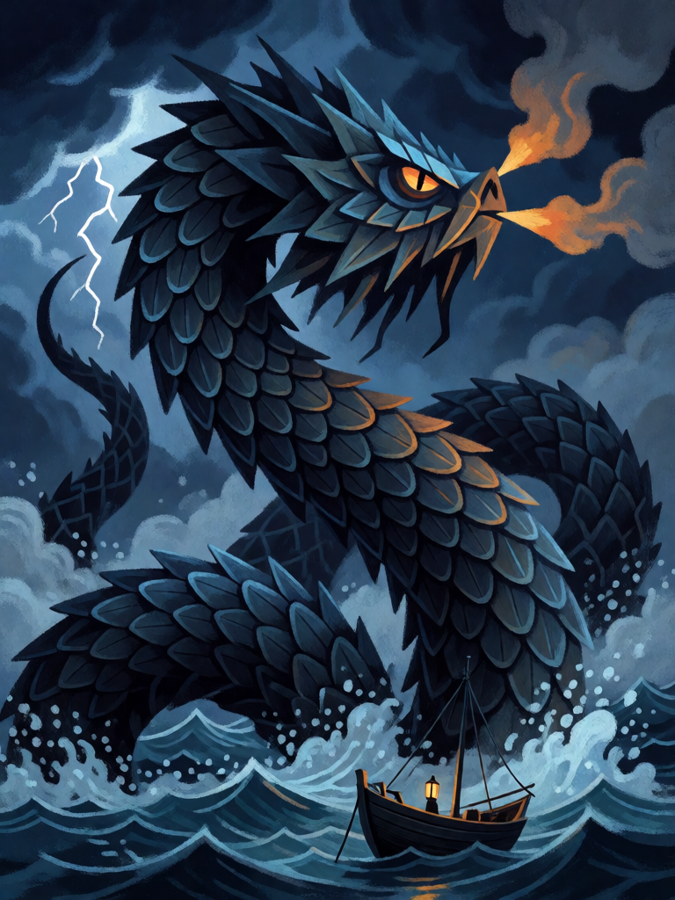

# Leviatã

[← Cristianismo](../cristianismo.md) · [Wiki KodeX](../README.md) · [◀ Serafim](cri_serafim.md) · [Elias, Carro de Fogo ▶](cri_elias.md)

| Carta | Arte |
|---|---|
|  |  |

| | |
|---|---|
| **Tradição** | Cristianismo |
| **Tipo** | Entidade |
| **Custo de Fé** | 6 |
| **ATK / DEF** | 6 / 7 |
| **Sacrifício** | 1 |
| **Palavras-chave** | — |
| **Lendária** | não |
| **Cópias no deck** | 1 |
| **Id** | `cri_leviata` |
| **Arte** | provisória nesta Alpha |

## Texto da carta

> Sacrifício 1. Último Sopro: cura 4 da sua Cornucópia.

**EN — Leviathan:** *Sacrifice 1. Last Breath: Heal your Cornucopia for 4.*

## Contexto mitológico

Leviatã é o monstro marinho primordial da Bíblia. O discurso final de Deus a Jó o descreve em mais de trinta versículos (Jó 40,25–41,26): couraça de escamas, fogo pelas narinas, "faz ferver o abismo como panela", e ninguém o fisga com anzol. Os Salmos lembram que Deus "esmagou as cabeças do Leviatã" (Sl 74,14) e também que o criou "para brincar" no mar (Sl 104,26). Isaías promete que "naquele dia o Senhor castigará com a sua espada o Leviatã, serpente fugidia, e matará o dragão do mar" (Is 27,1).

A literatura apocalíptica desenvolve o fim da criatura. Em 1 Enoque 60,7-9, Leviatã (fêmea, do mar) e Beemote (macho, da terra) são separados na criação; em 4 Esdras 6,49-52 e 2 Baruc 29,4, ambos são guardados para servir de alimento aos justos no banquete do fim dos tempos. A fera não é apenas vencida — é consumida, e sua morte alimenta.

É exatamente isso que a carta faz. O deck cristão a invoca como antagonista doméstico: um colosso que exige sacrifício para vir ao mundo e cuja queda é um **banquete** que restaura a Cornucópia.

## Papel no jogo

O corpo mais pesado do deck fora das Lendárias: 6/7 por 6 Fé e um sacrifício. Sacrifício **conta como morte** (regras §2): dispara Último Sopro, mas **não** Renascer. Logo as melhores oferendas são um Osso Erguido (token do Vale, perda zero), um Anjo da Guarda ferido (cura 2 ao cair) ou Sansão (o templo desaba sobre as inimigas no mesmo turno). Jonas e Lázaro são péssimas oferendas: vão ao cemitério sem voltar à mão. Tumba Vazia não dispara no sacrifício (Selos só disparam no turno do oponente). Segura qualquer linha e força o oponente a gastar remoção dura. Se morre, cura 4 da Cornucópia; se é destruído pelo próprio Juízo Final, idem. Sem Guarda: o inimigo pode ignorá-lo e bater nas Entidades menores. Se cai no turno do oponente com Tumba Vazia armada, volta para o campo sem novo sacrifício.

## Atributos visuais

serpente marinha colossal · uma única cabeça · escamas como escudos sobrepostos · fumaça e fogo pelas narinas · mar fervendo

Balanço (conta de custo)

Orçamento P = 2·C+1 = 13 pts; Sacrifício 1 vale −2 (desconto), ou seja, libera +2 de orçamento → 15. Gasto: ATK 6 + Vida 7 + Último Sopro curar 4 Cornucópia (2 × "curar 2 = 1") 2 = 15. Dentro. Observação: o desconto do Sacrifício é pago em corpo real (o deck perde uma Entidade, e um Renascido perde o Renascer), então a conta não está folgada.

Ficha completa: `cartas/cristianismo/10_leviata.md` · cartas base da versão Alpha
