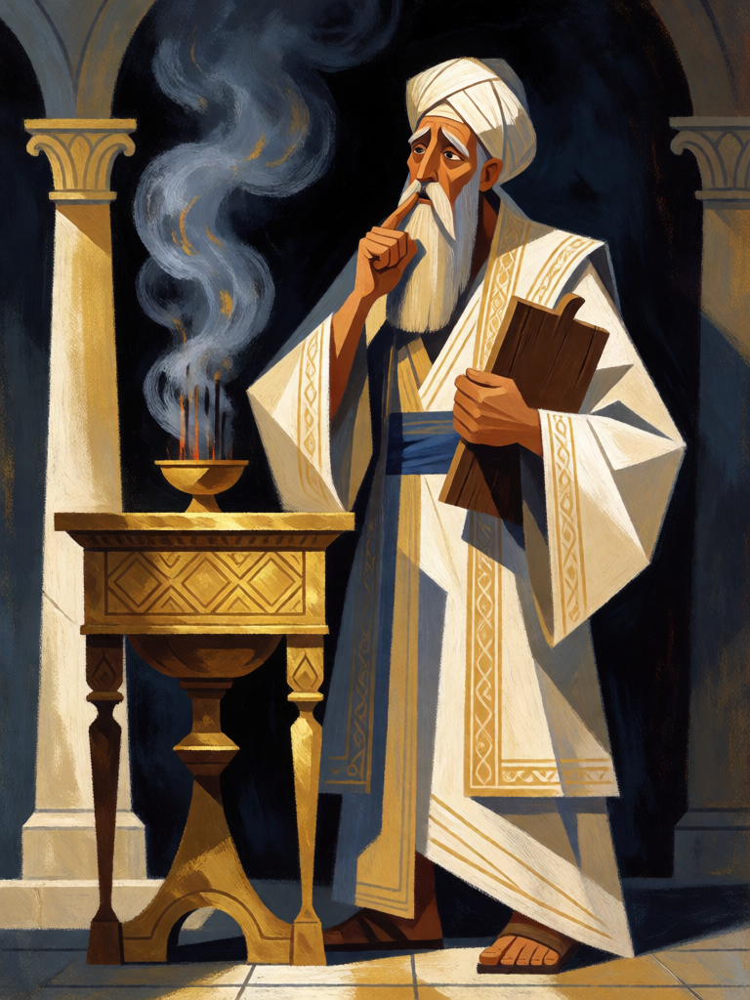

# Mudez de Zacarias

[← Cristianismo](../cristianismo.md) · [Wiki KodeX](../README.md) · [◀ Portão do Éden](cri_portao_do_eden.md) · [Sangue nos Umbrais ▶](cri_sangue_nos_umbrais.md)

| Carta | Arte |
|---|---|
|  |  |

| | |
|---|---|
| **Tradição** | Cristianismo |
| **Tipo** | Selo |
| **Custo de Fé** | 2 |
| **Palavras-chave** | — |
| **Lendária** | não |
| **Cópias no deck** | 1 |
| **Id** | `cri_mudez_de_zacarias` |

## Texto da carta

> Quando o oponente jogar um Rito, anule-o. Compre 1 carta.

**EN — Zechariah's Silence:** *When your opponent plays a Rite, counter it. Draw 1 card.*

## Contexto mitológico

Zacarias, sacerdote da classe de Abias, está oferecendo incenso no Santuário quando Gabriel aparece à direita do altar e anuncia que sua mulher Isabel, estéril e idosa, terá um filho chamado João. Zacarias duvida: "Como saberei disso? Sou velho e minha mulher é de idade avançada." A resposta é a sentença: "Ficarás mudo e não poderás falar até ao dia em que isto acontecer, porque não acreditaste nas minhas palavras" (Lc 1,18-20).

O povo espera do lado de fora e, quando ele sai sem conseguir falar, entende que teve uma visão. Nove meses depois, na circuncisão do menino, Zacarias escreve numa tabuinha "João é o seu nome" — "e imediatamente a sua boca se abriu, a sua língua se soltou, e falava bendizendo a Deus" (Lc 1,63-64): o *Benedictus*. A iconografia o mostra com a tabuinha na mão, dedo nos lábios.

Como **Selo**, a palavra do oponente é silenciada antes de produzir efeito; e, como Zacarias, você ganha algo no silêncio — uma carta.

## Papel no jogo

A única anulação do deck. Protege os Renascidos e as Lendárias de Ritos de remoção, área ou roubo. Como todo `counter`, exige adivinhar que o oponente vai jogar um Rito — mas o deck cristão perde pouco por esperar, e a compra extra compensa o tempo. Coloque-o quando o oponente estiver com Fé para a carta grande dele. Inútil contra decks de poucos Ritos (que invocam e equipam).

## Atributos visuais

idoso de barba grisalha · dedo indicador sobre os lábios (mudo) · tabuinha de cera na mão esquerda · vestes sacerdotais brancas e turbante · altar de incenso dourado

Balanço (conta de custo)

Orçamento P = 2·C+1 = 5 pts, +1 grátis de Selo = 6. Gasto: anular Rito inimigo 3 + comprar 1 carta 1,5 = 4,5. Dentro.

Ficha completa: `cartas/cristianismo/16_mudez_de_zacarias.md` · cartas base da versão Alpha
