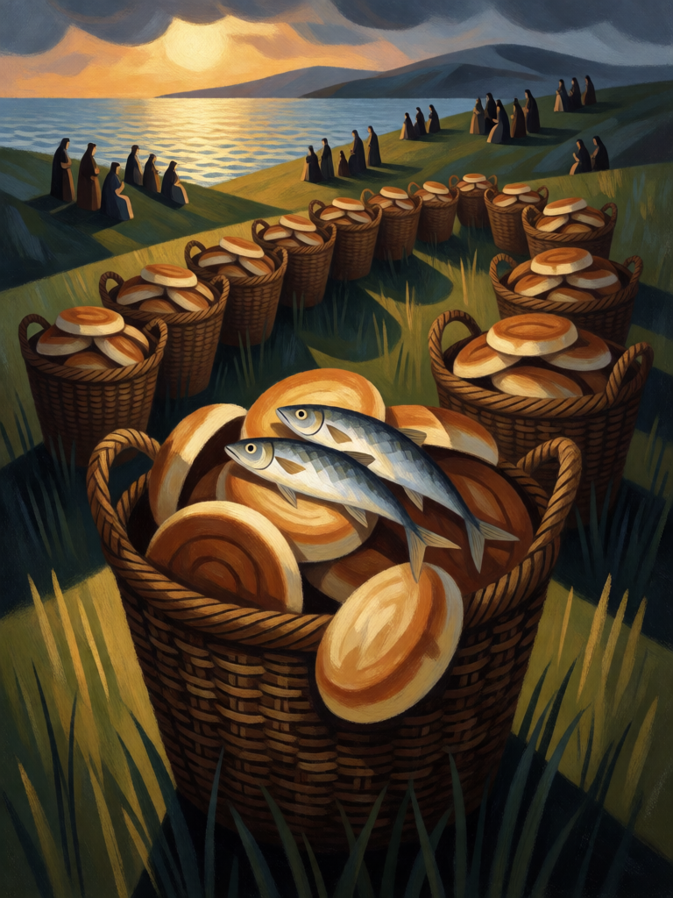

# Multiplicação dos Pães

[← Cristianismo](../cristianismo.md) · [Wiki KodeX](../README.md) · [◀ Sangue nos Umbrais](cri_sangue_nos_umbrais.md) · [Exorcismo ▶](cri_exorcismo.md)

| Carta | Arte |
|---|---|
|  |  |

| | |
|---|---|
| **Tradição** | Cristianismo |
| **Tipo** | Rito |
| **Custo de Fé** | 2 |
| **Palavras-chave** | — |
| **Lendária** | não |
| **Cópias no deck** | 1 |
| **Id** | `cri_multiplicacao_dos_paes` |

## Texto da carta

> Compre 2 cartas. Cure 2 da sua Cornucópia.

**EN — Loaves and Fishes:** *Draw 2 cards. Heal your Cornucopia for 2.*

## Contexto mitológico

É o único milagre narrado pelos quatro evangelhos (Mt 14,13-21; Mc 6,30-44; Lc 9,10-17; Jo 6,1-14). Uma multidão segue Jesus a um lugar deserto; ao entardecer os discípulos querem despedi-la para que compre comida. Há só cinco pães de cevada e dois peixes — em João, trazidos por um menino. Jesus manda sentar o povo na relva em grupos, ergue os olhos, abençoa, parte e distribui. "Todos comeram e ficaram saciados, e recolheram doze cestos cheios dos pedaços que sobraram" — para cerca de cinco mil homens, sem contar mulheres e crianças.

O episódio ecoa o maná do deserto (Ex 16) e os vinte pães de Eliseu para cem homens (2Rs 4,42-44), e a Igreja primitiva o leu como figura da Eucaristia: os afrescos das catacumbas e os mosaicos de Tabgha, na Galileia, mostram os pães e os peixes num cesto. A carta mostra os doze cestos de sobra — a abundância que fica depois que todos comeram.

Como **Rito**, é abundância em duas moedas: cartas na mão e Vida na Cornucópia.

## Papel no jogo

A principal compra do deck. Dois por 2 Fé, com uma cura pequena de bônus, recarrega a mão depois de uma troca de Ritos e procura as peças de ressurreição. Jogue quando a mão estiver com ≤ 3 cartas; não deixe para quando a mão estiver em 7 (o excesso é descartado). Sem sinergia especial além de alimentar Gabriel-busca e manter Talita Cumi disponível.

## Atributos visuais

cesto de vime transbordando · pães redondos de cevada · dois peixes sobre os pães · doze cestos no total · mar da Galileia ao pôr do sol

Balanço (conta de custo)

Orçamento P = 2·C+1 = 5 pts. Gasto: comprar 2 cartas (1,5 × 2) = 3 + curar 2 Cornucópia 1 = 4. Dentro.

Ficha completa: `cartas/cristianismo/18_multiplicacao_dos_paes.md` · cartas base da versão Alpha
