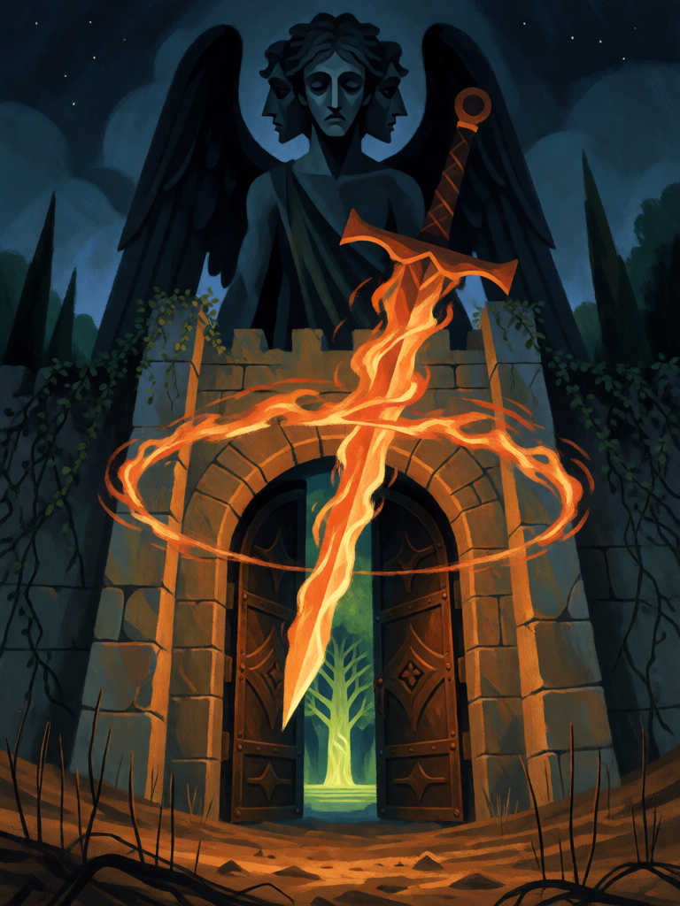

# Portão do Éden

[← Cristianismo](../cristianismo.md) · [Wiki KodeX](../README.md) · [◀ Tumba Vazia](cri_tumba_vazia.md) · [Mudez de Zacarias ▶](cri_mudez_de_zacarias.md)

| Carta | Arte |
|---|---|
|  |  |

| | |
|---|---|
| **Tradição** | Cristianismo |
| **Tipo** | Selo |
| **Custo de Fé** | 2 |
| **Palavras-chave** | — |
| **Lendária** | não |
| **Cópias no deck** | 1 |
| **Id** | `cri_portao_do_eden` |

## Texto da carta

> Quando o oponente invocar uma Entidade, ela sofre 3 de dano e não ataca no próximo turno dela.

**EN — Gate of Eden:** *When your opponent summons an Entity, it takes 3 damage and can't attack on its next turn.*

## Contexto mitológico

Depois da expulsão de Adão e Eva, "o Senhor Deus pôs, ao oriente do jardim do Éden, os querubins e a espada flamejante que se revolvia, para guardar o caminho da árvore da vida" (Gn 3,24). É a primeira menção a querubins na Bíblia, e já como guardiões de um limiar — função que repetem nas figuras de ouro sobre a Arca (Ex 25,18-22) e nas quatro criaturas de quatro faces que carregam o trono móvel de Ezequiel (Ez 1; 10).

Pseudo-Dionísio os coloca no segundo lugar da hierarquia, logo abaixo dos serafins, e interpreta o nome como "plenitude de conhecimento". A tradição posterior deu nomes ao guardião do portão: em Milton (*Paraíso Perdido*, IV) é Gabriel quem comanda a guarda do Paraíso, enquanto Uriel vigia do Sol (III); a cabala e algumas leituras tardias dão a espada de fogo a Uriel. O texto bíblico, porém, fala só de querubins e de uma espada que gira sozinha, de fogo — e é com ela que a carta fica.

O **Selo** é essa espada: quem tenta entrar no jardim é ferido e detido no limiar.

## Papel no jogo

Punição de invocação: a Entidade que o oponente joga chega com 3 de dano (morre, se tiver Vida ≤ 3) e, se sobreviver, fica congelada por um turno — tempo para Judite ou Davi acabarem com ela. Bom contra decks que dependem de um corpo grande no meio do jogo; pior contra tokens e Entidades de 1–2, que o deck já lida com as pragas. É o único Selo do deck que dispara em `enemy_plays_entity`, então o oponente não consegue "testar" com uma carta pequena sem perdê-la. Contra **Furtivo** depende da leitura do motor: a Entidade "não pode ser alvo de Selos até atacar", e aqui o alvo é `triggering` no momento em que entra — o simulador deve fixar se o Selo a acerta ou é pulado.

## Atributos visuais

espada de fogo girando sozinha · portão de pedra fechado · árvore da vida brilhando ao fundo · silhueta de querubim de quatro faces · chão árido à frente

Balanço (conta de custo)

Orçamento P = 2·C+1 = 5 pts, +1 grátis de Selo = 6. Gasto: 3 de dano a Entidade (3) + Freeze (tabela §10) 1,5 = 4,5. Dentro (faixa 4–6). Nota: o Freeze aqui tem valor real porque a Entidade entra cansada e perde *também* o turno seguinte — dois turnos sem atacar.

Ficha completa: `cartas/cristianismo/15_portao_do_eden.md` · cartas base da versão Alpha
