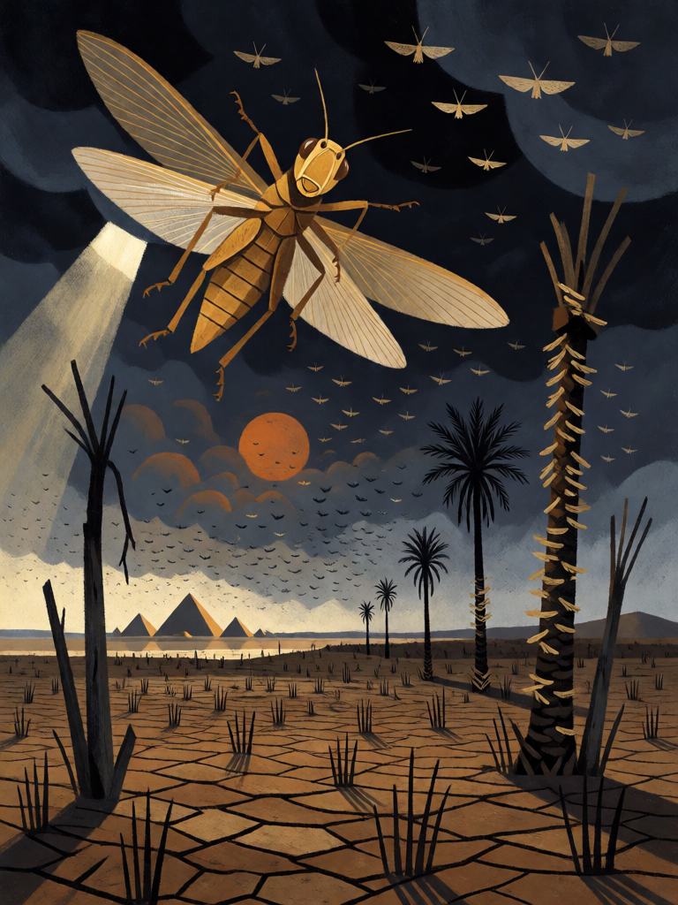

# Praga dos Gafanhotos

[← Cristianismo](../cristianismo.md) · [Wiki KodeX](../README.md) · [◀ Exorcismo](cri_exorcismo.md) · [Talita Cumi ▶](cri_talita_cumi.md)

| Carta | Arte |
|---|---|
|  |  |

| | |
|---|---|
| **Tradição** | Cristianismo |
| **Tipo** | Rito |
| **Custo de Fé** | 2 |
| **Palavras-chave** | — |
| **Lendária** | não |
| **Cópias no deck** | 1 |
| **Id** | `cri_praga_dos_gafanhotos` |

## Texto da carta

> Causa 2 de dano a todas as Entidades inimigas. O oponente descarta 1 carta aleatória.

**EN — Plague of Locusts:** *Deal 2 damage to all enemy Entities. Your opponent discards 1 random card.*

## Contexto mitológico

A oitava das dez pragas do Egito. Depois do granizo que destruiu o linho e a cevada, Moisés estende o cajado e "o Senhor fez soprar um vento oriental sobre a terra todo aquele dia e toda a noite; quando amanheceu, o vento oriental tinha trazido os gafanhotos. Cobriram toda a superfície do país, de modo que a terra ficou escura; devoraram toda a erva da terra e todos os frutos das árvores que o granizo deixara, e não ficou nada verde em todo o Egito" (Ex 10,13-15). O Faraó pede perdão pela primeira vez, mas endurece de novo quando o vento oeste leva os gafanhotos ao Mar Vermelho.

O gafanhoto é, em todo o Antigo Oriente, a imagem da fome absoluta; Joel 1–2 descreve uma invasão como exército do Dia do Senhor, e Ap 9,1-11 transforma os gafanhotos em criaturas do Abismo com rei chamado Abadom. No deck, é a praga que devora não só o campo mas também o celeiro — por isso, além do dano, uma carta some da mão do oponente.

## Papel no jogo

Primeira praga: limpa tokens e Entidades de Vida ≤ 2 e leva uma carta da mão inimiga. Boa contra decks de enxame (muitos corpos pequenos) e no meio do jogo, quando o descarte ainda dói. Combina com Davi e Judite para terminar o que sobrou com Vida 1. Não afeta Entidades grandes nem o seu próprio campo.

## Atributos visuais

enxame que escurece o céu · um gafanhoto grande em primeiro plano · campo de trigo devorado · palmeiras desfolhadas · sol encoberto alaranjado

Balanço (conta de custo)

Orçamento P = 2·C+1 = 5 pts. Gasto: 2 de dano a todas as inimigas (1,5 × 2) = 3 + oponente descarta 1 aleatória 2 = 5. Dentro.

Ficha completa: `cartas/cristianismo/20_praga_dos_gafanhotos.md` · cartas base da versão Alpha
