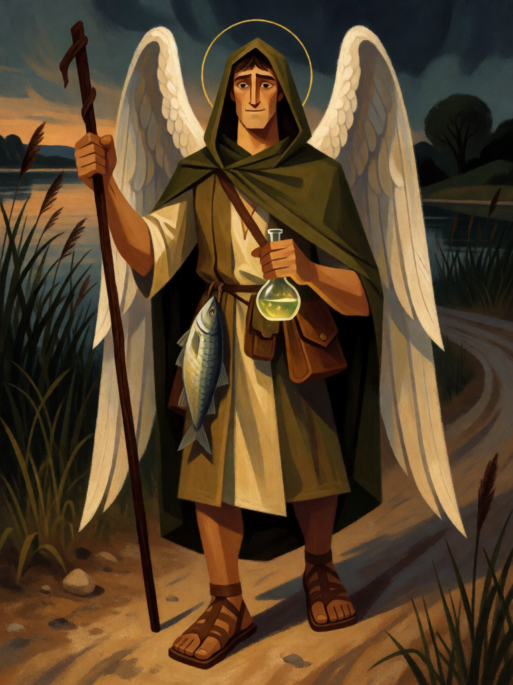

# Rafael, o Curador

[← Cristianismo](../cristianismo.md) · [Wiki KodeX](../README.md) · [◀ Gabriel, o Mensageiro](cri_gabriel.md) · [Sansão ▶](cri_sansao.md)

| Carta | Arte |
|---|---|
|  |  |

| | |
|---|---|
| **Tradição** | Cristianismo |
| **Tipo** | Entidade |
| **Custo de Fé** | 3 |
| **ATK / DEF** | 2 / 3 |
| **Palavras-chave** | — |
| **Lendária** | não |
| **Cópias no deck** | 1 |
| **Id** | `cri_rafael` |

## Texto da carta

> Despertar: cura 4 de Vida de uma Entidade aliada.

**EN — Raphael, the Healer:** *Awaken: Restore 4 Health to an allied Entity.*

## Contexto mitológico

Rafael ("Deus cura") é o protagonista oculto do Livro de Tobias. Disfarçado como o viajante Azarias, acompanha o jovem Tobias de Nínive à Média, ensina-o a tirar o coração, o fígado e o fel de um peixe do Tigre, com a fumaça expulsa o demônio Asmodeu que matara os sete noivos de Sara, e com o fel cura a cegueira do velho Tobit (Tb 6; 8; 11). Só no fim se revela: "Eu sou Rafael, um dos sete anjos que estão diante da glória do Senhor" (Tb 12,15).

No Primeiro Livro de Enoque é ele quem acorrenta Azazel no deserto de Dudael (1En 10,4-8), e a tradição o associa também ao anjo que agita a água da piscina de Betesda (Jo 5,4 — versículo ausente dos manuscritos mais antigos, mas firme na tradição latina). Na iconografia leva um peixe, um cajado de peregrino e um frasco de remédio; é patrono dos médicos, dos viajantes e dos cegos.

A carta é cura pura: ao chegar, devolve 4 de Vida a uma Entidade ferida — o fel do peixe sobre os olhos de Tobit.

## Papel no jogo

Mantém vivas as Entidades que o deck mais quer preservar: um Lázaro ou Serafim ferido em combate volta a pleno. Como a Vida não regenera sozinha entre turnos (regras §6), Rafael é a principal forma de desfazer trocas ruins. Também cura a portadora da Arca da Aliança, que tende a absorver ataques. Sem aliado ferido, é só um 2/3 — escolha o momento.

## Atributos visuais

cajado de peregrino na mão direita · frasco de remédio brilhando na esquerda · peixe pendurado no cinto · manto verde de viajante · asas brancas

Balanço (conta de custo)

Orçamento P = 2·C+1 = 7 pts. Gasto: ATK 2 + Vida 3 + curar 4 (2 × "curar 2 = 1") = 2 → 7. Dentro.

Ficha completa: `cartas/cristianismo/07_rafael.md` · cartas base da versão Alpha
