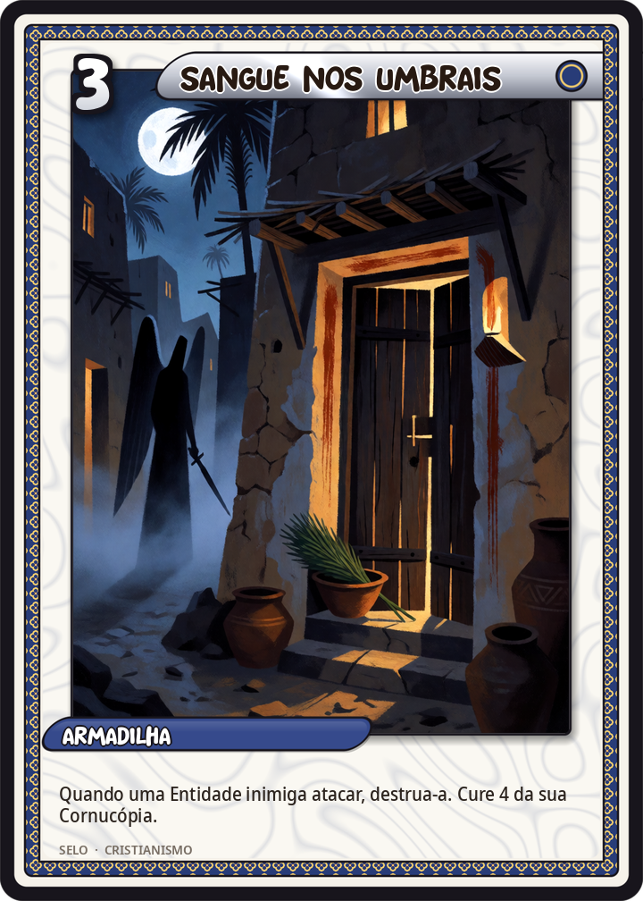
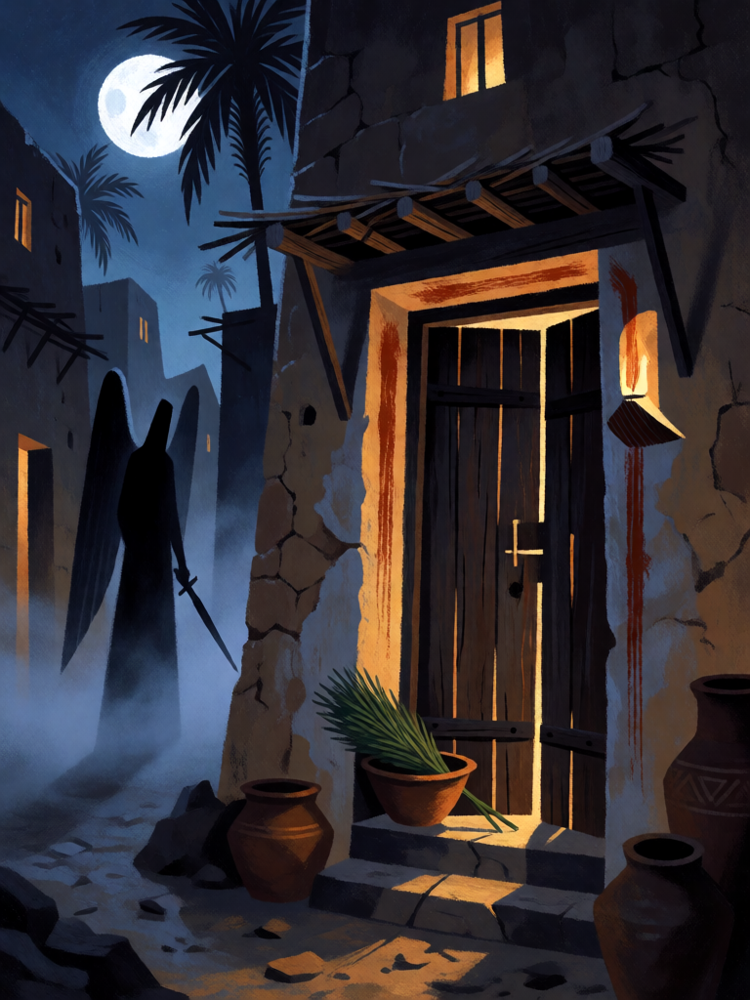

# Sangue nos Umbrais

[← Cristianismo](../cristianismo.md) · [Wiki KodeX](../README.md) · [◀ Mudez de Zacarias](cri_mudez_de_zacarias.md) · [Multiplicação dos Pães ▶](cri_multiplicacao_dos_paes.md)

| Carta | Arte |
|---|---|
|  |  |

| | |
|---|---|
| **Tradição** | Cristianismo |
| **Tipo** | Selo |
| **Custo de Fé** | 3 |
| **Palavras-chave** | — |
| **Lendária** | não |
| **Cópias no deck** | 1 |
| **Id** | `cri_sangue_nos_umbrais` |

## Texto da carta

> Quando uma Entidade inimiga atacar, destrua-a. Cure 4 da sua Cornucópia.

**EN — Blood on the Doorposts:** *When an enemy Entity attacks, destroy it. Heal your Cornucopia for 4.*

## Contexto mitológico

Na noite da décima praga, cada família israelita marca os umbrais da porta com o sangue do cordeiro. "O Senhor passará para ferir o Egito; e, vendo o sangue na verga e nos dois umbrais, passará adiante daquela porta e não deixará o Destruidor entrar nas vossas casas para ferir" (Ex 12,23). À meia-noite morrem todos os primogênitos do Egito, "desde o primogênito do Faraó até o do cativo no cárcere" (Ex 12,29) — e a Páscoa (*pessach*, "passar por cima") nasce dessa noite. O rito é fixado ali mesmo: cordeiro sem defeito, sangue no umbral, pães sem fermento, ervas amargas, e a ordem de contar a história aos filhos (Ex 12,24-27).

O Destruidor (*mashḥit*) volta em outros textos: a peste depois do recenseamento de Davi, detida pela mão de Deus na eira de Araúna (2Sm 24,16); os 185 mil assírios de Senaquerib mortos numa noite diante de Jerusalém (2Rs 19,35; Is 37,36). Nunca é nomeado; é "o anjo do Senhor" na sua face de juiz, e a tradição cristã o funde com Miguel ou o deixa sem rosto — a figura encapuzada com a espada erguida das gravuras de Doré. Mas em Ex 12 o que o texto celebra não é o anjo: é a **marca**. A casa marcada é poupada; a casa que não tem a marca é ferida.

Por isso a carta é um **Selo**, e não uma Entidade: ela não é o anjo, é o sangue na porta. A casa está marcada em silêncio (carta virada para baixo), e quem avança contra ela encontra o juízo que passava ao largo dos protegidos. A cura da Cornucópia é a manhã seguinte: a casa amanhece de pé.

## Papel no jogo

A remoção mais dura do deck fora de Miguel, e a mais "justa": só atinge quem atacou. Coloque-o quando o oponente tiver uma Entidade grande pronta para atacar; ele perde a ameaça e você recupera 4 de Cornucópia. Entidades com Ímpeto que atacam no turno de entrada caem nele sem dar tempo de reação, e Entidades com **Furtivo** também — ao atacar, deixam de ser intocáveis, e `attacker` é um alvo legítimo. Atenção: o gatilho é `enemy_attacks`, que dispara só em ataques a **Entidades**; se o seu campo estiver vazio e o oponente bater direto na Cornucópia (`enemy_attacks_cornucopia`), o Selo não dispara. Mantenha ao menos um Anjo da Guarda em campo para "oferecer" o alvo. Fraco contra oponentes passivos que preferem equipar e esperar.

## Atributos visuais

porta de casa de adobe · marcas vermelhas no lintel e nos dois umbrais · ramo de hissopo na tigela · sombra sem rosto do Destruidor · lua cheia

Balanço (conta de custo)

Orçamento P = 2·C+1 = 7 pts, +1 grátis de Selo = 8. Gasto: destruir Entidade inimiga (alvo `attacker`, contado como escolhido) 5 + curar 4 Cornucópia (2 × "curar 2 = 1") 2 = 7. Dentro (faixa 6–8). _(Rodada 1: reconta com `destroy` a 5 pts; antes 6. Sem mudança na carta.)_

Ficha completa: `cartas/cristianismo/17_sangue_nos_umbrais.md` · cartas base da versão Alpha
