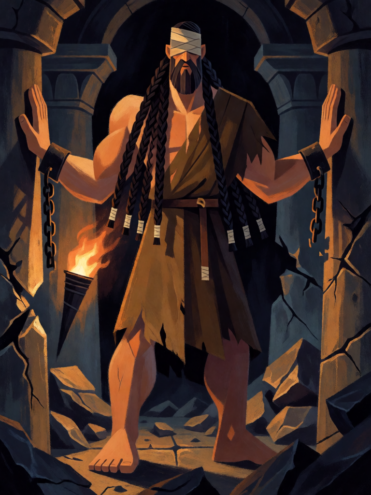

# Sansão

[← Cristianismo](../cristianismo.md) · [Wiki KodeX](../README.md) · [◀ Rafael, o Curador](cri_rafael.md) · [Serafim ▶](cri_serafim.md)

| Carta | Arte |
|---|---|
|  |  |

| | |
|---|---|
| **Tradição** | Cristianismo |
| **Tipo** | Entidade |
| **Custo de Fé** | 4 |
| **ATK / DEF** | 3 / 3 |
| **Palavras-chave** | — |
| **Lendária** | não |
| **Cópias no deck** | 1 |
| **Id** | `cri_sansao` |

## Texto da carta

> Último Sopro: causa 2 de dano a todas as Entidades inimigas.

**EN — Samson:** *Last Breath: Deal 2 damage to all enemy Entities.*

## Contexto mitológico

Sansão, da tribo de Dã, é nazireu desde o ventre: não corta o cabelo, não bebe vinho, e nele "o espírito do Senhor" desce como força bruta (Jz 13–16). Despedaça um leão com as mãos, mata mil filisteus com a mandíbula fresca de um jumento em Ramat-Leí (Jz 15,15-17), arranca as portas de Gaza e as carrega montanha acima. Traído por Dalila, que lhe corta as sete tranças, é cegado e posto a girar a mó na prisão.

O fim é o episódio que a carta captura. Levado ao templo de Dagon para divertir os filisteus reunidos — "havia ali cerca de três mil homens e mulheres" —, Sansão pede ao menino que o guia que o encoste nas colunas centrais e ora: "Que eu morra com os filisteus!" Empurra as colunas e o telhado desaba sobre todos; "os que matou ao morrer foram mais do que os que matara em vida" (Jz 16,30).

É o **Último Sopro** em área mais literal de todo o jogo: quando Sansão cai, o templo cai com ele sobre todas as Entidades inimigas.

## Papel no jogo

Ameaça que o oponente não quer matar nem deixar viva. Como 3/3 troca com a maioria dos custos 3–4, e ao morrer limpa tokens e fere o resto, abrindo espaço para Davi e Judite fecharem. A melhor oferenda do deck para o **Leviatã**: Sacrifício conta como morte (regras §2), então o templo cai sobre os inimigos no mesmo turno em que o monstro entra. Tumba Vazia e Talita Cumi o trazem de volta para uma segunda derrubada. **Não** há sinergia com o Juízo Final: quando Sansão cai ali, as inimigas já se foram e o Último Sopro não acerta ninguém. Ruim contra `bounce` e `silence`, que negam o Último Sopro.

## Atributos visuais

cego com venda sobre os olhos vazados · sete tranças longas · grilhões partidos nos pulsos · palmas empurrando duas colunas · túnica marrom rasgada

Balanço (conta de custo)

Orçamento P = 2·C+1 = 9 pts. Gasto: ATK 3 + Vida 3 + 2 de dano a todas as inimigas (1,5 × 2) = 3 → 9. Dentro.

Ficha completa: `cartas/cristianismo/08_sansao.md` · cartas base da versão Alpha
