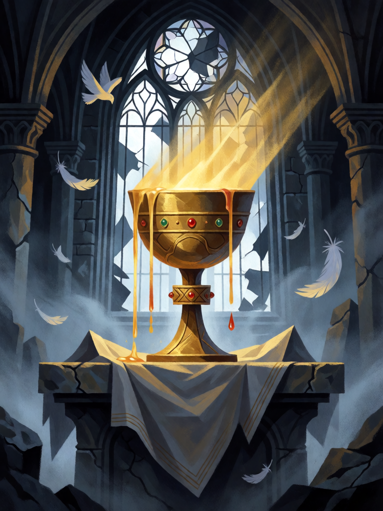

# Santo Graal

[← Cristianismo](../cristianismo.md) · [Wiki KodeX](../README.md) · [◀ Véu de Verônica](cri_veu_de_veronica.md) · [Arca da Aliança ▶](cri_arca_da_alianca.md)

| Carta | Arte |
|---|---|
|  |  |

| | |
|---|---|
| **Tradição** | Cristianismo |
| **Tipo** | Relíquia |
| **Custo de Fé** | 2 |
| **Palavras-chave** | — |
| **Lendária** | não |
| **Cópias no deck** | 1 |
| **Id** | `cri_santo_graal` |

## Texto da carta

> A portadora ganha +0/+2. Ao equipar, cure 4 da sua Cornucópia. Quando a portadora ataca, cure 2 dela.

**EN — Holy Grail:** *The bearer gains +0/+2. When equipped, heal your Cornucopia for 4. When the bearer attacks, heal it for 2.*

## Contexto mitológico

O cálice da Última Ceia — "tomou um cálice, deu graças e disse: tomai-o e distribuí-o entre vós" (Lc 22,17-20) — e o *graal* da literatura arturiana são duas tradições que se fundiram. Em Chrétien de Troyes (*Perceval ou le Conte du Graal*, c. 1190) o graal é um prato fundo levado em cortejo no castelo do Rei Pescador, que sustenta o velho rei com uma só hóstia. Robert de Boron (*Joseph d'Arimathie*, c. 1200) o identifica com o cálice da Ceia, no qual José de Arimateia recolheu o sangue de Cristo, e o traz à Bretanha. Daí a *Queste del Saint Graal* (c. 1225), onde só o puro Galaaz consegue contemplá-lo, e Wolfram von Eschenbach, para quem é uma pedra caída do céu.

Em todas as versões o Graal **alimenta e cura**: a mesa do Graal se enche de iguarias, as feridas do Rei Pescador só serão sanadas quando a pergunta certa for feita, Galaaz morre em êxtase ao vê-lo. Várias igrejas reivindicam o objeto — o Santo Cáliz de Valência, o de Génova —, mas o Graal pertence mais à imaginação do que à arqueologia: ele é a fonte que nunca se esgota.

A carta é essa fonte: cura a Cornucópia ao chegar, protege a portadora e a restaura a cada ataque.

## Papel no jogo

Sustentação. Os 4 de Cornucópia ao equipar valem por si; depois disso a portadora ganha 2 de Vida e recupera 2 por ataque, o que a mantém trocando por vários turnos (ideal em Serafim, Leviatã ou Miguel). Boa contra decks agressivos que já baixaram sua Cornucópia; fraca contra remoção dura, que leva Relíquia e portadora juntas. Não cure "por cima": a Vida não passa do máximo.

## Atributos visuais

cálice dourado simples · borda com gemas · luz líquida transbordando · altar com toalha branca · capela gótica em ruínas

Balanço (conta de custo)

Orçamento P = 2·C+1 = 5 pts, +1 grátis de Relíquia = 6. Gasto: +2 Vida permanente 2 + curar 4 Cornucópia (2 × "curar 2 = 1") 2 + curar 2 da portadora por ataque (gatilho repetível, valor cheio, sem Usos) 1 = 5. Dentro (faixa 4–6).

Ficha completa: `cartas/cristianismo/27_santo_graal.md` · cartas base da versão Alpha
