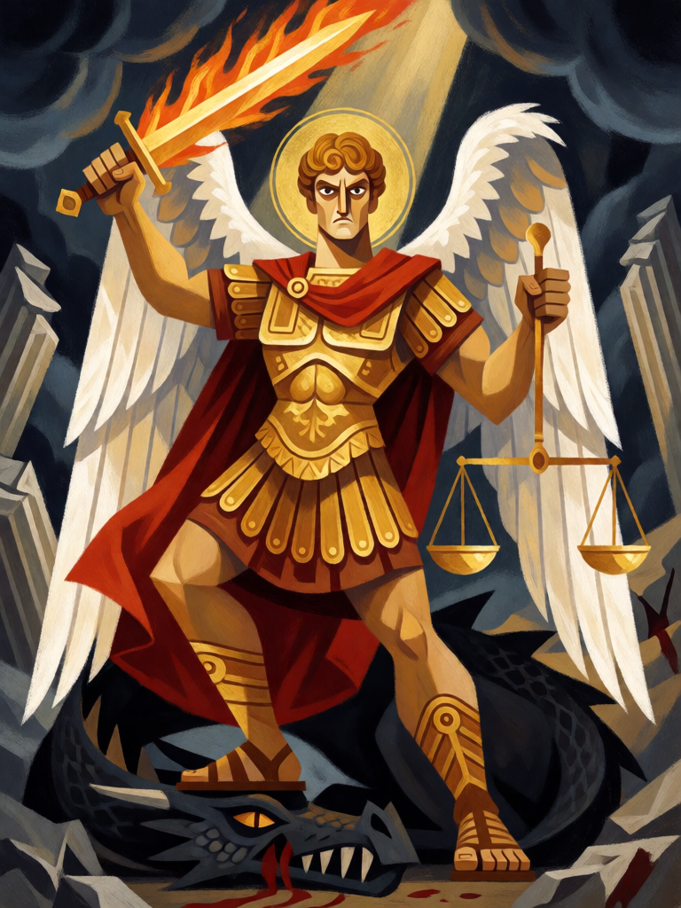

# São Miguel Arcanjo

[← Cristianismo](../cristianismo.md) · [Wiki KodeX](../README.md) · [◀ Elias, Carro de Fogo](cri_elias.md) · [Cova dos Leões ▶](cri_cova_dos_leoes.md)

| Carta | Arte |
|---|---|
|  |  |

| | |
|---|---|
| **Tradição** | Cristianismo |
| **Tipo** | Entidade |
| **Custo de Fé** | 7 |
| **ATK / DEF** | 5 / 6 |
| **Palavras-chave** | Guarda |
| **Lendária** | sim |
| **Cópias no deck** | 1 |
| **Id** | `cri_sao_miguel_arcanjo` |

## Texto da carta

> Lendária. Guarda. Despertar: destrói uma Entidade inimiga.

**EN — Saint Michael the Archangel:** *Legendary. Guard. Awaken: Destroy an enemy Entity.*

## Contexto mitológico

Miguel ("Quem é como Deus?") é "um dos primeiros príncipes" que vem em socorro de Daniel contra o príncipe da Pérsia (Dn 10,13) e "o grande príncipe que defende os filhos do teu povo" no tempo da angústia final (Dn 12,1). A Epístola de Judas lembra que ele disputou com o diabo o corpo de Moisés sem ousar julgá-lo por conta própria: "O Senhor te repreenda" (Jd 9). E o Apocalipse o faz general da guerra celeste: "Miguel e os seus anjos combateram contra o Dragão... e o grande Dragão foi precipitado, a antiga serpente, chamada Diabo e Satanás" (Ap 12,7-9).

A *Legenda Áurea* (cap. "São Miguel Arcanjo") acrescenta as aparições no Monte Gargano, na Apúlia, e o papel de psicopompo que recebe as almas e combaterá o Anticristo. A iconografia desenvolveu daí a psicostasia: é Miguel quem pesa as almas na balança no Juízo Final, como se vê nos tímpanos de Autun e Bourges e no políptico de Rogier van der Weyden em Beaune. Na iconografia é um guerreiro de armadura, lança ou espada em riste, o pé sobre o dragão derrubado, muitas vezes com a balança na outra mão.

A carta é o juiz-guerreiro: ao chegar, **julga** — destrói uma Entidade inimiga sem condição — e depois fica de **Guarda** entre o inimigo e os seus.

## Papel no jogo

O momento "uau" do deck e a única remoção incondicional. Chega no turno 7, elimina a maior ameaça do oponente e planta um 5/6 com Guarda que protege os Renascidos. Com a Arca da Aliança vira 5/9 e dá +1 ATK a todos. Revivê-lo por Talita Cumi ou Tumba Vazia devolve a muralha, não o julgamento: reviver para o campo não dispara Despertar (regras §8). Por ser caro, mãos sem Entidades baratas ficam a descoberto até ele chegar; e um `bounce` inimigo devolve 7 Fé de investimento à mão.

## Atributos visuais

espada flamejante na mão direita · balança dourada na esquerda · armadura dourada e capa vermelha · pé sobre a cabeça do dragão · asas brancas e auréola

Balanço (conta de custo)

Orçamento P = 2·C+1 = 15 pts; Lendária pode passar até +2 → 17. Gasto: ATK 5 + Vida 6 + Guarda 1 + destruir Entidade inimiga escolhida 5 = 17. Lendária +2.
Rodada 1 de balanceamento: era 6/6 (18 com `destroy` a 5 pts, acima do teto; 81 % de WR global).

Ficha completa: `cartas/cristianismo/12_sao_miguel_arcanjo.md` · cartas base da versão Alpha
