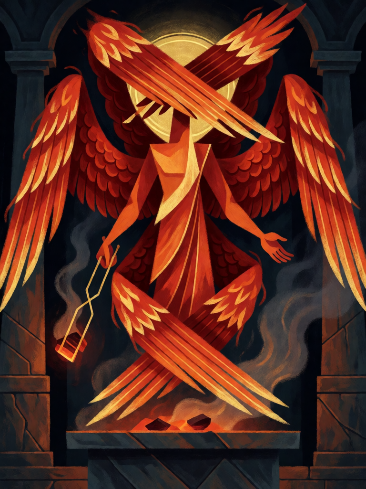

# Serafim

[← Cristianismo](../cristianismo.md) · [Wiki KodeX](../README.md) · [◀ Sansão](cri_sansao.md) · [Leviatã ▶](cri_leviata.md)

| Carta | Arte |
|---|---|
|  |  |

| | |
|---|---|
| **Tradição** | Cristianismo |
| **Tipo** | Entidade |
| **Custo de Fé** | 5 |
| **ATK / DEF** | 4 / 4 |
| **Palavras-chave** | Guarda |
| **Lendária** | não |
| **Cópias no deck** | 1 |
| **Id** | `cri_serafim` |

## Texto da carta

> Guarda. Despertar: silencia uma Entidade inimiga (perde palavras-chave e efeitos).

**EN — Seraph:** *Guard. Awaken: Silence an enemy Entity (it loses keywords and effects).*

## Contexto mitológico

Os serafins ("os ardentes", de *saraf*, queimar) aparecem uma única vez na Bíblia, na visão inaugural de Isaías: "Serafins estavam acima dele; cada um tinha seis asas: com duas cobriam o rosto, com duas cobriam os pés e com duas voavam. E clamavam: Santo, Santo, Santo é o Senhor dos Exércitos" (Is 6,2-3). Quando o profeta se declara "homem de lábios impuros", um serafim voa até ele com uma brasa tirada do altar e toca-lhe a boca: "a tua iniquidade foi tirada e o teu pecado, expiado" (Is 6,6-7).

Pseudo-Dionísio (*Da Hierarquia Celeste*, cap. 7) os põe no topo da primeira tríade, mais perto do trono que qualquer outro coro, e interpreta o nome como calor perpétuo, luz que purifica. Na arte bizantina e românica aparecem como rostos envolvidos em seis asas vermelhas, muitas vezes com os olhos nas asas.

A carta junta os dois traços: a posição de **Guarda** diante do trono e o **carvão purificador** — um toque que apaga o que havia de impuro na Entidade inimiga, deixando só o corpo.

## Papel no jogo

Primeiro corpo grande do deck, com Guarda para proteger os Renascidos e um `silence` que neutraliza a Entidade inimiga mais perigosa (tira Guarda inimiga para liberar ataques, apaga auras, Último Sopro e Renascer). O 4/4 segura bem o turno 5–6 enquanto Elias e Miguel chegam. Vulnerável a remoção dura (destroy), que é o que o oponente vai guardar para ele.

## Atributos visuais

exatamente seis asas de fogo · duas asas cobrindo o rosto · duas cobrindo os pés · tenaz de ouro com brasa · pairando sobre o altar

Balanço (conta de custo)

Orçamento P = 2·C+1 = 11 pts. Gasto: ATK 4 + Vida 4 + Guarda 1 + Silence (tabela §10) 2 = 11. Dentro.

Ficha completa: `cartas/cristianismo/09_serafim.md` · cartas base da versão Alpha
