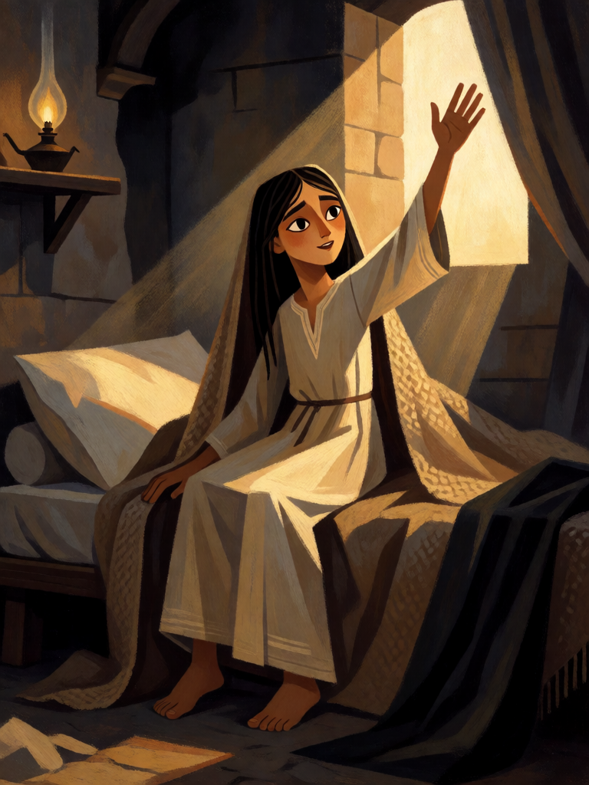

# Talita Cumi

[← Cristianismo](../cristianismo.md) · [Wiki KodeX](../README.md) · [◀ Praga dos Gafanhotos](cri_praga_dos_gafanhotos.md) · [Vale dos Ossos Secos ▶](cri_vale_dos_ossos_secos.md)

| Carta | Arte |
|---|---|
|  |  |

| | |
|---|---|
| **Tradição** | Cristianismo |
| **Tipo** | Rito |
| **Custo de Fé** | 3 |
| **Palavras-chave** | — |
| **Lendária** | não |
| **Cópias no deck** | 2 |
| **Id** | `cri_talita_cumi` |

## Texto da carta

> Reviva uma Entidade do seu cemitério para o campo.

**EN — Talitha Koum:** *Revive an Entity from your graveyard to the field.*

## Contexto mitológico

Jairo, chefe da sinagoga de Cafarnaum, cai aos pés de Jesus: a filha de doze anos está morrendo. No caminho, a hemorroíssa é curada ao tocar-lhe o manto, e chega a notícia de que a menina já morreu. Jesus entra na casa só com Pedro, Tiago e João e os pais, afasta os que choram e as carpideiras ("a menina não morreu, está dormindo"), toma-a pela mão e diz em aramaico: "*Talitha kum*" — "menina, eu te digo, levanta-te". "E imediatamente a menina se levantou e começou a andar" (Mc 5,21-43). Ele manda que lhe deem de comer.

É uma das três ressurreições dos evangelhos sinóticos, com o filho da viúva de Naim (Lc 7,11-17) e, em João, Lázaro. Marcos conserva as palavras no aramaico original, o que lhes dá o tom de fórmula — e é por isso que o nome da carta é a frase, não a cena. O Rito não representa quem fala; representa o que a palavra faz: alguém que estava morto se levanta e anda.

## Papel no jogo

O Rito de ressurreição do deck, ×2. Por 3 Fé devolve ao campo qualquer Entidade do cemitério — barato para um Lázaro ou um Anjo da Guarda, excelente para um Miguel (7 Fé de corpo com Guarda por 3). A Entidade volta cansada e **sem Despertar** (reviver para o campo não o dispara, regras §8): Talita devolve corpos e palavras-chave, não os golpes de entrada. Guarde uma cópia para a Lendária e a outra como seguro contra remoção. Com Juízo Final, o oponente perde tudo e você recomeça por 3. Precisa de um slot livre e de algo no cemitério.

## Atributos visuais

menina de 12 anos · túnica branca de linho de mangas longas · levantando-se do leito · mão estendida para a luz · casa de pedra da Galileia

Balanço (conta de custo)

Orçamento P = 2·C+1 = 7 pts. Gasto: reviver para o campo = 3 + custo ÷ 2; custo médio das 14 Entidades do deck = 51/14 ≈ 3,6 → 4,8; pior caso Miguel 3 + 3,5 = 6,5 ≤ 7. Dentro. A linha "Miguel morre → Talita Cumi → destrói de novo" deixou de existir com a regra de Despertar da rodada 1.

Ficha completa: `cartas/cristianismo/21_talita_cumi.md` · cartas base da versão Alpha
