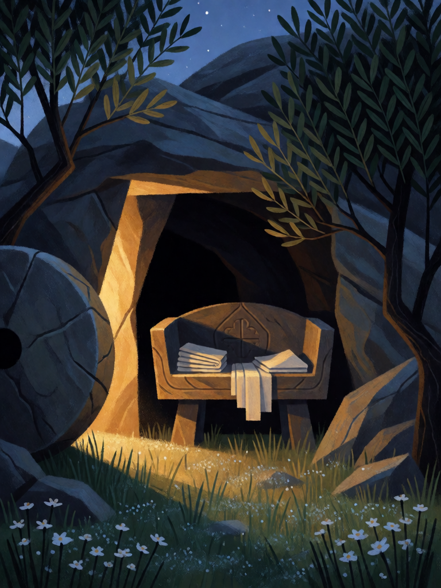

# Tumba Vazia

[← Cristianismo](../cristianismo.md) · [Wiki KodeX](../README.md) · [◀ Cova dos Leões](cri_cova_dos_leoes.md) · [Portão do Éden ▶](cri_portao_do_eden.md)

| Carta | Arte |
|---|---|
|  |  |

| | |
|---|---|
| **Tradição** | Cristianismo |
| **Tipo** | Selo |
| **Custo de Fé** | 2 |
| **Palavras-chave** | — |
| **Lendária** | não |
| **Cópias no deck** | 2 |
| **Id** | `cri_tumba_vazia` |

## Texto da carta

> Quando uma Entidade aliada morrer, reviva uma Entidade do seu cemitério para o campo.

**EN — Empty Tomb:** *When an allied Entity dies, revive an Entity from your graveyard to the field.*

## Contexto mitológico

Na manhã do primeiro dia da semana, as mulheres vão ao sepulcro com aromas e encontram a pedra removida. "Não vos assusteis. Buscais Jesus de Nazaré, o crucificado? Ressuscitou, não está aqui; eis o lugar onde o puseram" (Mc 16,6). João acrescenta a corrida de Pedro e do discípulo amado, as faixas de linho no chão e o sudário dobrado à parte (Jo 20,1-9). O sepulcro aberto e vazio é o centro da fé cristã: não uma descrição da ressurreição em si — nenhum evangelho a narra —, mas o seu sinal.

A carta se detém exatamente nesse sinal. Não representa Cristo; representa o **lugar**: a pedra rolada, a entrada escura, as faixas vazias. Na arte medieval e nos ícones da *Anástasis* o túmulo aberto é um portal; nas Marias ao Sepulcro de Duccio e de Fra Angelico, o vazio é a mensagem.

Como **Selo**, é a promessa escondida sob a derrota: quando o inimigo mata uma aliada no turno dele, a tumba se abre e alguém volta.

## Papel no jogo

Núcleo da identidade e por isso ×2. Em geral revive a própria Entidade que acabou de morrer (ela está no cemitério), anulando a remoção do oponente — mas o jogador pode escolher outra, como um Sansão ou um Miguel já caídos. A Entidade volta cansada e **sem Despertar** (reviver para o campo não o dispara, regras §8): Miguel volta como 5/6 Guarda, Elias como 4/5 com Renascer — o corpo, não o golpe de entrada. Não revive Entidades com Renascer que voltaram à mão (elas não estão no cemitério), então combine com Lázaro só depois que ele gastou o Renascer. Como todo Selo, só dispara no **turno do oponente**: não acorda com o seu Juízo Final nem com o Sacrifício do Leviatã. Inútil se o cemitério está vazio.

## Atributos visuais

pedra redonda rolada · entrada aberta e vazia · faixas de linho dobradas · sudário dobrado à parte · luz dourada saindo do túmulo

Balanço (conta de custo)

Orçamento P = 2·C+1 = 5 pts, +1 grátis de Selo = 6. Gasto: reviver para o campo = 3 + custo ÷ 2. Custo médio das 14 Entidades do deck = 51/14 ≈ 3,6 → 3 + 1,8 = **4,8**. Dentro. Pior caso (Miguel, custo 7): 3 + 3,5 = 6,5, +0,5 acima — não aplico o ×0,7 de "condicional" porque o +1 grátis do Selo já paga a condição. Mantido em 2 Fé.
Rodada 1 de balanceamento: o Analista propôs custo 3 por causa da linha "Miguel morre → Tumba → Miguel destrói de novo" (0,44 Lendária revivida por partida contra indígena). A regra nova "reviver para o campo não dispara Despertar" desfez a linha sem mexer na carta; o custo fica em 2 e a carta volta a ser observada na rodada 2.

Ficha completa: `cartas/cristianismo/14_tumba_vazia.md` · cartas base da versão Alpha
