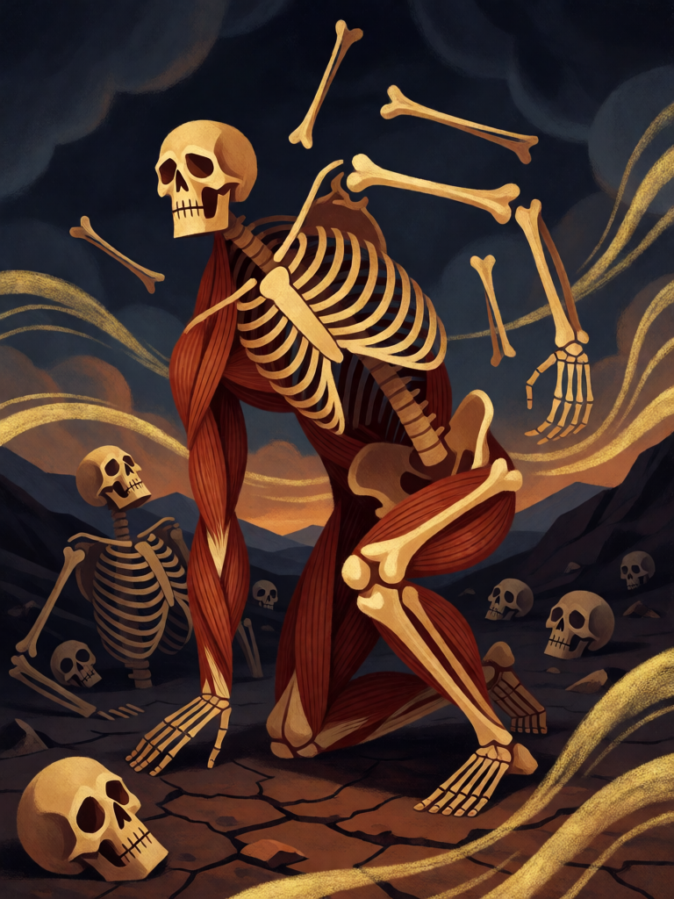

# Vale dos Ossos Secos

[← Cristianismo](../cristianismo.md) · [Wiki KodeX](../README.md) · [◀ Talita Cumi](cri_talita_cumi.md) · [Granizo e Fogo ▶](cri_granizo_e_fogo.md)

| Carta | Arte |
|---|---|
|  |  |

| | |
|---|---|
| **Tradição** | Cristianismo |
| **Tipo** | Rito |
| **Custo de Fé** | 3 |
| **Palavras-chave** | — |
| **Lendária** | não |
| **Cópias no deck** | 1 |
| **Id** | `cri_vale_dos_ossos_secos` |

## Texto da carta

> Invoque dois Ossos Erguidos 1/1. Reviva uma Entidade aleatória do seu cemitério para a mão.

**EN — Valley of Dry Bones:** *Summon two 1/1 Risen Bones. Return a random Entity from your graveyard to your hand.*

## Contexto mitológico

"A mão do Senhor veio sobre mim e me levou em espírito e me pôs no meio de um vale, que estava cheio de ossos; eram muitíssimos sobre a superfície do vale, e estavam sequíssimos" (Ez 37,1-2). Deus pergunta ao profeta se aqueles ossos podem viver e manda que ele profetize sobre eles. "Houve um ruído, e eis um rebuliço, e os ossos se achegaram, cada osso ao seu osso"; vêm nervos, carne, pele — e então o sopro dos quatro ventos, "e viveram e se puseram em pé, um exército muito grande" (Ez 37,7-10).

A visão é dirigida aos exilados na Babilônia — "estes ossos são toda a casa de Israel" — e promete o retorno à terra como ressurreição nacional. A tradição cristã a leu como profecia da ressurreição dos corpos; o painel da sinagoga de Dura-Europos (séc. III) e as *Homilias de Gregório de Nazianzo* (Paris gr. 510, séc. IX) mostram os esqueletos se recompondo e se levantando do chão. É uma das imagens mais poderosas da Bíblia sobre a vida que volta ao que está morto há muito tempo.

Como **Rito**, são dois movimentos: os ossos se levantam como exército (tokens) e o sopro traz de volta algo do cemitério — aleatório, porque o vento sopra onde quer.

## Papel no jogo

Recupera campo e mão num só gasto. Os dois 1/1 são bloqueadores descartáveis, alimentam Tumba Vazia ao morrer no turno do oponente e são a oferenda ideal para o Sacrifício do Leviatã; a Entidade revivida para a mão é jogada de novo no turno seguinte, com Despertar. Melhor no meio do jogo, com dois ou três corpos no cemitério e slots livres. Precisa de slots: com o campo cheio, só o revive acontece.

## Atributos visuais

esqueleto se levantando · ossos se juntando no ar · tendões e carne se formando · segundo esqueleto ao fundo · vento dourado dos quatro cantos

Balanço (conta de custo)

Orçamento P = 2·C+1 = 7 pts. Gasto: invocar 2 tokens 1/1 (1+1) × 2 = 4 + reviver para a mão 2 × aleatório 0,8 = 1,6 → 5,6. Dentro.

Ficha completa: `cartas/cristianismo/22_vale_dos_ossos_secos.md` · cartas base da versão Alpha
