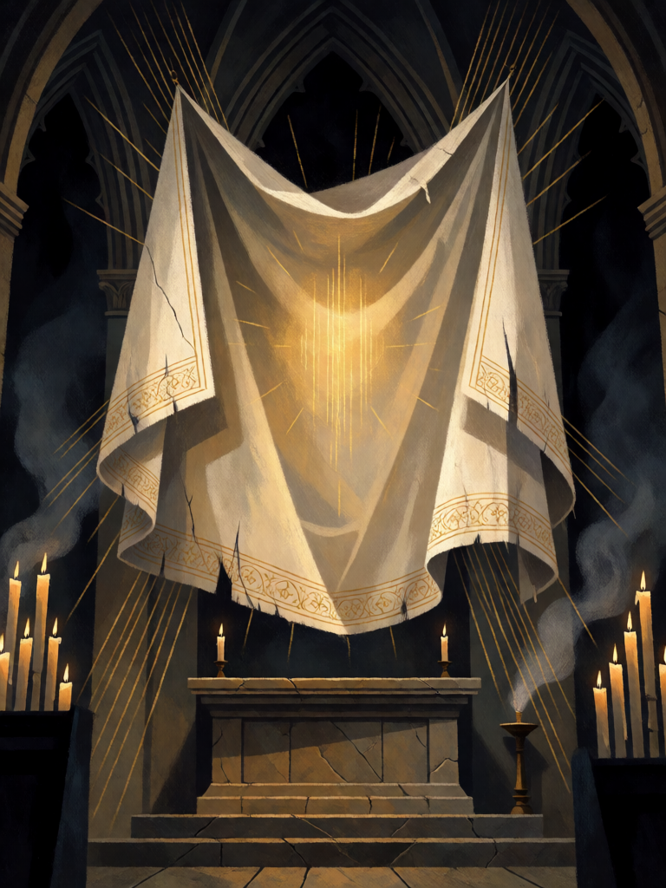

# Véu de Verônica

[← Cristianismo](../cristianismo.md) · [Wiki KodeX](../README.md) · [◀ Funda de Davi](cri_funda_de_davi.md) · [Santo Graal ▶](cri_santo_graal.md)

| Carta | Arte |
|---|---|
|  |  |

| | |
|---|---|
| **Tradição** | Cristianismo |
| **Tipo** | Relíquia |
| **Custo de Fé** | 2 |
| **Palavras-chave** | — |
| **Lendária** | não |
| **Cópias no deck** | 1 |
| **Id** | `cri_veu_de_veronica` |

## Texto da carta

> A portadora ganha +1/+2 e Renascer.

**EN — Veil of Veronica:** *The bearer gains +1/+2 and Rebirth.*

## Contexto mitológico

Verônica não está nos evangelhos. A lenda nasce dos *Atos de Pilatos* e da *Cura de Tibério* (séc. IV–VII) e se fixa na *Legenda Áurea*, no relato da *Vindicta Salvatoris*: uma mulher de Jerusalém, Verônica, possui um pano com o retrato de Cristo impresso — não pintado por mão humana — e é levada a Roma, onde o imperador Tibério, doente, é curado ao contemplá-lo. A partir do séc. XIII a história se funde com a Via Sacra: Verônica enxuga o rosto de Jesus a caminho do Calvário e o pano guarda a imagem (6ª estação).

O nome é a própria explicação: *vera icona*, a "imagem verdadeira". A relíquia foi exposta em São Pedro desde 1208 e atraía peregrinos de toda a Europa — Dante a menciona no *Paraíso* (XXXI, 103-108) como aquela imagem que o peregrino croata não se cansa de olhar. O véu de Verônica, com o rosto no linho, tornou-se um dos motivos mais repetidos da arte do fim da Idade Média (Mestre de Flémalle, Zurbarán).

A carta traduz os dois poderes atribuídos ao véu: ele **cura** quem o porta (Vida) e carrega uma imagem que vence a morte — a portadora ganha **Renascer**.

## Papel no jogo

Dá Renascer a quem **não** tem: Sansão volta e derruba o templo duas vezes; Judite volta e decapita de novo; Serafim e Miguel voltam para a mão em vez de para o cemitério. **Não** dá um "segundo Renascer" a Lázaro, Jonas ou Elias — palavras-chave são um conjunto, não acumulam; neles o Véu vale só o +1/+2. O +1/+2 torna a portadora mais difícil de matar no caminho. Quando a portadora renasce, a Relíquia vai ao cemitério — é o preço. Péssimo alvo: tokens, que somem em vez de voltar. Lembre que o Sacrifício do Leviatã não aciona o Renascer concedido.

## Atributos visuais

véu quadrado de linho branco · brilho dourado suave no centro · bainha bordada a ouro · flutuando sobre altar · velas e incenso

Balanço (conta de custo)

Orçamento P = 2·C+1 = 5 pts, +1 grátis de Relíquia = 6. Gasto: +1 ATK permanente 1 + +2 Vida permanente 2 + Renascer 2 = 5. Dentro.

Ficha completa: `cartas/cristianismo/26_veu_de_veronica.md` · cartas base da versão Alpha
