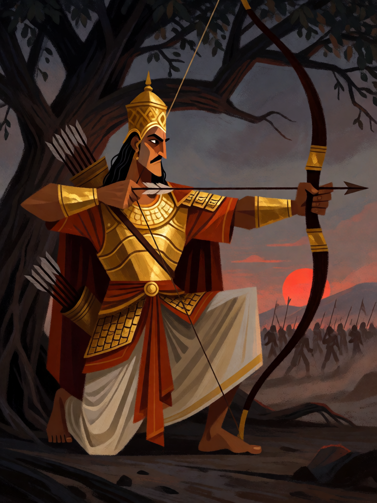

# Arjuna

[← Hinduísmo](../hinduismo.md) · [Wiki KodeX](../README.md) · [◀ Ganesha, Removedor de Obstáculos](hin_ganesha.md) · [Hanuman ▶](hin_hanuman.md)

| Carta | Arte |
|---|---|
|  |  |

| | |
|---|---|
| **Tradição** | Hinduísmo |
| **Tipo** | Entidade |
| **Custo de Fé** | 3 |
| **ATK / DEF** | 2 / 2 |
| **Palavras-chave** | Furtivo |
| **Lendária** | não |
| **Cópias no deck** | 1 |
| **Id** | `hin_arjuna` |

## Texto da carta

> Furtivo. Ao atacar, causa 1 de dano a uma Entidade inimiga à sua escolha.

**EN — Arjuna:** *Stealth. When this attacks, deal 1 damage to an enemy Entity of your choice.*

## Contexto mitológico

Arjuna é o terceiro dos cinco Pandavas, filho de Kunti com o deus Indra, e o maior arqueiro do Mahabharata. Discípulo predileto de Drona, ganha o arco Gandiva e duas aljavas inesgotáveis no incêndio da floresta de Khandava (Adi Parva). No Vana Parva, pratica ascese no Himalaia até que Shiva, disfarçado de caçador kirata, o testa em combate e lhe concede o Pashupatastra. É a Arjuna que Krishna, seu auriga, ensina a Bhagavad Gita no campo de Kurukshetra, quando o herói hesita diante de matar parentes e mestres.

A palavra-chave Furtivo vem do Virata Parva: no último ano de exílio, os Pandavas devem viver incógnitos, e Arjuna passa esse ano na corte do rei Virata disfarçado de Brihannala, professor(a) de dança das princesas, com o Gandiva escondido numa árvore. Ninguém o reconhece — até o dia em que ele retoma o arco e, sozinho, derrota o exército Kaurava inteiro que viera roubar o gado de Virata.

A flecha extra ao atacar lembra que Arjuna raramente dispara uma seta só.

## Papel no jogo

Pode ser invocado sem medo de remoção: enquanto não atacar, Ritos e Selos inimigos não o alcançam, o que o torna o portador mais seguro do deck para Gandiva (a Relíquia equipa antes do primeiro ataque; Arjuna vira 5/4 e cada ataque dele chove flechas no campo inimigo) ou Trishula. O ping ao atacar termina um corpo ferido ou mata um token antes do combate. Com Krishna em campo ganha Ímpeto e vira ameaça imediata. Fraco: corpo 2/2 — sem Relíquia, é um arqueiro sem arco; depois do primeiro ataque, morre fácil.

## Atributos visuais

arqueiro adulto indiano · arco longo Gandiva retesado com flecha · armadura dourada e coroa · meio escondido na sombra de uma árvore

Balanço (conta de custo)

Orçamento P = 2·3+1 = 7 pts. Gasto: ATK 2 + Vida 2 + Furtivo 1 + 1 de dano a alvo escolhido a cada ataque (repetível, sem Usos: 1 × 2 = 2) = 7. Dentro.
Revisão: era 3/2 (total 8, acima de P); o ping repetível vale cheio, então o corpo caiu para 2/2.

Ficha completa: `cartas/hinduismo/05_arjuna.md` · cartas base da versão Alpha
