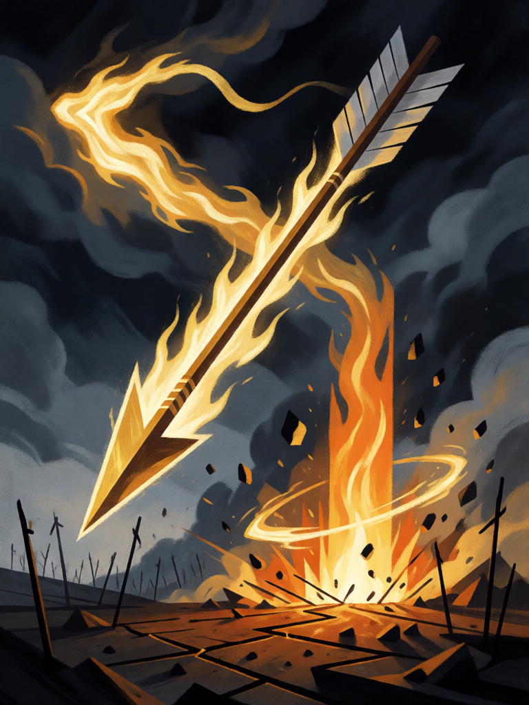

# Brahmastra

[← Hinduísmo](../hinduismo.md) · [Wiki KodeX](../README.md) · [◀ Samudra Manthan](hin_samudra_manthan.md) · [Descida do Avatar ▶](hin_descida_do_avatar.md)

| Carta | Arte |
|---|---|
|  |  |

| | |
|---|---|
| **Tradição** | Hinduísmo |
| **Tipo** | Rito |
| **Custo de Fé** | 3 |
| **Palavras-chave** | — |
| **Lendária** | não |
| **Cópias no deck** | 1 |
| **Id** | `hin_brahmastra` |

## Texto da carta

> Destrua uma Entidade inimiga.

**EN — Brahmastra:** *Destroy an enemy Entity.*

## Contexto mitológico

O Brahmastra é a arma de Brahma, o criador — a mais temida das astras (armas invocadas por mantra) das epopeias. Não é um objeto: é um mantra que se infunde em qualquer flecha ou mesmo numa folha de grama, e que só se aprende de um mestre após longa disciplina. Uma vez disparada, não pode ser retirada; só outro Brahmastra a neutraliza, e onde ela cai a terra fica estéril por gerações.

No Ramayana, Rama a recebe do sábio Agastya e com ela, no último dia da guerra, mata Ravana — a flecha de Brahma atravessa o peito do rei de Lanka e volta à aljava. No Mahabharata, Drona a ensina a Arjuna e a Ashwatthama; Karna a aprende de Parashurama, mas é amaldiçoado a esquecê-la na hora decisiva. No fim da guerra (Sauptika Parva), Ashwatthama, derrotado, dispara o Brahmastra contra Arjuna, que responde com o seu; os sábios Narada e Vyasa interpõem-se e ordenam que ambos recolham as armas — Arjuna consegue, Ashwatthama não sabe como, e desvia a dele para o ventre das mulheres Pandava, condenando os filhos por nascer. Krishna o amaldiçoa a vagar três mil anos.

O Rito é o disparo: um alvo é apagado, e tudo ao redor sente o calor.

## Papel no jogo

A arma única: por 3 Fé, tira do jogo a maior ameaça inimiga — e só ela. Abre caminho para o ataque de Hanuman no mesmo turno a partir do turno 7 (3 + 4 Fé). Em deck com poucas respostas, é a carta que se guarda para a Lendária adversária; contra tokens, use Lanka ou Kali. Fraco: não afeta a Cornucópia, e contra campo vazio é carta morta.

## Atributos visuais

flecha divina em chamas descendo do céu · rastro de fogo dourado · coluna de fogo no impacto · campo de batalha estéril

Balanço (conta de custo)

Orçamento P = 2·3+1 = 7 pts. Gasto: destruir Entidade inimiga escolhida 5 = 5. Dentro (P−2). Custo mínimo para `destroy` (3) respeitado.
Rodada 1 de balanceamento: era custo 3 com 2 em área (8 pts em P = 7 com `destroy` a 5); subiu para 4.
Rodada 2 de balanceamento (pacote H1 do Analista): volta a custo 3 e perde a área (−0,8 pp medido): o deck precisa de menos dano em área, não de remoção mais cara.

Ficha completa: `cartas/hinduismo/22_brahmastra.md` · cartas base da versão Alpha
