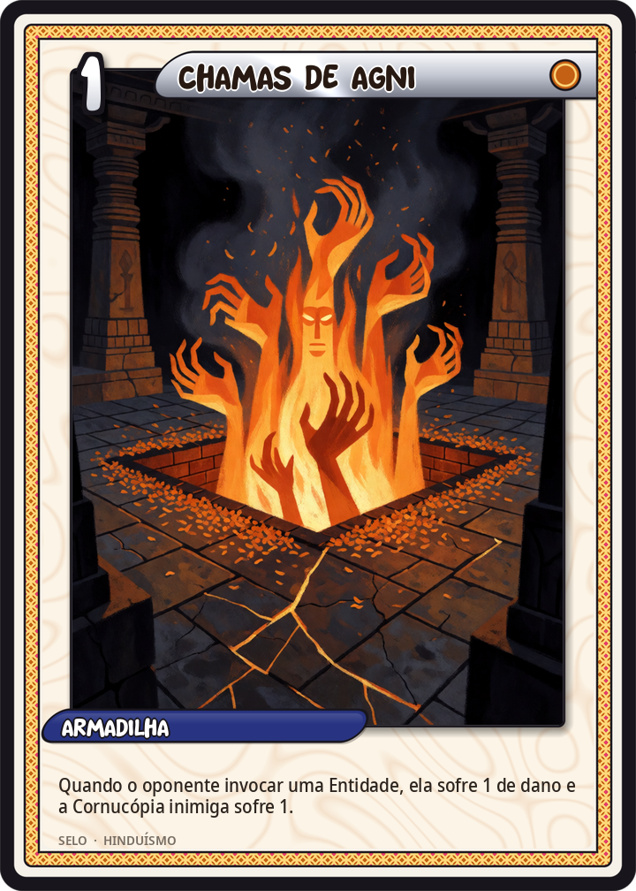
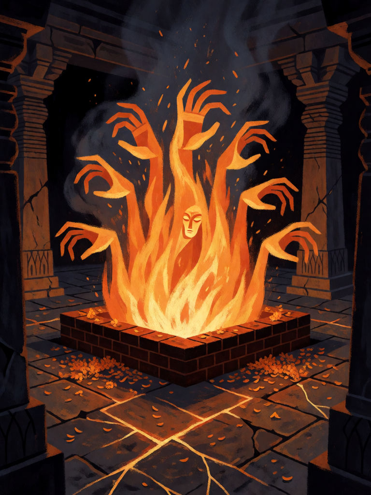

# Chamas de Agni

[← Hinduísmo](../hinduismo.md) · [Wiki KodeX](../README.md) · [◀ Shiva Nataraja](hin_shiva_nataraja.md) · [Roda do Samsara ▶](hin_roda_do_samsara.md)

| Carta | Arte |
|---|---|
|  |  |

| | |
|---|---|
| **Tradição** | Hinduísmo |
| **Tipo** | Selo |
| **Custo de Fé** | 1 |
| **Palavras-chave** | — |
| **Lendária** | não |
| **Cópias no deck** | 1 |
| **Id** | `hin_chamas_de_agni` |
| **Arte** | provisória nesta Alpha |

## Texto da carta

> Quando o oponente invocar uma Entidade, ela sofre 1 de dano e a Cornucópia inimiga sofre 1.

**EN — Flames of Agni:** *When your opponent summons an Entity, it takes 1 damage and the enemy Cornucopia takes 1.*

## Contexto mitológico

Agni é o fogo e o deus do fogo, uma das três divindades centrais do Rigveda ao lado de Indra e Soma: o primeiro hino do primeiro livro (RV 1.1) começa com seu nome — "Agni eu invoco, o sacerdote posto à frente". Ele é a boca dos deuses: tudo o que se verte no fogo do sacrifício — manteiga clarificada, grãos, soma — é Agni quem leva ao céu. Tem duas cabeças (o fogo doméstico e o fogo sacrificial), sete línguas de chama, cabelos em brasa, e cavalga um carneiro.

Agni é também o fogo que purifica e o que consome: é ele quem, faminto, pede a Krishna e Arjuna que lhe deem a floresta de Khandava para devorar (Mahabharata, Adi Parva) e, em troca, lhes entrega o Gandiva e o Sudarshana Chakra. É Agni quem recebe Sita na prova do fogo e a devolve intacta. Em todo rito hindu de passagem — nascimento, casamento, cremação — o fogo está presente como testemunha.

O Selo é o fogo que recebe o que chega: quem entra no campo do inimigo passa pelas chamas antes de se firmar.

## Papel no jogo

Selo barato de pressão: o oponente invoca e seu novo corpo já chega ferido (mata um 1 de Vida; deixa um 2 de Vida ao alcance de Garuda), enquanto a Cornucópia perde mais 1. Colocado no turno 1 ou 2, custa quase nada e pune a primeira invocação adversária. Fraco contra Entidades grandes (1 de dano não muda a conta de um 5/6) e inútil se o oponente já não joga Entidades.

## Atributos visuais

altar de tijolos escondido · sete línguas de fogo · rosto tênue nas chamas · pétalas de cravo-de-defunto · pátio escuro de templo

Balanço (conta de custo)

Orçamento P = 2·1+1 = 3 pts (+1 Selo = 4). Gasto: 1 de dano a Entidade (alvo gatilho) 1 + 1 de dano direto à Cornucópia 2 = 3. Dentro (P−1).
Rodada 2 de balanceamento (pacote H1 do Analista): dano à Entidade 2 → 1 (−0,9 pp medido).

Ficha completa: `cartas/hinduismo/13_chamas_de_agni.md` · cartas base da versão Alpha
