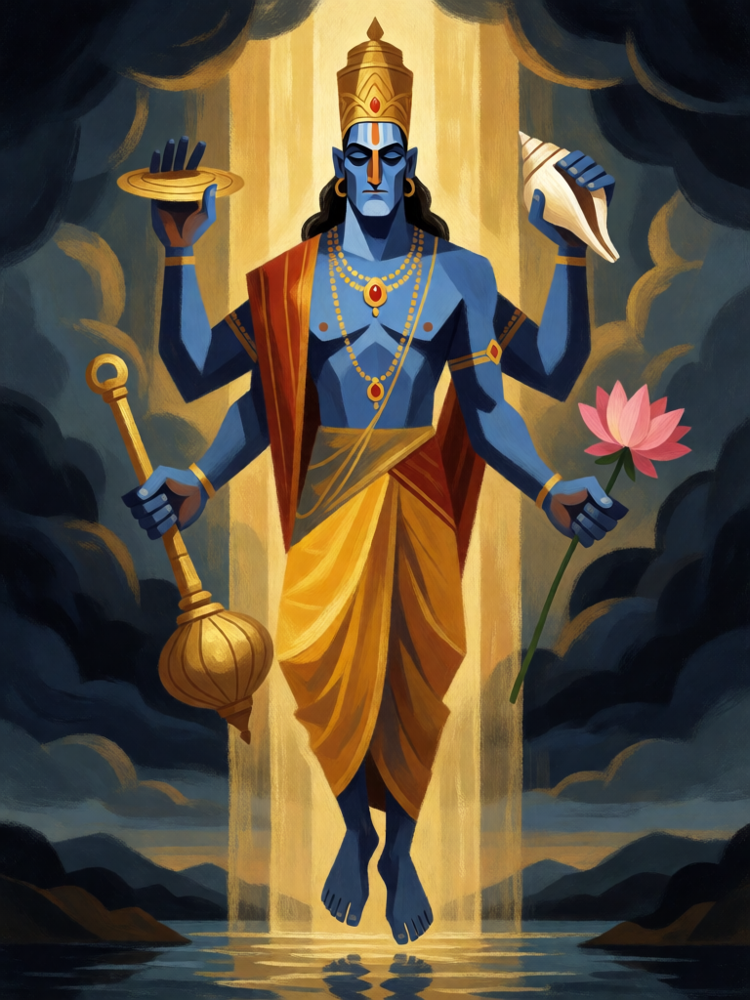

# Descida do Avatar

[← Hinduísmo](../hinduismo.md) · [Wiki KodeX](../README.md) · [◀ Brahmastra](hin_brahmastra.md) · [Vishvarupa, a Forma Universal ▶](hin_vishvarupa.md)

| Carta | Arte |
|---|---|
|  |  |

| | |
|---|---|
| **Tradição** | Hinduísmo |
| **Tipo** | Rito |
| **Custo de Fé** | 3 |
| **Palavras-chave** | — |
| **Lendária** | não |
| **Cópias no deck** | 1 |
| **Id** | `hin_descida_do_avatar` |

## Texto da carta

> Reviva uma Entidade do seu cemitério para o campo.

**EN — Descent of the Avatar:** *Revive an Entity from your graveyard to the field.*

## Contexto mitológico

*Avatara* significa literalmente "descida": o deus que desce ao mundo numa forma — peixe, tartaruga, javali, homem-leão, anão, guerreiro, príncipe, pastor — para restaurar o que se perdeu. O princípio está formulado na Bhagavad Gita (4.7–8), na voz de Krishna: "Sempre que o dharma declina e o adharma se levanta, ó Bharata, eu me manifesto. Para proteger os bons, destruir os maus e restabelecer o dharma, eu nasço era após era."

A lista dos dez avatares (Dashavatara) se fixa nos Puranas — Bhagavata 1.3 enumera mais de vinte manifestações antes de dizer que "as encarnações do Senhor são incontáveis, como os riachos que nascem de um lago inesgotável". Cada descida tem uma missão e um fim: Rama volta a Vaikuntha depois de reinar, Krishna deixa o corpo depois de Kurukshetra; e a seguinte descida está sempre prometida. O que morre não acaba — é chamado de volta quando é preciso.

O Rito é essa promessa cumprida: o avatar que caiu desce de novo, inteiro, com a mesma tarefa.

## Papel no jogo

O coração do ciclo de renascimento: devolve ao campo qualquer Entidade do cemitério — Hanuman, para atacar de novo no turno seguinte; Shiva ou Kali, por 3 Fé em vez de 6–7, como corpo grande de volta à mesa. O avatar desce **sem o Despertar** (reviver para o campo não o dispara, regras §8): o que volta é o corpo, a palavra-chave (Ímpeto de Shiva, Renascer de Rama) e os gatilhos contínuos (o `enemy_dies` de Kali). Com Krishna em campo, o revivido ataca na hora. Fraca cedo no jogo, com cemitério vazio.

## Atributos visuais

homem adulto de pele azul · exatamente quatro braços com disco, concha, maça e lótus · coroa alta dourada · descendo do céu numa coluna de luz

Balanço (conta de custo)

Orçamento P = 2·3+1 = 7 pts. Gasto: reviver Entidade para o campo = 3 + custo dela ÷ 2 — pior caso Shiva (custo 7): 3 + 3,5 = 6,5; caso típico Hanuman (custo 4): 5. Dentro.

Ficha completa: `cartas/hinduismo/23_descida_do_avatar.md` · cartas base da versão Alpha
