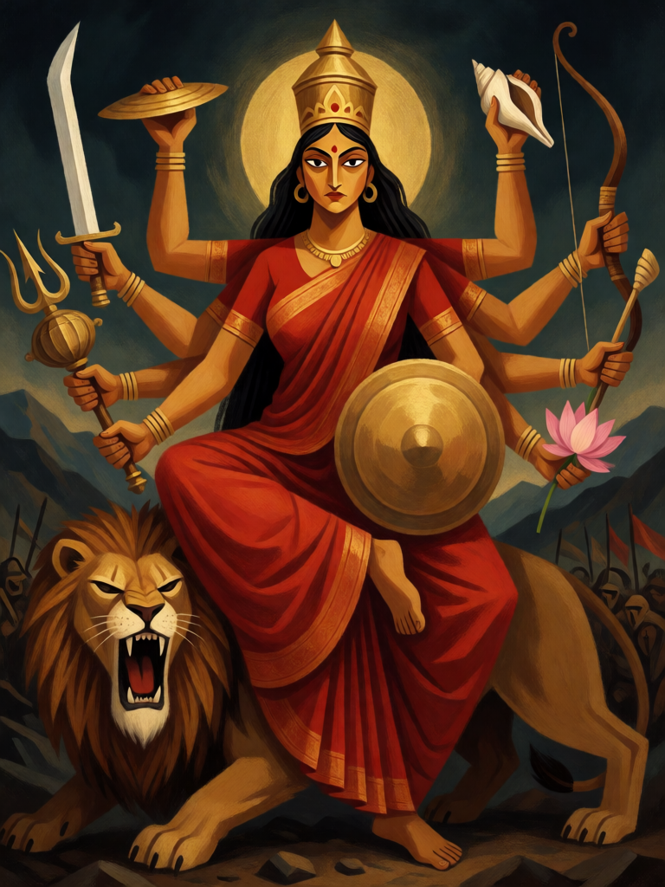

# Durga, a Fortaleza

[← Hinduísmo](../hinduismo.md) · [Wiki KodeX](../README.md) · [◀ Krishna, o Auriga](hin_krishna.md) · [Kali ▶](hin_kali.md)

| Carta | Arte |
|---|---|
|  |  |

| | |
|---|---|
| **Tradição** | Hinduísmo |
| **Tipo** | Entidade |
| **Custo de Fé** | 5 |
| **ATK / DEF** | 4 / 5 |
| **Palavras-chave** | Ímpeto, Guarda |
| **Lendária** | não |
| **Cópias no deck** | 1 |
| **Id** | `hin_durga` |

## Texto da carta

> Ímpeto. Guarda.

**EN — Durga, the Fortress:** *Rush. Guard.*

## Contexto mitológico

Durga ("a inacessível", "a fortaleza") é a forma guerreira da Deusa (Devi, Shakti). O Devi Mahatmya, inserido no Markandeya Purana (séc. V–VI) e recitado inteiro nos nove dias do Navaratri, conta sua origem: o asura-búfalo Mahishasura expulsou os deuses do céu, protegido por uma bênção que o tornava invencível a qualquer homem ou deus. Da cólera reunida de Vishnu, Shiva, Brahma, Indra e todos os demais saiu uma luz que tomou forma de mulher, e cada deus lhe entregou uma arma: o tridente de Shiva, o disco de Vishnu, a concha de Varuna, a lança de Agni, o arco de Vayu, o raio de Indra, o laço de Yama. Himavat lhe deu o leão.

Durga desfez o exército dos asuras e, quando Mahishasura mudou de forma — búfalo, leão, homem, elefante, búfalo de novo —, pisou-lhe o pescoço e o atravessou com o tridente: Mahishasuramardini, "esmagadora do búfalo", a imagem mais reproduzida da deusa. No texto ela ri na batalha e bebe vinho antes do golpe final; sua fúria é a de uma mãe protegendo os filhos. A tradição do Navaratri celebra essa batalha em nove noites e a vitória no décimo dia, o Vijayadashami.

A carta a mostra como foi concebida: toda a força dos deuses num só corpo que avança (Ímpeto) e se interpõe entre o inimigo e os seus (Guarda).

## Papel no jogo

A única Entidade defensiva do deck — e mesmo ela ataca no turno em que entra. Com Guarda, protege Krishna e os portadores de Relíquia frágeis (Arjuna, Garuda) de ataques diretos; com 5 de Vida sobrevive a duas trocas. Em deck tão ofensivo, é a carta que se joga quando o oponente ameaça virar o jogo. Fraca contra remoção (destroy, bounce) — aí é um 5 Fé perdido.

## Atributos visuais

mulher adulta indiana · exatamente oito braços, uma arma em cada mão · montada num leão · sari vermelho cobrindo o peito · postura de guarda de frente

Balanço (conta de custo)

Orçamento P = 2·5+1 = 11 pts. Gasto: ATK 4 + Vida 5 + Ímpeto 1 + Guarda 1 = 11. Dentro.

Ficha completa: `cartas/hinduismo/10_durga.md` · cartas base da versão Alpha
