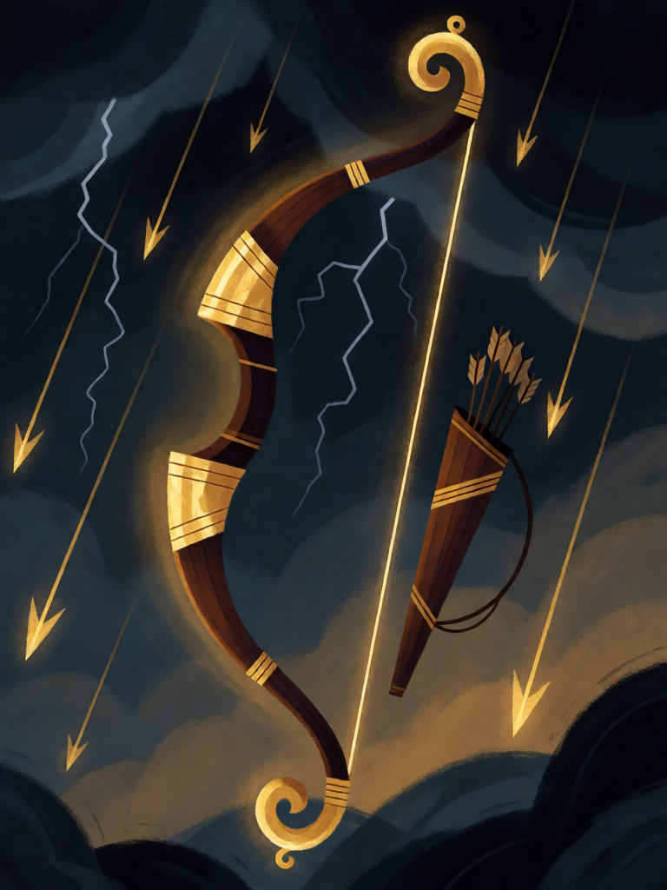

# Gandiva

[← Hinduísmo](../hinduismo.md) · [Wiki KodeX](../README.md) · [◀ Sudarshana Chakra](hin_sudarshana_chakra.md) · [Trishula ▶](hin_trishula.md)

| Carta | Arte |
|---|---|
|  |  |

| | |
|---|---|
| **Tradição** | Hinduísmo |
| **Tipo** | Relíquia |
| **Custo de Fé** | 3 |
| **Palavras-chave** | — |
| **Lendária** | não |
| **Cópias no deck** | 1 |
| **Id** | `hin_gandiva` |

## Texto da carta

> Portadora: +3 ATK / +1 Vida. Quando a portadora atacar, causa 1 de dano a todas as Entidades inimigas.

**EN — Gandiva:** *Bearer: +3 ATK / +1 Health. When the bearer attacks, deal 1 damage to all enemy Entities.*

## Contexto mitológico

O Gandiva é o arco de Arjuna, o mais famoso do Mahabharata. Feito por Brahma, passou por Prajapati, Indra, Soma e Varuna até que, no episódio do incêndio de Khandava (Adi Parva), Agni, querendo devorar a floresta protegida por Indra, pede ajuda a Krishna e Arjuna; para que o herói possa enfrentar a chuva de Indra, Varuna lhe entrega o Gandiva, duas aljavas inesgotáveis e um carro com cavalos brancos. O arco é indestrutível e sua corda, ao vibrar, soa como o trovão; as aljavas que o acompanham nunca se esvaziam.

Com o Gandiva, Arjuna vence os deuses em Khandava, derrota sozinho o exército Kaurava em Virata, mata Jayadratha, Karna e milhares de guerreiros ao longo dos dezoito dias. É por isso que seu epíteto é *Gandivadhari*, "portador do Gandiva" — e por isso Krishna, na Gita, repreende-o ao vê-lo largar o arco (1.30: "o Gandiva me escorrega da mão"). No fim do Mahabharata, Agni pede que Arjuna devolva o arco às águas, porque sua tarefa está cumprida.

Na carta, cada ataque da portadora é a chuva de flechas de Virata: o alvo principal recebe o golpe, e todo o campo inimigo recebe uma seta.

## Papel no jogo

A Relíquia de pressão em área: +3/+1 faz de qualquer corpo uma ameaça, e cada ataque fere 1 em todas as Entidades inimigas — tokens somem, corpos feridos por Garuda e Kali terminam de morrer, e o campo adversário se esvazia para os ataques diretos do turno seguinte. Sobre Arjuna (Furtivo até atacar) a Relíquia é equipada em segurança; sobre Hanuman, a soma de ATK cresce a cada turno. Fraca contra bounce e remoção da portadora, e contra um único corpo grande.

## Atributos visuais

arco longo recurvo de madeira escura e ouro · corda brilhante · aljava cheia ao lado · chuva de flechas luminosas ao fundo

Balanço (conta de custo)

Orçamento P = 2·3+1 = 7 pts (+1 Relíquia = 8). Gasto: +3 ATK 3 + +1 Vida 1 + 1 de dano a todas as inimigas a cada ataque (repetível, sem Usos: 1,5 × 2 = 3) = 7. Dentro (P−1).
Rodada 2 de balanceamento (pacote H1 do Analista): +2 → +1 Vida (pacote de Relíquias).
Revisão: era "1 à Cornucópia e 1 a uma Entidade por ataque" — como repetível cheio valia 11 e era dano direto sem teto (estourava o limite do deck de ≤ 8). O dano direto saiu; virou dano em área.

Ficha completa: `cartas/hinduismo/28_gandiva.md` · cartas base da versão Alpha
