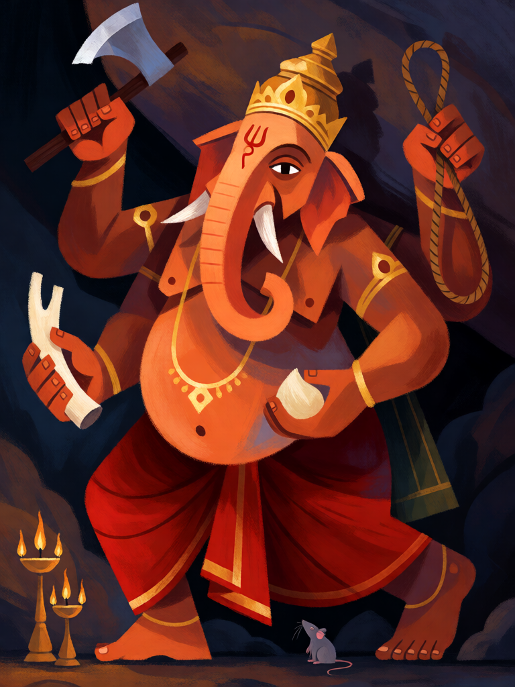

# Ganesha, Removedor de Obstáculos

[← Hinduísmo](../hinduismo.md) · [Wiki KodeX](../README.md) · [◀ Jatayu](hin_jatayu.md) · [Arjuna ▶](hin_arjuna.md)

| Carta | Arte |
|---|---|
|  |  |

| | |
|---|---|
| **Tradição** | Hinduísmo |
| **Tipo** | Entidade |
| **Custo de Fé** | 3 |
| **ATK / DEF** | 2 / 3 |
| **Palavras-chave** | — |
| **Lendária** | não |
| **Cópias no deck** | 1 |
| **Id** | `hin_ganesha` |
| **Arte** | provisória nesta Alpha |

## Texto da carta

> Despertar: devolva uma Entidade inimiga à mão do dono.

**EN — Ganesha, Remover of Obstacles:** *Awaken: Return an enemy Entity to its owner's hand.*

## Contexto mitológico

Ganesha (Ganapati, Vinayaka) é o deus de cabeça de elefante, filho de Parvati e Shiva, e uma das divindades mais amadas da Índia: é invocado antes de qualquer começo — uma viagem, um casamento, a primeira página de um livro. Seu epíteto mais comum é *Vighnaharta* ou *Vighneshvara*, "o que remove (e governa) os obstáculos".

O Shiva Purana (Rudra Samhita) conta a origem da cabeça: Parvati molda um menino com a pasta do próprio banho e o põe de guarda à porta. Shiva, voltando, é barrado pelo guardião desconhecido e, na luta, corta-lhe a cabeça. Diante do desespero de Parvati, Shiva manda buscar a cabeça do primeiro ser encontrado — um elefante — e a põe no corpo do menino, fazendo-o chefe (*gana-pati*) de seus séquitos. No Mahabharata (prólogo do Adi Parva), é Ganesha quem escreve o poema inteiro ditado por Vyasa, com a condição de que o sábio nunca pare de ditar.

Na carta, remover obstáculos é literal: a Entidade inimiga que trava o caminho é tirada da mesa.

## Papel no jogo

Resposta de turno 3 a uma Guarda ou a um corpo grande que o oponente pagou caro: o alvo volta para a mão, ele perde o tempo investido e o campo se abre para os atacantes com Ímpeto. Também recoloca na mão um inimigo buffado por Relíquia (a Relíquia vai ao cemitério). O corpo 2/3 segura a linha depois. Fraco contra tokens e corpos baratos — devolver custo 1 não vale 3 Fé.

## Atributos visuais

cabeça de elefante · presa direita quebrada, só a esquerda inteira · exatamente quatro braços · machado, laço, doce modak e presa quebrada nas mãos · rato pequeno aos pés

Balanço (conta de custo)

Orçamento P = 2·3+1 = 7 pts. Gasto: ATK 2 + Vida 3 + devolver Entidade inimiga à mão 2 = 7. Dentro.

Ficha completa: `cartas/hinduismo/04_ganesha.md` · cartas base da versão Alpha
