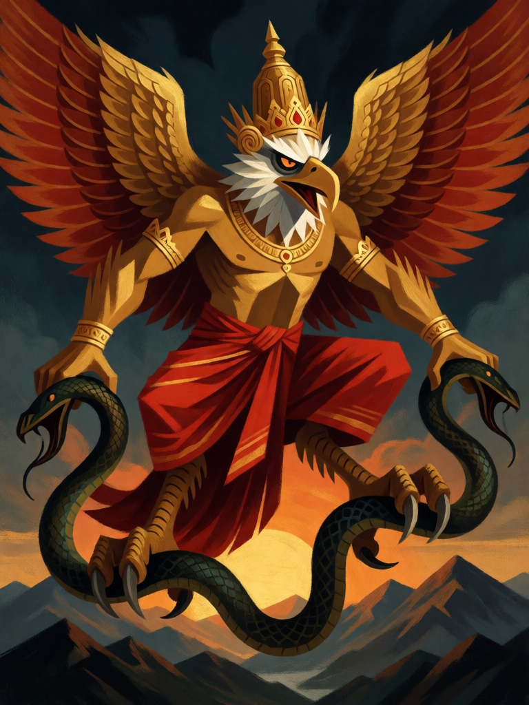

# Garuda

[← Hinduísmo](../hinduismo.md) · [Wiki KodeX](../README.md) · [◀ Matsya, o Peixe](hin_matsya.md) · [Jatayu ▶](hin_jatayu.md)

| Carta | Arte |
|---|---|
|  |  |

| | |
|---|---|
| **Tradição** | Hinduísmo |
| **Tipo** | Entidade |
| **Custo de Fé** | 2 |
| **ATK / DEF** | 1 / 2 |
| **Palavras-chave** | Ímpeto |
| **Lendária** | não |
| **Cópias no deck** | 2 |
| **Id** | `hin_garuda` |

## Texto da carta

> Ímpeto.

**EN — Garuda:** *Rush.*

## Contexto mitológico

Garuda é o rei das aves e a montaria (vahana) de Vishnu: corpo de homem, asas, bico e garras de águia, dourado como o sol. Sua história está no Astika Parva do Mahabharata (Adi Parva): nasce de Vinata, que fora escravizada pela irmã Kadru, mãe das nagas (serpentes). Para libertar a mãe, Garuda aceita o preço exigido pelas serpentes — a amrita dos deuses — e sobe ao céu, derrota Indra e os devas em pleno voo e traz o néctar, sem beber uma gota. Vishnu, impressionado com a força e com a renúncia, oferece-lhe a imortalidade e o lugar de sua montaria; Indra, derrotado, recupera a amrita e sela com Garuda um pacto: as serpentes serão para sempre seu alimento.

Por isso Garuda é o inimigo arquetípico das nagas e símbolo de velocidade e ataque certeiro. O Garuda Purana leva seu nome; sua imagem está nos estandartes de Vishnu e, até hoje, nos brasões da Indonésia e da Tailândia.

Na carta, o mergulho de Garuda sobre as serpentes vira Ímpeto e uma bicada em quem estiver no caminho no instante em que ele pousa.

## Papel no jogo

A montaria de Vishnu: um corpo de turno 2 que ataca na hora e existe para carregar uma arma. Portador ideal de Vajra ou Sudarshana Chakra (já tem Ímpeto, então o Chakra vale pelo dano): com Vajra vira um 3/2 que já feriu o bloqueador. Sozinho bate só por 1 — é a montaria, não o golpe. Com 2 de Vida sobrevive a um ping e alimenta a Roda do Samsara quando cai.

## Atributos visuais

cabeça de águia com bico dourado · corpo humano musculoso com duas asas enormes · garras de águia nos pés · serpente naga presa nas garras · coroa e dhoti vermelho

Balanço (conta de custo)

Orçamento P = 2·2+1 = 5 pts. Gasto: ATK 1 + Vida 2 + Ímpeto 1 = 4. Dentro (P−1).
Rodada 2 de balanceamento (pacote H1 do Analista): saiu o ping do Despertar (−1,4 pp medido). O deck tinha 17 cartas que ferem ou destroem Entidades; o aparo é de 1 ponto em muitas, não de uma carta.
Rodada 1 de balanceamento: era 2/1 — duas cópias com Ímpeto batendo por 2 num campo vazio nas rodadas 2–4 eram metade do chip inicial do deck (dano de ataque à Cornucópia 14–17 por partida).
Revisão: o ping era `on_attack` (repetível a cada ataque → 0,8 × 2 = 1,6, total 5,6, acima de P); passou a Despertar.

Ficha completa: `cartas/hinduismo/02_garuda.md` · cartas base da versão Alpha
