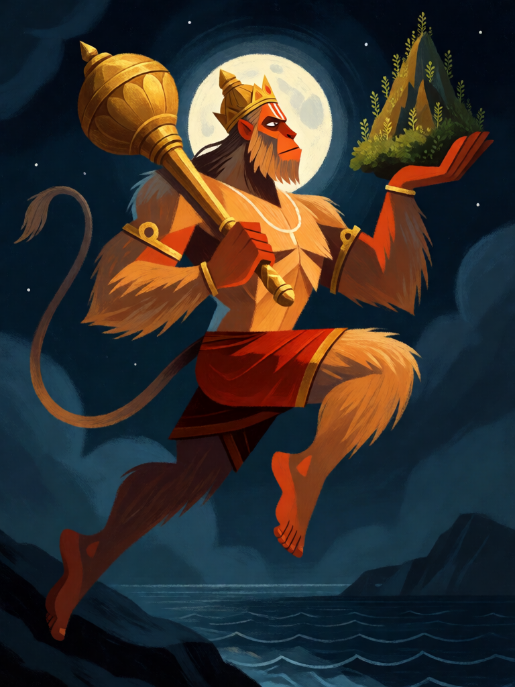

# Hanuman

[← Hinduísmo](../hinduismo.md) · [Wiki KodeX](../README.md) · [◀ Arjuna](hin_arjuna.md) · [Narasimha ▶](hin_narasimha.md)

| Carta | Arte |
|---|---|
|  |  |

| | |
|---|---|
| **Tradição** | Hinduísmo |
| **Tipo** | Entidade |
| **Custo de Fé** | 4 |
| **ATK / DEF** | 3 / 2 |
| **Palavras-chave** | Ímpeto |
| **Lendária** | não |
| **Cópias no deck** | 2 |
| **Id** | `hin_hanuman` |

## Texto da carta

> Ímpeto. Sempre que atacar, ganha +1 ATK permanente.

**EN — Hanuman:** *Rush. Whenever this attacks, it gains permanent +1 ATK.*

## Contexto mitológico

Hanuman é o vanara (homem-macaco) filho do deus do vento Vayu — por isso Anjaneya, Pavanaputra, Maruti — e o devoto perfeito de Rama. No Sundara Kanda do Ramayana, quando os aliados de Rama chegam à beira do oceano sem saber como alcançar Lanka, Hanuman cresce até o tamanho de uma montanha e salta os cem *yojanas* de mar num único impulso. Em Lanka, encolhe ao tamanho de um gato para procurar Sita, encontra-a no bosque de ashoka, deixa-se capturar para falar com Ravana e, quando os rakshasas incendeiam sua cauda, usa o fogo para queimar a cidade inteira antes de voltar.

Na guerra (Yuddha Kanda), quando Lakshmana cai ferido e só a erva Sanjivani do Himalaia pode salvá-lo, Hanuman, sem conseguir identificar a planta, arranca a montanha inteira e a traz na palma da mão. É um dos sete imortais (chiranjivi) e, segundo a tradição, está presente onde quer que se recite o nome de Rama. O Hanuman Chalisa de Tulsidas (séc. XVI) é um dos hinos mais recitados da Índia.

A carta é o salto para Lanka: ataca no turno em que entra e cresce a cada investida — Hanuman nunca é menor do que a tarefa exige.

## Papel no jogo

O atacante principal do deck. O bônus chega ao declarar o ataque, antes do golpe: entra como 3/2 mas bate por 4 no turno em que entra, 5 no seguinte, depois 6 — o oponente é obrigado a responder ou perde a corrida em três turnos. Portador perfeito de Trishula (+3/+2 e dano extra a cada ataque) e de Gandiva. Com duas cópias e Descida do Avatar, volta do cemitério atacando. Fraco contra Selos de contra-ataque e contra Guarda alta — 2 de Vida morre para qualquer corpo de 2 ATK; ele precisa matar o que ataca.

## Atributos visuais

rosto de macaco e pelo dourado · cauda longa · maça dourada na mão direita · montanha na palma esquerda · salto sobre o oceano

Balanço (conta de custo)

Orçamento P = 2·4+1 = 9 pts. Gasto: ATK 3 + Vida 2 + Ímpeto 1 + (+1 ATK permanente a cada ataque, repetível, sem Usos: 1 × 2 = 2) = 8. Dentro (P−1).
Rodada 2 de balanceamento (pacote H1 do Analista): Vida 3 → 2 (−2,9 pp medido, o maior corte isolado do pacote; o atacante principal passa a precisar de proteção).
Revisão: era 4/3 (total 10 com o crescimento precificado como repetível; antes estava contado como 1 pt único). Corpo caiu para 3/3 — na prática ele ainda bate por 4 na entrada.

Ficha completa: `cartas/hinduismo/06_hanuman.md` · cartas base da versão Alpha
