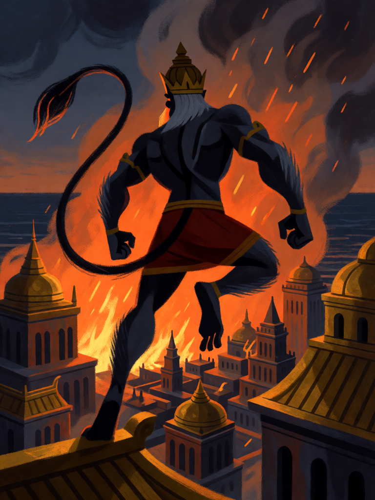

# Incêndio de Lanka

[← Hinduísmo](../hinduismo.md) · [Wiki KodeX](../README.md) · [◀ Véu de Maya](hin_veu_de_maya.md) · [Pashupatastra ▶](hin_pashupatastra.md)

| Carta | Arte |
|---|---|
|  |  |

| | |
|---|---|
| **Tradição** | Hinduísmo |
| **Tipo** | Selo |
| **Custo de Fé** | 1 |
| **Palavras-chave** | — |
| **Lendária** | não |
| **Cópias no deck** | 1 |
| **Id** | `hin_incendio_de_lanka` |

## Texto da carta

> No fim do turno do oponente, 1 de dano a todas as Entidades inimigas e 1 à Cornucópia inimiga.

**EN — Burning of Lanka:** *At the end of your opponent's turn, 1 damage to all enemy Entities and 1 to the enemy Cornucopia.*

## Contexto mitológico

No Sundara Kanda do Ramayana, Hanuman, depois de encontrar Sita no bosque de ashoka e lhe entregar o anel de Rama, decide se deixar capturar para medir a força do inimigo e falar com Ravana cara a cara. Levado à corte como prisioneiro, fala como embaixador: pede ao rei de Lanka que devolva Sita e se poupe. Ravana, enfurecido, manda matá-lo; o irmão Vibhishana lembra que um mensageiro não se mata, e a pena vira humilhação — embrulhar a cauda do macaco em panos embebidos em óleo e atear fogo.

Hanuman faz a cauda crescer, e crescer, e os rakshasas gastam quase todo o pano da cidade. Então, com a cauda em chamas, ele se solta, salta de telhado em telhado e incendeia Lanka inteira — palácios, torres, mansões de ouro — poupando apenas o bosque onde está Sita e a casa de Vibhishana. Mergulha a cauda no mar para apagar o fogo e volta ao continente para contar a Rama o que viu.

O Selo é a noite do incêndio: o oponente termina o turno achando que tem a situação sob controle, e sua cidade queima.

## Papel no jogo

Dano de área barato que o oponente não vê vindo — mata tokens 1/1 e termina o serviço de Garuda e Gandiva, somando 1 à Cornucópia para a corrida do deck. Colocado um turno antes de Kali, o 1 do Selo mais o 1 do Despertar dela limpam os corpos de 2 de Vida. Por 1 Fé cabe em qualquer turno. Fraco contra um único corpo grande, e inútil se o oponente não tem Entidades (ainda causa o 1 à Cornucópia).

## Atributos visuais

silhueta de Hanuman de costas · cauda longa em chamas · saltando sobre telhados · cidade dourada de Lanka em incêndio à noite

Balanço (conta de custo)

Orçamento P = 2·1+1 = 3 pts (+1 Selo = 4). Gasto: 1 de dano a todas as inimigas (1,5) + 1 de dano direto à Cornucópia 2 = 3,5. Dentro.
Rodada 2 de balanceamento (pacote H1 do Analista): era custo 2 com 2 em área (5/6); −0,8 pp medido.

Ficha completa: `cartas/hinduismo/17_incendio_de_lanka.md` · cartas base da versão Alpha
