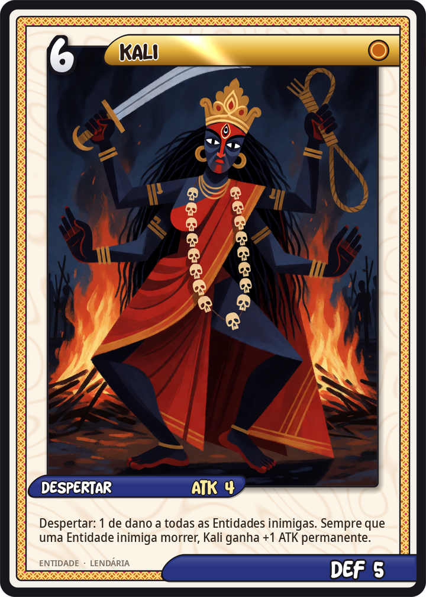
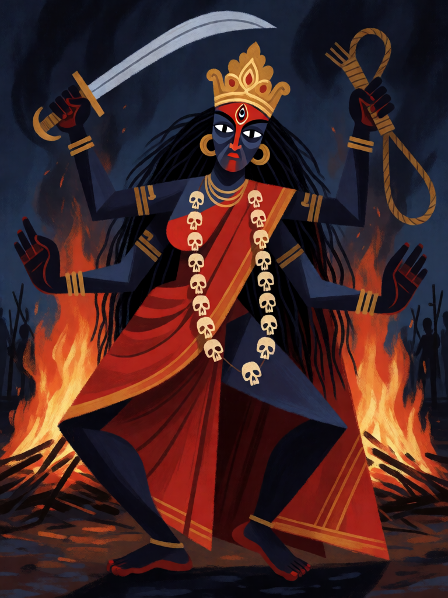

# Kali

[← Hinduísmo](../hinduismo.md) · [Wiki KodeX](../README.md) · [◀ Durga, a Fortaleza](hin_durga.md) · [Shiva Nataraja ▶](hin_shiva_nataraja.md)

| Carta | Arte |
|---|---|
|  |  |

| | |
|---|---|
| **Tradição** | Hinduísmo |
| **Tipo** | Entidade |
| **Custo de Fé** | 6 |
| **ATK / DEF** | 4 / 5 |
| **Palavras-chave** | — |
| **Lendária** | sim |
| **Cópias no deck** | 1 |
| **Id** | `hin_kali` |

## Texto da carta

> Despertar: 1 de dano a todas as Entidades inimigas. Sempre que uma Entidade inimiga morrer, Kali ganha +1 ATK permanente.

**EN — Kali:** *Awaken: 1 damage to all enemy Entities. Whenever an enemy Entity dies, Kali gains permanent +1 ATK.*

## Contexto mitológico

Kali ("a negra", "a do tempo") é a face mais terrível da Deusa. No Devi Mahatmya (cap. 7), quando os generais asuras Chanda e Munda avançam contra Durga, a testa da deusa escurece de cólera e dela salta Kali: pele negra, língua pendente, colar de cabeças, saia de braços cortados, espada e laço nas mãos. Ela devora elefantes, carros e cavalos, mata os dois generais e traz suas cabeças a Durga — ganhando o nome Chamunda.

No capítulo seguinte, o asura Raktabija ("semente de sangue") gera um novo asura de cada gota do próprio sangue que toca o chão; o exército dos deuses se afoga em réplicas. Kali então estende a língua e bebe cada gota antes que caia — e Raktabija, exaurido, morre. Nos Puranas posteriores, embriagada pela matança, Kali dança até fazer os mundos tremerem; Shiva se deita sob seus pés e ela, ao reconhecê-lo, para. Daí a iconografia de Kali sobre Shiva, e o nome Dakshina Kali, a mãe benevolente que o Bengala venera.

A carta é essa dupla imagem: o salto que fere tudo que está diante dela, e a sede que cresce com cada queda.

## Papel no jogo

Primeira Lendária, finalizadora de área: entra e fere todas as Entidades inimigas por 1 — mata tokens e termina o que Garuda, Gandiva e Lanka começaram — e cada morte a partir daí (inclusive as que ela própria causa ao entrar) a engorda. Com Krishna em campo, ataca no mesmo turno; com Trishula, cada ataque fere outro alvo e a bola de neve dispara. Descida do Avatar a traz de volta como 4/5 que volta a crescer a cada morte (sem repetir o Despertar — reviver para o campo não o dispara). Fraca contra remoção única e bounce (Ganesha inimigo).

## Atributos visuais

pele negro-azulada · exatamente quatro braços · terceiro olho na testa · língua vermelha para fora · colar de crânios estilizados · espada erguida

Balanço (conta de custo)

Orçamento P = 2·6+1 = 13 pts (+2 Lendária = 15). Gasto: ATK 4 + Vida 5 + 1 de dano a todas as inimigas (1,5) + +1 ATK permanente por inimiga morta (`enemy_dies`, gatilho repetível: valor cheio; 3 disparos típicos = 3) = 13,5. Lendária +0,5.
Rodada 2 de balanceamento (pacote H1 do Analista): o 4/4 com 2 em área da rodada 1 virou 4/5 com 1 em área (−1,8 pp medido): o corpo volta, o Despertar deixa de limpar sozinho corpos de 2 de Vida.
Rodada 1 de balanceamento (2º passe): era 4/5 (P+2). Os cortes em Shiva, Brahmastra, Garuda e Vajra tiraram só 3,6 pp do deck (84 → 81 %); Kali era a proposta condicional do Analista para esse caso.
Revisão: era 5/5 com o gatilho contado a 1,5 (total 16 na conta oficial). Ela entra como 4/5 e cresce — em mesa típica já ataca por 5 ou 6 no turno seguinte.

Ficha completa: `cartas/hinduismo/11_kali.md` · cartas base da versão Alpha
