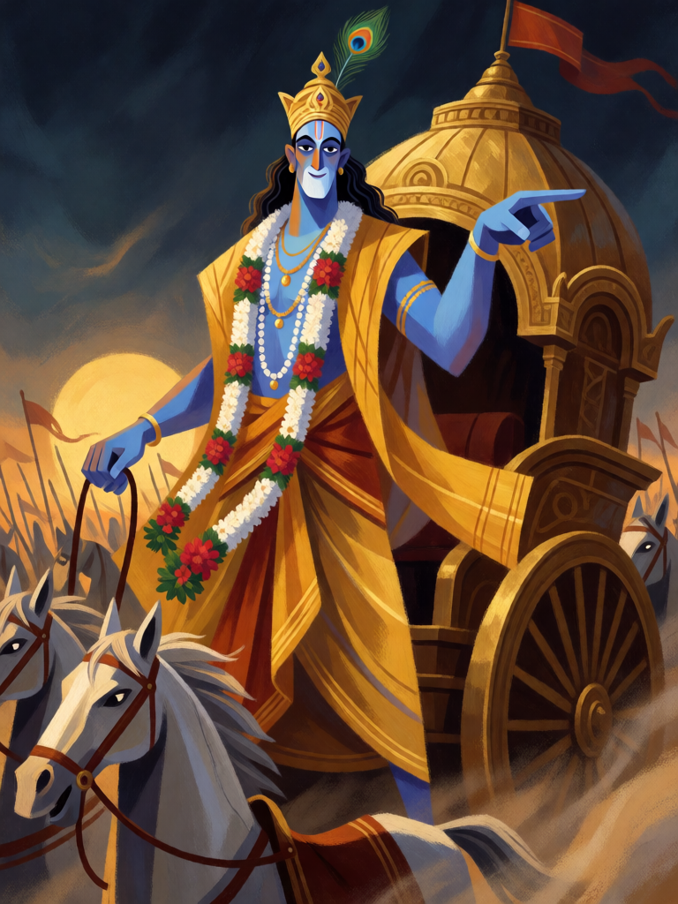

# Krishna, o Auriga

[← Hinduísmo](../hinduismo.md) · [Wiki KodeX](../README.md) · [◀ Rama, Príncipe de Ayodhya](hin_rama.md) · [Durga, a Fortaleza ▶](hin_durga.md)

| Carta | Arte |
|---|---|
|  |  |

| | |
|---|---|
| **Tradição** | Hinduísmo |
| **Tipo** | Entidade |
| **Custo de Fé** | 5 |
| **ATK / DEF** | 3 / 4 |
| **Palavras-chave** | — |
| **Lendária** | não |
| **Cópias no deck** | 1 |
| **Id** | `hin_krishna` |

## Texto da carta

> Enquanto Krishna estiver em campo, suas Entidades têm Ímpeto.

**EN — Krishna, the Charioteer:** *While Krishna is on the field, your Entities have Rush.*

## Contexto mitológico

Krishna é o oitavo avatar de Vishnu e, para muitas tradições vaishnavas, a própria divindade suprema de quem os outros avatares emanam. O Bhagavata Purana (livro 10) narra sua infância em Vrindavan — o bebê que rouba manteiga, o menino que ergue o monte Govardhana num dedo para abrigar os pastores da tempestade de Indra, o jovem flautista das gopis — e a juventude em Mathura, onde mata o tirano Kamsa.

No Mahabharata ele é o estrategista e o auriga: recusa-se a lutar na guerra de Kurukshetra, mas conduz o carro de Arjuna. Quando, no primeiro dia, o arqueiro deixa cair o Gandiva e se recusa a combater, Krishna lhe ensina a Bhagavad Gita — a ação sem apego ao fruto, o dever (dharma) de cada um, a devoção — e lhe mostra a Vishvarupa, a forma universal que contém todos os mundos. Depois disso, Arjuna pega o arco.

A carta é exatamente isso: Krishna não ataca por você, mas quem está em seu carro ataca na hora.

## Papel no jogo

A carta de tempo do deck. A aura inclui o próprio Krishna, que por isso ataca no turno em que entra; e tudo que entra depois bate no mesmo turno: Rama, Arjuna, Narasimha, Kali e Shiva perdem o turno de espera, e o oponente nunca mais tem um turno para se preparar. Turno 5 Krishna, turno 6 Kali atacando, turno 7 Shiva atacando é a sequência letal do deck. Corpo 3/4: guia, não bate. Fraco: é o alvo prioritário de remoção e não protege a si mesmo.

## Atributos visuais

pele azul · pena de pavão na coroa · dhoti de seda amarela · rédeas nas mãos · carro de guerra com cavalos brancos

Balanço (conta de custo)

Orçamento P = 2·5+1 = 11 pts. Gasto: ATK 3 + Vida 4 + aura `static` de palavra-chave em todas as aliadas (tabela §10: aura em todas = 3; o Ímpeto vale o mesmo que +1 ATK e a aura inclui a fonte) = 10. Dentro (P−1).
Rodada 2 de balanceamento (pacote H1 do Analista): ATK 4 → 3 (−0,7 pp medido). A aura foi medida e é neutra (±0,2 pp): o auriga guia, não bate.

Ficha completa: `cartas/hinduismo/09_krishna.md` · cartas base da versão Alpha
