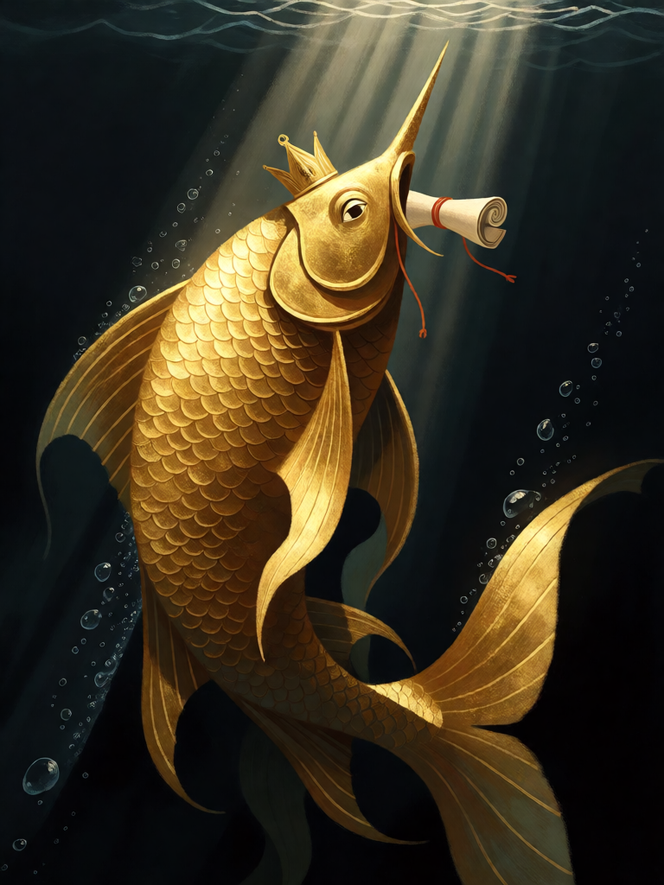

# Matsya, o Peixe

[← Hinduísmo](../hinduismo.md) · [Wiki KodeX](../README.md) · [Garuda ▶](hin_garuda.md)

| Carta | Arte |
|---|---|
|  |  |

| | |
|---|---|
| **Tradição** | Hinduísmo |
| **Tipo** | Entidade |
| **Custo de Fé** | 1 |
| **ATK / DEF** | 0 / 1 |
| **Palavras-chave** | — |
| **Lendária** | não |
| **Cópias no deck** | 1 |
| **Id** | `hin_matsya` |

## Texto da carta

> Despertar: busque uma Relíquia do seu deck para a mão.

**EN — Matsya, the Fish:** *Awaken: Search your deck for a Relic and put it into your hand.*

## Contexto mitológico

Matsya ("peixe") é o primeiro dos dez avatares de Vishnu. Na versão mais antiga (Shatapatha Brahmana 1.8.1), um peixinho pede proteção a Manu, o primeiro homem; Manu o cria num pote, depois num tanque, depois no mar, e o peixe, já imenso, avisa-o do dilúvio que vem e lhe manda construir uma barca. Quando as águas sobem, Manu amarra a barca ao chifre do peixe, que a reboca até a montanha do norte — e a humanidade recomeça dali.

O Bhagavata Purana (8.24) amplia a história: o asura Hayagriva rouba os Vedas da boca de Brahma adormecido, e Vishnu, na forma de Matsya, os recupera do fundo do oceano e os devolve ao criador. É esse segundo motivo — o peixe que *resgata o que é precioso do fundo* — que define a carta.

No deck, Matsya é o avatar mais humilde e o primeiro a descer: corpo mínimo, mas traz do fundo do deck a arma divina de que o jogador precisa.

## Papel no jogo

Abertura de turno 1: não combate, mas garante que Vajra, Sudarshana Chakra, Gandiva ou Trishula apareçam cedo — o deck vive de equipar suas armas em corpos com Ímpeto (Garuda, Hanuman). Também serve de corpo barato para receber Vishvarupa (vira 6/6 com Ímpeto) ou de portador descartável para uma Relíquia equipada no turno 2. Ruim em mão tardia, quando as Relíquias já saíram.

## Atributos visuais

peixe gigante dourado · um único chifre na cabeça · pergaminho dos Vedas na boca · fundo do oceano com raios de luz

Balanço (conta de custo)

Orçamento P = 2·1+1 = 3 pts. Gasto: ATK 0 + Vida 1 + buscar carta de um tipo (search) = 2 pts → total 3. Dentro.

Ficha completa: `cartas/hinduismo/01_matsya.md` · cartas base da versão Alpha
