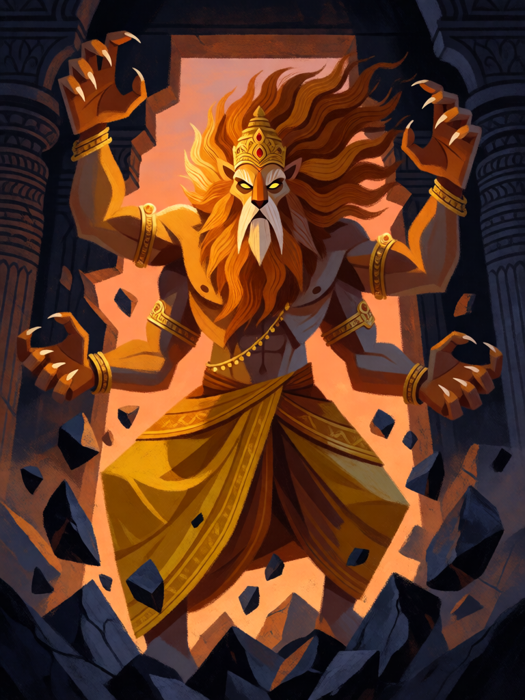

# Narasimha

[← Hinduísmo](../hinduismo.md) · [Wiki KodeX](../README.md) · [◀ Hanuman](hin_hanuman.md) · [Rama, Príncipe de Ayodhya ▶](hin_rama.md)

| Carta | Arte |
|---|---|
|  |  |

| | |
|---|---|
| **Tradição** | Hinduísmo |
| **Tipo** | Entidade |
| **Custo de Fé** | 4 |
| **ATK / DEF** | 3 / 2 |
| **Palavras-chave** | — |
| **Lendária** | não |
| **Cópias no deck** | 1 |
| **Id** | `hin_narasimha` |

## Texto da carta

> Despertar: destrua uma Entidade inimiga de custo 3 ou menos.

**EN — Narasimha:** *Awaken: Destroy an enemy Entity that costs 3 or less.*

## Contexto mitológico

Narasimha ("homem-leão") é o quarto avatar de Vishnu. O Bhagavata Purana (livro 7) conta que o rei asura Hiranyakashipu, querendo vingar o irmão Hiranyaksha morto por Varaha, obteve de Brahma uma bênção quase perfeita: não poderia ser morto por homem nem animal, por deva nem asura, de dia nem de noite, dentro nem fora de casa, no chão nem no ar, por arma alguma. Tornou-se tirano dos três mundos e perseguiu o próprio filho, o menino Prahlada, devoto de Vishnu, tentando matá-lo com veneno, elefantes, fogo e precipícios — sem sucesso.

Quando Hiranyakashipu desafia o filho a mostrar Vishnu numa coluna do palácio e a golpeia, dela irrompe Narasimha: metade homem, metade leão (nem um nem outro); ao crepúsculo (nem dia nem noite); arrasta o rei até a soleira (nem dentro nem fora); deita-o sobre o colo (nem no chão nem no ar); e o abre com as garras (nenhuma arma). Cada cláusula da bênção é respeitada e, mesmo assim, o tirano morre. Prahlada é coroado em seu lugar.

A carta é a descida súbita que elimina um tirano protegido por regras — mas só de certo tamanho: a bênção de Brahma tinha brechas, não ausência de limites.

## Papel no jogo

Remoção com corpo: paga 4 Fé, tira do jogo o melhor alvo de custo até 3 do oponente e deixa um 3/2 na mesa. Resolve a Guarda ou o corpo com Relíquia que estava atrasando os ataques de Hanuman e Garuda. Descida do Avatar o traz de volta só como corpo (reviver para o campo não dispara Despertar); para repetir o golpe é preciso reinvocá-lo da mão. Fraco quando o oponente só tem corpos de custo 4 ou mais — vira um 3/2 caro.

## Atributos visuais

cabeça de leão com juba dourada · corpo humano · exatamente quatro braços · garras · irrompendo de uma coluna de pedra partida

Balanço (conta de custo)

Orçamento P = 2·4+1 = 9 pts. Gasto: ATK 3 + Vida 2 + destruir Entidade inimiga escolhida com `target_cost_max` ≤ 3 (3,5) = 8,5. Dentro (P−0,5). Custo mínimo para `destroy` (3) respeitado.
Rodada 1 de balanceamento: era 3/3 (9,5 com a tabela §10 nova — `destroy` condicionado vale 3,5 fixo, não 4 × 0,7).
Nota para o simulador: a `cond` `target_cost_max` deve ser avaliada sobre o **alvo escolhido** do `destroy` (como diz `dsl_efeitos.md`), não sobre a carta que disparou o gatilho — em `on_play` a Entidade gatilho é o próprio Narasimha (custo 4), e a condição nunca seria verdadeira.

Ficha completa: `cartas/hinduismo/07_narasimha.md` · cartas base da versão Alpha
