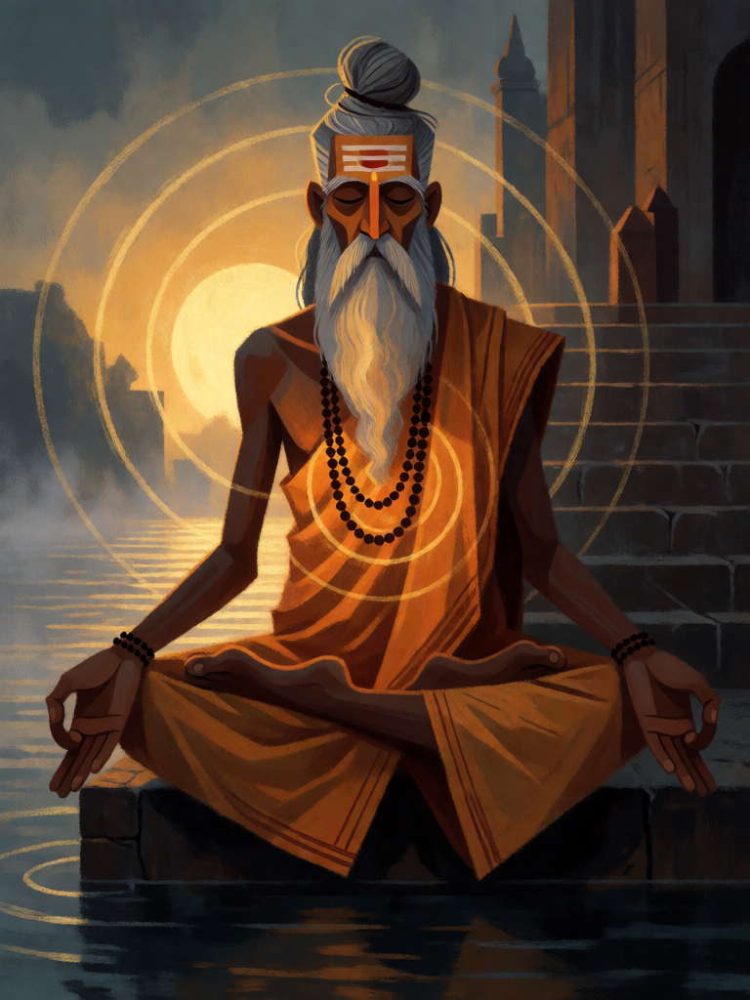

# Om

[← Hinduísmo](../hinduismo.md) · [Wiki KodeX](../README.md) · [◀ Pashupatastra](hin_pashupatastra.md) · [Yajna, o Fogo Sacrificial ▶](hin_yajna.md)

| Carta | Arte |
|---|---|
|  |  |

| | |
|---|---|
| **Tradição** | Hinduísmo |
| **Tipo** | Rito |
| **Custo de Fé** | 1 |
| **Palavras-chave** | — |
| **Lendária** | não |
| **Cópias no deck** | 2 |
| **Id** | `hin_om` |

## Texto da carta

> Compre 1 carta e ganhe 1 de Fé temporária.

**EN — Om:** *Draw 1 card and gain 1 temporary Faith.*

## Contexto mitológico

Om (Aum, ॐ) é a sílaba sagrada que abre e fecha toda recitação védica, todo mantra, toda oração hindu. É o som primordial — a vibração de que o universo emerge — e o nome sonoro de Brahman, o absoluto. O Mandukya Upanishad é inteiramente dedicado a ela: seus três sons, A-U-M, correspondem aos estados de vigília, sonho e sono profundo, e o silêncio que segue o M é o quarto estado (turiya), a consciência pura. Na Bhagavad Gita (8.13), Krishna diz que quem deixa o corpo pronunciando "Om" e lembrando-se dele alcança a meta suprema; em 9.17 ele mesmo se declara "a sílaba Om".

Om é também o começo de todo ato: escreve-se no alto de cartas, contratos e cadernos escolares; recita-se antes de iniciar um estudo ou uma viagem. É a menor unidade da religião e a que contém todas as outras.

Como Rito, é o sopro antes da ação: um instante de concentração que traz uma carta e rende a Fé que o próprio Om custou.

## Papel no jogo

Cantrip: custa 1, devolve 1 de Fé no mesmo turno e compra uma carta — na prática, troca-se a si mesmo por outra carta de graça e afina a mão em busca de Hanuman ou de uma Relíquia. Duas cópias deixam o deck de 32 funcionar como um de 30. Nunca é ruim, nunca ganha o jogo.

## Atributos visuais

sábio idoso indiano · barba grisalha longa e coque · túnica cor de açafrão · rosário rudraksha · meditando em lótus · anéis de luz dourada

Balanço (conta de custo)

Orçamento P = 2·1+1 = 3 pts. Gasto: comprar 1 carta 1,5 + 1 de Fé temporária 1,5 = 3. Dentro.

Ficha completa: `cartas/hinduismo/19_om.md` · cartas base da versão Alpha
