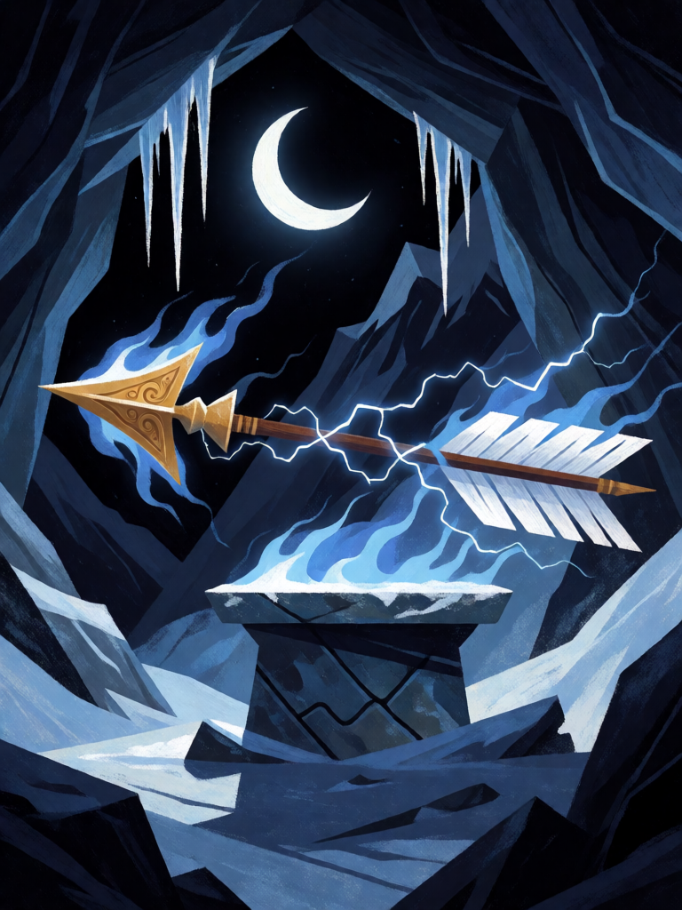

# Pashupatastra

[← Hinduísmo](../hinduismo.md) · [Wiki KodeX](../README.md) · [◀ Incêndio de Lanka](hin_incendio_de_lanka.md) · [Om ▶](hin_om.md)

| Carta | Arte |
|---|---|
|  |  |

| | |
|---|---|
| **Tradição** | Hinduísmo |
| **Tipo** | Selo |
| **Custo de Fé** | 3 |
| **Palavras-chave** | — |
| **Lendária** | não |
| **Cópias no deck** | 1 |
| **Id** | `hin_pashupatastra` |

## Texto da carta

> Quando uma Entidade inimiga atacar, destrua-a. Compre 1 carta.

**EN — Pashupatastra:** *When an enemy Entity attacks, destroy it. Draw 1 card.*

## Contexto mitológico

O Pashupatastra é a arma pessoal de Shiva em sua forma de Pashupati, "senhor das criaturas": a mais destrutiva de todas as armas divinas, capaz de aniquilar a criação inteira se disparada sem alvo à altura. Pode ser lançada pela mente, pelo olhar, pela palavra ou pelo arco, e não tem contra-arma.

O Mahabharata (Vana Parva, episódio Kairata) conta como Arjuna a obteve. Durante o exílio, ele sobe ao Himalaia e pratica ascese severa para agradar a Shiva. Um javali o ataca; Arjuna o flecha, mas um caçador kirata reivindica a presa, e os dois lutam — Arjuna, pela primeira vez na vida, é derrotado. O caçador então revela-se Shiva, que estava testando o herói. Satisfeito, concede-lhe o Pashupatastra com uma ordem: nunca usá-la contra um inimigo menor, porque ela pode destruir o mundo. Arjuna a recebe, e jamais a dispara em Kurukshetra.

Como Selo, a arma fica guardada, virada para baixo, exatamente como Arjuna a guardou — e dispara apenas quando alguém vem até ela.

## Papel no jogo

O Selo mais caro do deck: o atacante inimigo deixa de existir e você repõe a carta. Colocado no turno 3 atrás de um Garuda, transforma o ataque adversário seguinte num desastre para ele — mas só para quem atacou; o resto do campo fica. É a resposta do deck a Lendárias inimigas sem gastar um turno de ataque próprio. Fraco quando o oponente não ataca (decks de controle) — 3 Fé parados.

## Atributos visuais

uma única flecha divina · envolta em fogo azul-branco e raios · pairando sobre altar de pedra · caverna nevada · lua crescente

Balanço (conta de custo)

Orçamento P = 2·3+1 = 7 pts (+1 Selo = 8). Gasto: destruir Entidade (o atacante) 5 + comprar 1 (1,5) = 6,5. Dentro (P−1,5). Custo mínimo para `destroy` (3) respeitado.
Rodada 2 de balanceamento (pacote H1 do Analista): o Analista propôs custo 2 só com o destroy (5/6, −1,3 pp medido); mantive custo 3 porque a tabela §10 exige custo mínimo 3 para `destroy`, e troquei a área por "compre 1" para a carta não cair abaixo de P−2.

Ficha completa: `cartas/hinduismo/18_pashupatastra.md` · cartas base da versão Alpha
