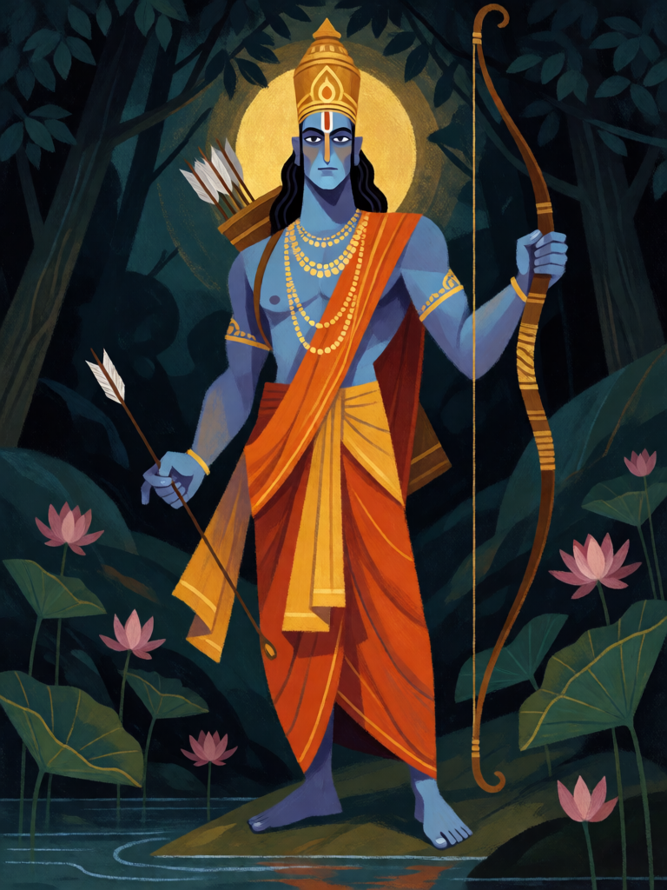

# Rama, Príncipe de Ayodhya

[← Hinduísmo](../hinduismo.md) · [Wiki KodeX](../README.md) · [◀ Narasimha](hin_narasimha.md) · [Krishna, o Auriga ▶](hin_krishna.md)

| Carta | Arte |
|---|---|
|  |  |

| | |
|---|---|
| **Tradição** | Hinduísmo |
| **Tipo** | Entidade |
| **Custo de Fé** | 4 |
| **ATK / DEF** | 3 / 4 |
| **Palavras-chave** | Renascer |
| **Lendária** | não |
| **Cópias no deck** | 1 |
| **Id** | `hin_rama` |

## Texto da carta

> Renascer.

**EN — Rama, Prince of Ayodhya:** *Rebirth.*

## Contexto mitológico

Rama é o sétimo avatar de Vishnu e o herói do Ramayana de Valmiki. Nasce em Ayodhya como filho mais velho do rei Dasharatha, ganha Sita ao erguer e partir o arco Pinaka de Shiva no torneio de Janaka, e, na véspera de ser coroado, aceita sem queixa catorze anos de exílio na floresta para que o pai honre uma promessa antiga à rainha Kaikeyi. Na floresta, Ravana rapta Sita; Rama alia-se ao rei vanara Sugriva e a Hanuman, atravessa o oceano por uma ponte de pedras e, em Lanka, mata Ravana — a quem a bênção de Brahma tornara invulnerável a deuses e demônios, mas não a um homem. Por isso Vishnu desceu como humano.

Rama é o *maryada purushottama*, o homem perfeito dentro dos limites do dharma: filho, marido, irmão e rei exemplar. Seu reinado, Rama-rajya, é até hoje a expressão para uma era de justiça. O Ramcharitmanas de Tulsidas (séc. XVI), composto em awadhi, fez da história o texto devocional mais recitado do norte da Índia.

Renascer é a leitura mecânica do avatar: Vishnu desce, cumpre a tarefa, parte — e desce de novo quando preciso.

## Papel no jogo

Corpo sólido de meio de jogo que o oponente precisa matar duas vezes: a primeira morte devolve Rama à mão e ele volta ao campo no turno seguinte. Portador de Relíquia mais confiável depois de Arjuna (a Relíquia cai com a morte, mas o corpo volta). Com Krishna ganha Ímpeto; com Vishvarupa vira 6/6 com Renascer. Fraco: sem habilidade de impacto imediato, não resolve problemas sozinho.

## Atributos visuais

príncipe adulto de pele azul-escura · arco longo na mão esquerda · flecha na direita · aljava nas costas · coroa alta dourada

Balanço (conta de custo)

Orçamento P = 2·4+1 = 9 pts. Gasto: ATK 3 + Vida 4 + Renascer 2 = 9. Dentro.

Ficha completa: `cartas/hinduismo/08_rama.md` · cartas base da versão Alpha
