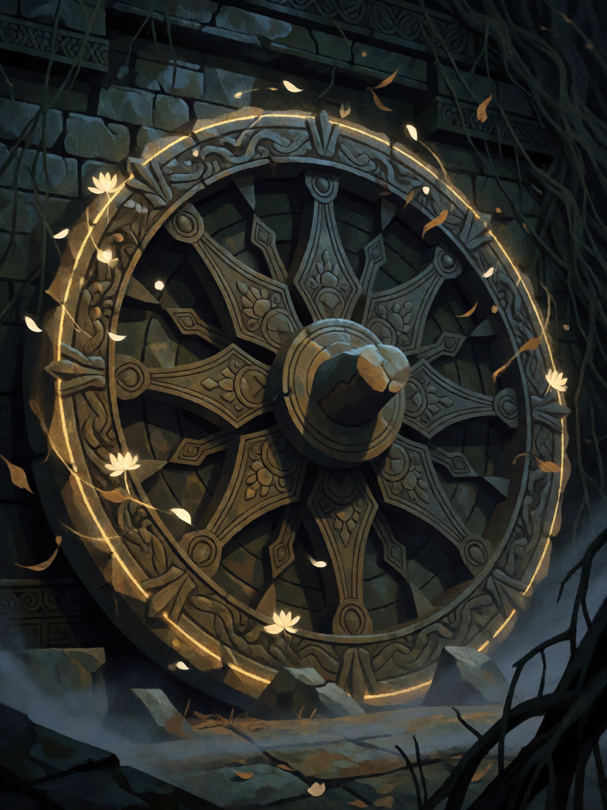

# Roda do Samsara

[← Hinduísmo](../hinduismo.md) · [Wiki KodeX](../README.md) · [◀ Chamas de Agni](hin_chamas_de_agni.md) · [Lei do Karma ▶](hin_lei_do_karma.md)

| Carta | Arte |
|---|---|
|  |  |

| | |
|---|---|
| **Tradição** | Hinduísmo |
| **Tipo** | Selo |
| **Custo de Fé** | 1 |
| **Palavras-chave** | — |
| **Lendária** | não |
| **Cópias no deck** | 1 |
| **Id** | `hin_roda_do_samsara` |

## Texto da carta

> Quando uma Entidade aliada morrer, devolva uma Entidade do seu cemitério à sua mão e compre 1 carta.

**EN — Wheel of Samsara:** *When an allied Entity dies, return an Entity from your graveyard to your hand and draw 1 card.*

## Contexto mitológico

Samsara ("fluxo", "vagar") é o ciclo de nascimento, morte e renascimento a que todo ser está preso, movido pelo karma — o fruto inevitável das ações. A ideia aparece formulada nas Upanishads mais antigas: no Brihadaranyaka (4.4.5), "conforme age, conforme se conduz, assim o homem se torna; quem faz o bem torna-se bom, quem faz o mal torna-se mau". A Bhagavad Gita (2.22) usa a imagem que todo hindu conhece: "assim como um homem deixa as roupas gastas e veste roupas novas, a alma encarnada deixa os corpos gastos e entra em outros, novos".

A roda (chakra) é o símbolo visual do ciclo — a mesma roda que está na bandeira da Índia, herdada da iconografia budista e hindu do dharma. A morte, nessa visão, não é fim: é passagem. O objetivo último, moksha, é sair da roda; mas enquanto se está nela, o que cai volta.

O Selo é a roda girando: uma Entidade aliada morre, e outra, já morta, ganha um novo corpo na mão do jogador.

## Papel no jogo

Motor de valor para um deck que troca corpos frágeis com frequência: quando Garuda ou Jatayu morrem no turno do oponente, uma Entidade do cemitério volta à mão (pode ser a própria, ou Hanuman) e ainda se compra uma carta. Alimenta as duas cópias de Hanuman e recupera Narasimha ou Kali para serem jogados de novo. Fraco quando o oponente não ataca nem remove — fica parado.

## Atributos visuais

roda de pedra com oito raios · aro dourado brilhante · luzes de almas girando · ruínas de templo cobertas de vinhas

Balanço (conta de custo)

Orçamento P = 2·1+1 = 3 pts (+1 Selo = 4). Gasto: reviver Entidade do cemitério para a mão 2 + comprar 1 carta 1,5 = 3,5. Dentro.

Ficha completa: `cartas/hinduismo/14_roda_do_samsara.md` · cartas base da versão Alpha
