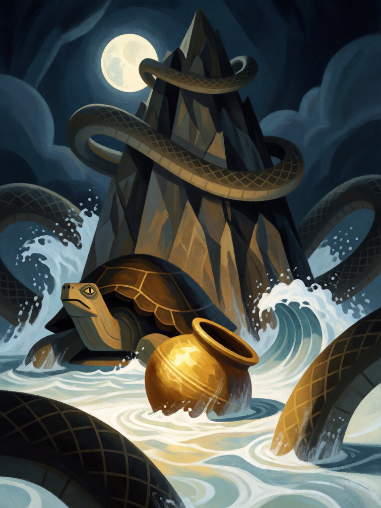

# Samudra Manthan

[← Hinduísmo](../hinduismo.md) · [Wiki KodeX](../README.md) · [◀ Yajna, o Fogo Sacrificial](hin_yajna.md) · [Brahmastra ▶](hin_brahmastra.md)

| Carta | Arte |
|---|---|
|  |  |

| | |
|---|---|
| **Tradição** | Hinduísmo |
| **Tipo** | Rito |
| **Custo de Fé** | 3 |
| **Palavras-chave** | — |
| **Lendária** | não |
| **Cópias no deck** | 1 |
| **Id** | `hin_samudra_manthan` |

## Texto da carta

> Compre 2 cartas, ganhe 2 de Fé temporária e cure 2 da sua Cornucópia.

**EN — Samudra Manthan:** *Draw 2 cards, gain 2 temporary Faith and heal your Cornucopia for 2.*

## Contexto mitológico

O Samudra Manthan, batimento do oceano de leite, é um dos episódios mais contados dos Puranas (Bhagavata 8.6–12, Vishnu Purana 1.9, Mahabharata Adi Parva). Os devas, enfraquecidos por uma maldição, aceitam o conselho de Vishnu: unir-se aos asuras para bater o oceano cósmico e extrair dele a amrita, o néctar da imortalidade. Arrancam o monte Mandara para servir de batedor, Vishnu toma a forma da tartaruga Kurma para sustentá-lo, e a serpente Vasuki vira a corda — devas na cauda, asuras na cabeça, engolindo o veneno que ela exala.

Do oceano batido sai primeiro o Halahala, veneno capaz de destruir os mundos; Shiva o bebe e Parvati o detém na garganta, que fica azul (Neelakantha). Depois emergem os catorze tesouros: a vaca Kamadhenu, o cavalo Uchchaihshravas, o elefante Airavata, a joia Kaustubha, a árvore Parijata, as apsaras, a deusa Lakshmi — que escolhe Vishnu —, a lua, o arco Sharanga, a concha e, por fim, o médico Dhanvantari com o pote de amrita. Os asuras o arrebatam; Vishnu, como a encantadora Mohini, os distrai e serve o néctar só aos devas.

O Rito é o batimento em si: esforço (a Fé) que devolve tesouros (cartas) e um pouco do néctar (cura).

## Papel no jogo

A única carta de cura do deck, e ela é antes de tudo um motor de cartas: compra 2, devolve 2 de Fé no mesmo turno e cura 2 — de graça, se o jogador tem o que jogar com a Fé devolvida. Reabastece a mão depois de um turno de trocas agressivas. Melhor no turno 3–5, quando a Fé devolvida ainda paga um Garuda ou um Yajna. Fraco: não afeta a mesa diretamente.

## Atributos visuais

montanha no oceano de leite · serpente Vasuki enrolada nela · tartaruga gigante sob a montanha · pote dourado de amrita emergindo

Balanço (conta de custo)

Orçamento P = 2·3+1 = 7 pts. Gasto: comprar 2 cartas (2 × 1,5 = 3) + 2 de Fé temporária (2 × 1,5 = 3) + curar 2 de Cornucópia 1 = 7. Dentro.

Ficha completa: `cartas/hinduismo/21_samudra_manthan.md` · cartas base da versão Alpha
