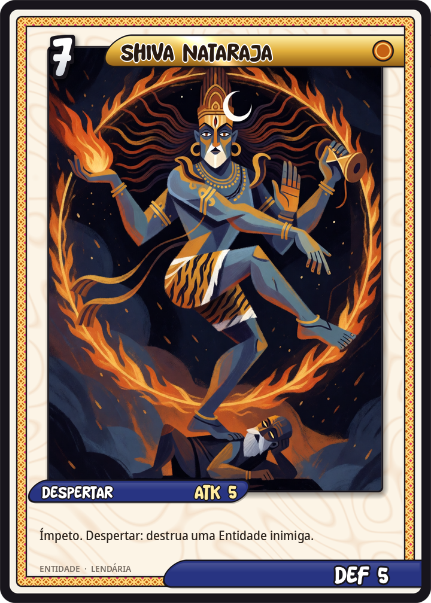
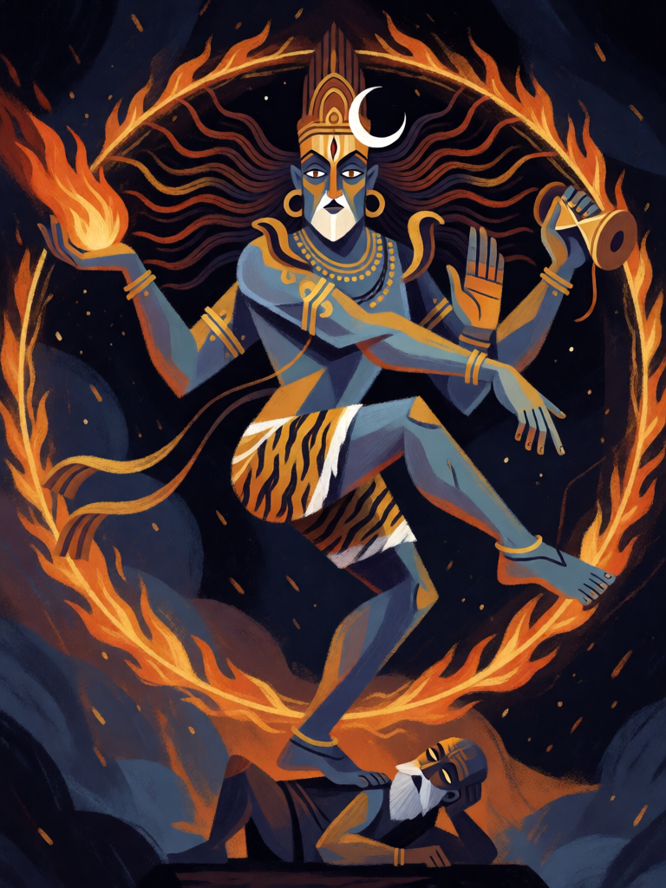

# Shiva Nataraja

[← Hinduísmo](../hinduismo.md) · [Wiki KodeX](../README.md) · [◀ Kali](hin_kali.md) · [Chamas de Agni ▶](hin_chamas_de_agni.md)

| Carta | Arte |
|---|---|
|  |  |

| | |
|---|---|
| **Tradição** | Hinduísmo |
| **Tipo** | Entidade |
| **Custo de Fé** | 7 |
| **ATK / DEF** | 5 / 5 |
| **Palavras-chave** | Ímpeto |
| **Lendária** | sim |
| **Cópias no deck** | 1 |
| **Id** | `hin_shiva_nataraja` |
| **Arte** | provisória nesta Alpha |

## Texto da carta

> Ímpeto. Despertar: destrua uma Entidade inimiga.

**EN — Shiva Nataraja:** *Rush. Awaken: Destroy an enemy Entity.*

## Contexto mitológico

Shiva é o terceiro da Trimurti, o deus que dissolve o universo no fim de cada ciclo para que ele possa ser criado de novo — destruição como transformação. Herda o Rudra do Rigveda (2.33), o arqueiro temível das montanhas, e nos Puranas e no Shvetashvatara Upanishad torna-se Mahadeva, o grande deus: asceta de Kailash coberto de cinzas, com a lua na cabeleira, o Ganges caindo pelos cabelos, a serpente Vasuki ao pescoço, o terceiro olho que incinera o que fixa, o tridente Trishula e o tambor damaru. Bebe o veneno Halahala que ameaçava os mundos no batimento do oceano e fica de garganta azul, Neelakantha.

Nataraja, "rei da dança", é sua forma mais célebre, consagrada nos bronzes Chola de Chidambaram (séc. X–XII): Shiva dança o Ananda Tandava dentro de um círculo de fogo, uma mão com o damaru (o som que cria), outra com a chama (que destrói), um pé esmagando o demônio-anão Apasmara (a ignorância), o outro erguido em libertação. Em sua forma furiosa, o Rudra Tandava, a dança desfaz o universo.

A carta é a chegada de Nataraja: ele entra dançando (Ímpeto) e a primeira coisa que seu pé toca deixa de existir.

## Papel no jogo

A Lendária de topo e o fecho do deck: destrói o maior problema do oponente e ataca por 5 no mesmo turno. Resolve qualquer Guarda e, com o campo limpo pelo Despertar de Kali ou por Tandava, pode atacar a Cornucópia direto. Com Descida do Avatar, volta do cemitério por 3 Fé — mas só como corpo: reviver para o campo não dispara Despertar (regras §8). Equipado com Trishula vira 8/6 que fere mais um alvo por ataque. Fraco: 7 Fé é turno 7; contra decks que anulam Entidades ao entrar (Selo `enemy_plays_entity` com counter) é a maior perda possível.

## Atributos visuais

pele azul-acinzentada · exatamente quatro braços com damaru e chama · terceiro olho · em pé sobre a perna direita, esquerda erguida · anel de fogo

Balanço (conta de custo)

Orçamento P = 2·7+1 = 15 pts (+2 Lendária = 17). Gasto: ATK 5 + Vida 5 + Ímpeto 1 + destruir Entidade inimiga escolhida 5 = 16. Lendária +1.
Rodada 1 de balanceamento: era 6/6 (com `destroy` a 5 pts somava 18, acima do teto lendário; 87 % de WR global, 72 % no espelho).
Rodada 3 de balanceamento: 5/6 → 5/5. Depois dos pacotes da rodada 2 o resto do deck baixou e Shiva ficou como a única carta destoante no espelho (60 % de WR comprada, 68 % jogada); é o único corte que sobra nele sem tocar no Ímpeto.

Ficha completa: `cartas/hinduismo/12_shiva_nataraja.md` · cartas base da versão Alpha
